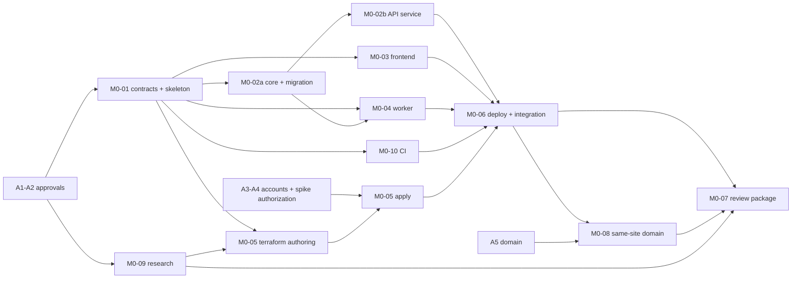

# M0 task board

**Status:** Local implementation done on branch `m0/integration`; cloud-dependent work BLOCKED. Nothing was pushed, merged or deployed. The Owner keeps this board current at meaningful changes, not every commit (WF-10). Acceptance criteria are defined in `test-plan.md`; the context, approvals A1–A5 and contracts are in `plan.md`.

Verification commands below are the intended checks. Exact script names are fixed by M0-01 and recorded in `AGENTS.md`; `<health>` and similar placeholders come from the M0-01 contracts.

## Board
| ID | Objective | Depends on | Workstream | Status |
|---|---|---|---|---|
| M0-01 | Repository skeleton, tooling and shared contracts | A1, A2 | Owner | done locally (merged into `m0/integration`) |
| M0-02 | Shared core (config, DB, logging, errors), initial migration, API service | M0-01 | Backend | done locally |
| M0-03 | Frontend shell and generated API client | M0-01 | Frontend | done locally; deployed smoke BLOCKED |
| M0-04 | Worker: signed delivery, job claim, outbox publish and recovery dispatcher | M0-01; M0-02a for integration | Worker | done locally; live QStash/OIDC BLOCKED |
| M0-05 | Terraform: GCP, Pages, IAM, Secret Manager, OIDC, budgets | M0-01; apply needs A3, A4 | Infrastructure | code authored + validated; plan/apply BLOCKED |
| M0-06 | Deploy workflow, full integration and deployed smoke | M0-02..05, M0-10 | Owner | workflows authored; **not run**; BLOCKED (A3/A4) |
| M0-07 | Spike report, security review, traceability and review package | M0-06, M0-08, M0-09 | Owner + Review Agent | not started (needs M0-06/08/09) |
| M0-08 | Hosting route feasibility: same-site subdomains, or the same-origin `/api` proxy if OPEN-21 is approved | M0-06; A5 | Infrastructure | API side done; deployed check BLOCKED (A3/A4/A5) |
| M0-09 | Provider research: limits, regions, Terraform coverage, backups, cost sources | A1 (read-only) | Research (Owner or a read-only agent) | done (sourced documented values; nothing measured) |
| M0-10 | CI quality pipeline and branch protection | M0-01 | CI (may merge with Owner or Infrastructure) | workflows authored + actionlint clean; **not run on GitHub** |

M0-01..07 keep their earlier numbering. M0-08..10 were split out of the earlier M0-05/M0-06 drafts, so the work that is genuinely parallel or blocked can run separately. They are part of the OPEN-20 approval.

## Execution log (evidence, local only)
Branch `m0/integration` was verified by the Owner after each merge (not just agent reports). Last full run: `uv run ruff format --check . && uv run ruff check . && uv run pyright && uv run pytest` -> 124 passed (48 core, 25 API, 51 Worker); `pnpm -r lint|format:check|typecheck|test|build` -> all pass (14 frontend tests); `check:api` pass; `actionlint` clean; Terraform `fmt -check`, `init -backend=false`, `validate` pass (container, no cloud contact); `check_no_secrets.py` OK. Local stack (`docker compose up migrate api worker`): migration exit 0, API `/v1/status` 200, unsigned Worker call 401, locally signed delivery completed a job with the API request's correlation id in the Worker logs, and the real (unmocked) Playwright spec passed against the local API and database.

| Workstream | Branch | Parallel? | Notes |
|---|---|---|---|
| Owner (M0-01, core, API skeleton, integration) | `m0/integration` | n/a | contracts and ADRs first, then fan-out |
| API hardening + Docker | `m0/02b-api` | yes | 25 tests, image runs as non-root |
| Worker + outbox | `m0/04-worker` | yes | 51 service tests + 31 jobs/outbox/QStash core tests; QStash/OIDC logic unverified live |
| Frontend | `m0/03-frontend` | yes | 14 tests, typed client, Playwright |
| Terraform | `m0/05-terraform` | yes | validate only |
| CI + deploy workflows | `m0/10-ci` | yes | not executed remotely |
| Research (M0-09) | `m0/09-research` | yes | `spike-report.md`; 13 findings, 14 spike items |
| Independent security review | read-only | yes | findings below |

Real parallel agents were used (five workstreams plus a reviewer, each in its own git worktree under `C:/Users/barak/ks-worktrees/`).

### Security review outcome (independent, read-only)
No Critical findings. Fixed: **H1** (Workload Identity now restricted to `refs/heads/main` + `production` environment), **H2** (Worker could not start: `worker_public_url` and `dispatcher_oidc_audience` are now required Terraform variables), **M2** (automatic deploy on push disabled until approved; GitHub environment rules are mandatory), **L2** (Worker body-size cap, 413), **L5** (https required for Worker/QStash URLs in production).
Open, for decision or later: **M1** the deployer cannot read `database-url` but `deploy.yml` reads it for migrations (decision needed: separate migration secret/role, or a Cloud Run migration job); **M3** pin third-party actions by SHA and pin wrangler (needs real SHAs); **M4** (before M3) lease heartbeat, max attempts and rowcount check on completion; **L1** certificate-fetch amplification on the dispatcher endpoint; **L3** `last_error` content; **L4** refuse non-production env on Cloud Run; **L6/L7** Cloud Run limits and the dead `WORKER_REQUIRES_IAM` branch.

## Dependency graph

**Critical path:** approvals → M0-01 → M0-05 authoring → *user prerequisites A3/A4* → M0-05 apply → M0-06 → M0-08 (needs A5) → M0-07. The infrastructure path, not the code, determines the M0 duration. Completing A3–A5 before M0 starts is the biggest schedule lever.

**Genuinely parallel:**
- M0-09, alongside M0-01 (read-only research).
- After M0-01: M0-02, M0-03, M0-04 (development against the contracts and fakes), M0-05 (authoring and `plan`) and M0-10.

**Blocked:**
- M0-04 *integration* waits for M0-02a (the migration).
- M0-05 *apply* waits for A3/A4.
- M0-06 waits for all implementation streams.
- M0-08 waits for a deployed API, the Pages site and A5.
- M0-07 is last.

## Workstreams, file ownership and branches
The milestone branch `m0/integration` is created from `main` after the docs PR merges. Each task gets its own branch `m0/<id>-<slug>` in its own worktree `../KnowServe-wt/m0-<id>`. The Owner uses a trial-integration worktree `../KnowServe-wt/m0-trial` (WF-07).

| Workstream | Tasks | Owns (writes) | Reads only |
|---|---|---|---|
| Owner | M0-01, M0-06, M0-07 | root workspace files (`pyproject.toml`, `pnpm-workspace.yaml`, `compose.yaml` skeleton, `.env.example`), `docs/contracts/`, `docs/adr/`, `docs/milestones/M0/`, `AGENTS.md`, `.github/workflows/deploy*.yml`, legacy removal commits | everything |
| Backend | M0-02 | `packages/backend_core/`, `apps/api/` (incl. `Dockerfile`), Alembic migrations, the API service in `compose.yaml` | contracts |
| Frontend | M0-03 | `apps/frontend/` | OpenAPI snapshot |
| Worker | M0-04 | `apps/worker/` (incl. `Dockerfile`), the Worker service in `compose.yaml`, the outbox publish/dispatch module in the location the M0-01 contract assigns | shared core, migrations |
| Infrastructure | M0-05, M0-08 | `infra/terraform/`, the spike cookie-echo configuration | deploy interface contract |
| CI | M0-10 | `.github/workflows/ci.yml`, the CI helper scripts named in M0-01 | — |
| Research | M0-09 | `docs/milestones/M0/spike-report.md` (research sections) | provider documentation |

Conflict rules:
- **Lockfiles** (`uv.lock`, `pnpm-lock.yaml`) are never hand-merged. On conflict, the branch rebases and regenerates the lockfile, and the Owner re-locks at integration.
- **Schema:** only the Backend workstream writes migrations. Other workstreams request schema changes through the Owner (ARCH-11, WF-03).
- **`compose.yaml`:** each stream edits only its own service block.
- **Contracts:** a change needs Owner approval plus a note to every dependent workstream *before* implementation.

## Integration order
1. M0-01 merged into `m0/integration`; every task branch forks from it.
2. M0-02a (shared core + initial migration) is merged early, which unblocks M0-04 integration.
3. M0-10 baseline CI, so every later merge is gated.
4. M0-02b, M0-03 and M0-04 as each one passes its gates (any order).
5. M0-05 Terraform: code merged after `plan` review; apply evidence follows A3/A4.
6. M0-06 deploy workflow and full-stack integration; deployed smoke.
7. M0-08 domain topology.
8. M0-07 review package, then the milestone PR to `main` for user approval (WF-13).

## Handoff (agent → Owner, WF-08)
Each handoff provides:
- branch and commit
- files and contracts touched
- the commands run, with their actual output summary
- the test IDs added, named with requirement ids (TEST-07)
- risks, known gaps, integration notes

The Owner re-runs the checks in the trial worktree and does not rely on a "tests pass" claim. Blockers get bounded attempts, then escalate with the options (WF-09).

## Quality gates
- **Every merge into `m0/integration`:** M0-10 checks green for the touched packages; contract diff clean or approved.
- **Independent Review Agent (required):** M0-04 (signature verification, claim/lease), M0-05 (IAM, Workload Identity Federation, secrets, state contents), M0-06 (workflow permissions and deploy gating), M0-08 (cookie/CORS configuration).
- **Milestone PR:** full CI, every M0-AC in `test-plan.md` with evidence or an explicit gap, the TEST-03 traceability table, spike report, and user approval.

## Tasks

### M0-01 Repository skeleton, tooling and shared contracts
- **Objective:** create the target monorepo skeleton next to the legacy folders and freeze the minimal contracts that let workstreams run in parallel.
- **Deliverables:**
  - the target directories with minimal package manifests; root `pyproject.toml` (uv workspace), `pnpm-workspace.yaml`, lockfiles, `.env.example`, `compose.yaml` skeleton (Postgres+pgvector)
  - the `docs/contracts/` set listed in `plan.md`, plus an OpenAPI baseline snapshot
  - ADRs:
    - repo layout and legacy move/rebuild per part
    - committed binaries
    - CI DB strategy
    - environment and bootstrap (following A3)
  - `AGENTS.md` commands
- **Acceptance:** M0-AC01, M0-AC13 (skeleton part).
- **Verification:** `uv sync --frozen`; `pnpm install --frozen-lockfile`; contracts reviewed and approved by the Owner; `git diff --stat` shows legacy folders untouched unless an ADR step is executed.
- **Integration point:** first merge into `m0/integration`.
- **Blocking risks:** workspace tooling choices delay every stream, so keep the contracts minimal (only what M0 uses).

### M0-02 Shared core, initial migration and API service
- **Objective:** a minimal API service on the approved stack, with the shared core that the Worker also uses.
- **Deliverables:**
  - **M0-02a:**
    - `knowserve_core` with typed settings, async SQLAlchemy engine/session, JSON logging with a request/correlation id, and error envelope types
    - Alembic setup and the initial migration: `vector` extension, job and outbox tables, pgvector feasibility table
  - **M0-02b:**
    - `apps/api` with liveness and readiness (DB check) and the error envelope on 404/422/500
    - an OpenAPI export script
    - a `Dockerfile` and the Compose service
    - a non-public way to create a job + outbox row in one transaction for tests (no public enqueue endpoint)
- **Acceptance:** M0-AC03, M0-AC14 (API side), the M0-AC06 export side; ARCH-01..05, 07, 09, 11..13 at M0 depth.
- **Verification:**
  - `uv run alembic upgrade head` on an empty DB
  - `uv run pytest -m "m0 and api"` against Postgres+pgvector
  - a vector insert + distance query test
  - `docker compose up` followed by `curl <api>/<health>`
- **Integration point:** M0-02a merged before M0-04 integration; M0-02b before M0-06.
- **Blocking risks:** async driver behavior with Neon's connection pooler and the extension on Neon are verified in M0-06 against the real DB; an incompatibility is escalated, not worked around silently.

### M0-03 Frontend shell and generated client
- **Objective:** the target frontend foundation.
- **Deliverables:**
  - `apps/frontend`: Vite + React + TS strict, Tailwind + shadcn/ui init, React Router, TanStack Query
  - a client generated with `openapi-typescript` from the snapshot, with `credentials: 'include'`, an environment-based API base URL and the error-envelope parser
  - a status page showing the API health result and a Demo Mode placeholder
  - Vitest + RTL setup and a Playwright smoke skeleton
- **Acceptance:** M0-AC06 (TS side), M0-AC07 (frontend checks), M0-AC02 (after M0-06); FE-ARCH-01, 05, 08, 10, 11 at M0 depth.
- **Verification:** `pnpm -r lint`, `pnpm -r typecheck`, `pnpm -r test`, `pnpm --filter frontend build`; regenerate the types and confirm no diff.
- **Integration point:** before M0-06.
- **Blocking risks:** low; contract drift is caught by M0-AC06.

### M0-04 Worker, signed delivery and outbox recovery
- **Objective:** prove the async foundation with a minimal no-op job.
- **Deliverables:**
  - `apps/worker` HTTP service: QStash signature verification, then a job existence/eligibility check (ING-14), an atomic claim with a lease, and an idempotent minimal job (ING-15)
  - outbox publish after commit, plus the recovery dispatcher endpoint with the authenticated invocation fixed in the M0-01 contract (ING-13)
  - correlation id carried from the outbox through the job into the Worker logs
  - a `Dockerfile` and the Compose service
  - faked QStash signing in tests (TEST-09)
- **Acceptance:** M0-AC04, M0-AC05, M0-AC10, M0-AC14 (Worker side); ING-10/12/13/14/15/21 at M0 depth.
- **Verification:** `uv run pytest -m "m0 and worker"`, covering:
  - no signature / bad signature / unknown job
  - duplicate concurrent delivery
  - crash after commit, then a dispatcher run
- **Integration point:** after M0-02a; before M0-06. Review Agent required.
- **Blocking risks:**
  - a real QStash delivery needs A4 and a deployed Worker, so it is evidenced in M0-06
  - the Cloud Run timeout for longer jobs is measured with M0-09 (ING-22)

### M0-05 Terraform infrastructure
- **Objective:** reproducible infrastructure with no secret values in code or state.
- **Deliverables:**
  - `infra/terraform` with the remote state backend
  - GCP: Artifact Registry, Cloud Run API and Worker services, least-privilege service accounts, Secret Manager secret *containers* and access bindings, a Cloud Scheduler job for the dispatcher, Workload Identity Federation for GitHub OIDC, billing budget alerts
  - Cloudflare Pages project
  - Neon and QStash resources where provider support exists; otherwise documented manual steps (OPEN-06)
- **Acceptance:** M0-AC12, the M0-AC09 alerts part; INFRA-05..07.
- **Verification:**
  - `terraform fmt -check`, `terraform validate`, `terraform plan`, with plan output reviewed for secret values
  - after A3/A4: apply logs and the state inspected for secret values
- **Integration point:** Terraform code merged after `plan` review; applied resources are needed by M0-06. Review Agent required.
- **Blocking risks:**
  - apply is blocked on A3/A4
  - the bootstrap (state bucket, federation) needs the user's credentials
  - provider coverage gaps become documented manual steps, not workarounds

### M0-06 Deploy workflow, integration and deployed smoke
- **Objective:** connect everything and prove deployment.
- **Deliverables:**
  - a GitHub Actions deploy workflow (OIDC; builds and pushes both images; deploys the Cloud Run revisions and the Pages site; runs the migrations; post-deploy smoke)
  - gating so production deploys run only on merge to `main` after an approved PR, with the spike exception from A3 run as a manual, recorded dispatch
  - full-stack integration in the trial worktree
  - a Playwright deployed smoke
  - one real QStash → Worker delivery and one Scheduler-triggered dispatcher run
- **Acceptance:** M0-AC02, M0-AC08 (pre-merge part), deployed parts of M0-AC04 and M0-AC10, M0-AC12.
- **Verification:** workflow run logs; smoke report; Worker/dispatcher log lines with the correlation id; a PR without approval or with failing checks does not trigger the deploy.
- **Integration point:** last integration before M0-08/M0-07. Review Agent required.
- **Blocking risks:** A3/A4; cold starts and timeouts (record them, don't tune them away).

### M0-07 Spike report, security review and review package
- **Objective:** evidence for the milestone PR.
- **Deliverables:**
  - `docs/milestones/M0/spike-report.md` completed with measured values
  - the TEST-03 traceability table for every M0-AC and M0-tagged requirement
  - the independent security review summary
  - M0 handoff (WF-12)
  - updates to `../../open-decisions.md` for OPEN-06/09/10 with evidence
- **Acceptance:** M0-AC09, M0-EX6; every M0-AC either has evidence or an explicit, user-visible gap.
- **Verification:** the review package checklist; the Owner re-runs full CI.
- **Integration point:** milestone PR to `main`.
- **Blocking risks:** missing measured cost data if deployments ran briefly; mark those values as estimates.

### M0-08 Same-site domain topology feasibility
- **Objective:** verify the OPEN-04 topology before M1 depends on it.
- **Deliverables:**
  - `app.<domain>` mapped to Pages and `api.<domain>` mapped to the Cloud Run API, with TLS
  - a spike-only cookie-echo endpoint, disabled by configuration outside the spike, that sets a non-sensitive host-only `SameSite=Lax` test cookie and echoes it back on a credentialed request
  - the CORS allowlist for `app.`
  - the domain cost recorded
- **Acceptance:** M0-AC11.
- **Verification:**
  - Playwright from `app.`: the cookie is set on `api.` without a `Domain` attribute, and a credentialed call succeeds
  - from another origin: blocked by CORS
  - the echo endpoint is off by default (config test)
- **Integration point:** after M0-06. Review Agent required.
- **Blocking risks:** A5; mapping or cost infeasibility, which is then reported with alternatives (no silent cross-site cookies).

### M0-09 Provider research
- **Objective:** sourced facts for the spike decisions, without inventing figures.
- **Deliverables:** research sections of `spike-report.md` covering:
  - free tiers, pricing, quotas and regions per service
  - Cloud Run request timeout and streaming behavior
  - QStash limits and signature scheme
  - Neon backup capabilities
  - Terraform provider coverage
  - every item with a dated source link, and measured vs documented values kept apart
- **Acceptance:** inputs to M0-AC09; OPEN-06/09/10 research parts.
- **Verification:** Owner review that every figure has a source and date.
- **Integration point:** feeds M0-05 (before apply) and M0-07.
- **Blocking risks:** provider documentation changes; the report records the retrieval date.

### M0-10 CI quality pipeline and branch protection
- **Objective:** blocking quality gates from the first merge.
- **Deliverables:**
  - `ci.yml`: frozen installs; Ruff, Pyright, pytest against a Postgres+pgvector service container (per the CI DB ADR); ESLint, Prettier, `tsc`, Vitest; OpenAPI drift check; secret scan (provider chosen here, as tech-stack "not selected yet")
  - the required checks and branch protection on `main`, applied by a repo admin (A4) and exported as evidence
- **Acceptance:** M0-AC01, M0-AC06, M0-AC07.
- **Verification:** a deliberately failing commit on a throwaway PR is blocked for each check type; the protection settings are exported.
- **Integration point:** right after M0-01; extended as streams add tests.
- **Blocking risks:** service-container image availability for pgvector (verify; fall back per ADR).

### Findings from the provider research that need a decision (`spike-report.md`)
- **F1 (blocks M0-AC11 design):** Cloud Run domain mapping, used by `infra/terraform/gcp_cloud_run.tf` for `api.<domain>`, is documented as preview and "not production-ready". The alternatives (load balancer, Firebase Hosting) change cost and topology. Decision for the user, with OPEN-04/OPEN-10.
- **F3:** QStash retries (default 3, backoff up to 6 h) count against the free daily message limit, and the Worker's retryable 409 is retried; the behavior after retries are exhausted is undefined in `jobs-outbox.md`.
- **F5:** immediate publish after the response may stall under request-based CPU billing; the recovery dispatcher covers it, latency unmeasured.
- **F6/F7:** Cloud Run timeout is not set in Terraform (default applies) and `deletion_protection` defaults to true in current docs; Terraform provider pins lag the latest releases.
- **F8:** Neon Free has a 6-hour point-in-time window, no scheduled backups (OPEN-09 input). A GCP budget with alerts does not cap spend.

### Hosting decision (2026-10-30)
User approved a temporary, isolated cloud spike (option b). The Firebase Hosting vs Cloudflare Pages comparison is in `hosting-comparison.md`; the Owner recommendation (Pages Function proxy on `pages.dev`, OPEN-21) awaits the user's approval and is not applied anywhere. Local preparation done: the spike-only SSE endpoint `GET /v1/spike/stream` (126 tests pass). Not done, by instruction: no cloud resource provisioned, no architecture or approved spec changed.
