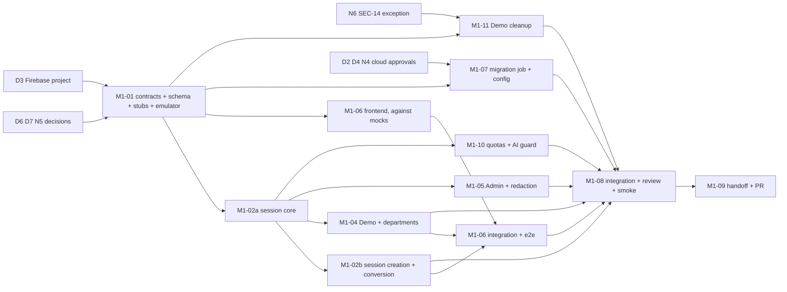

# M1: Authentication and Demo

**Status:** Approved by the Owner on 2026-11-06 (OPEN-26); local implementation is authorized. Cloud, IAM, Firebase Console, production database, QStash schedule, Admin provisioning, billing, deployment and merge actions are not. The task board is `tasks.md`. Revised 2026-11-06 for the decisions recorded as OPEN-24 and OPEN-25. Normative requirements stay in the specs; this document adds the scope, acceptance criteria, dependency graph, shared contracts, ownership, agent allocation, test strategy and the decisions that are still open.

## Approved architecture (inputs to this plan, not up for discussion)
| Area | Decision | Record |
|---|---|---|
| Authentication | Firebase Authentication: Email/Password, Google Sign-In, Anonymous (Try Demo only). Email address is the login identifier. No custom password hashing or storage. Email OTP removed. | OPEN-24, AUTH-01, 29..33 |
| Sessions | KnowServe opaque DB sessions kept. Firebase ID token verified once, then a KnowServe session cookie is used. Registered, Admin and Demo sessions expire 24 h after creation, never extended. Not Firebase Session Cookies. | OPEN-25, AUTH-06, 10, 30 |
| Try Demo | Firebase Anonymous Authentication plus an internal Demo identity bound to the Firebase uid. | AUTH-16 |
| Demo → Registered | Firebase anonymous-account linking, same uid and same internal identity, history preserved; new accounts only, no merge into existing accounts in M1. | AUTH-34 |
| Demo data | Session 24 h, unconverted history kept 48 h from creation, cleanup once a day, converted data never deleted. | AUTH-35 |
| Admin | One provisioned Admin bound to a Firebase uid, authorized from the database, Email/Password or Google linked to one account, no role management. | AUTH-04 |
| Departments | Last active department stored in PostgreSQL, restored after login, required on first login; selection is never a permission elevation. | AUTH-17 |
| Limits | Demo creation 5/h/IP; chat per day: Demo 20, Registered 100, Admin 100; HTTP 429; all configurable; global AI usage guard with graceful degradation. | AUTH-15, 36 |
| Tests | Firebase Auth Emulator, unit, integration, targeted Playwright, one limited real-Firebase smoke including Google before release. | below |

## Scope (normative text lives in the specs)
- Firebase identity, token verification, session creation, opaque sessions, cookies: AUTH-01, 04, 06..11, 18, 29, 30, PROD-02.
- Email verification, Google Sign-In, account linking, password reset: AUTH-13, 31..33, FE-AUTH-02, 03, 07, 11, 12.
- Try Demo, Demo → Registered conversion, retention and cleanup: AUTH-16, 34, 35, FE-AUTH-08, 13, SEC-16, PROD-01.
- Departments, persisted active department and switching: AUTH-17, 20, PROD-04, SEC-10, FE-AUTH-09.
- CSRF + Origin, same-origin topology: AUTH-14, 19 (topology proven in M0, M0-AC11).
- Demo creation rate limit, daily quotas, global AI guard (mechanism only; chat applies it in M4): AUTH-15, 36, COST-02, COST-03.
- Admin identity and Admin-only 403: AUTH-04, 11, SEC-03, 15, 17.
- Error envelope and codes, including 409 `ACTIVE_DEPARTMENT_REQUIRED`, 403 `EMAIL_NOT_VERIFIED`, 401 `REAUTH_REQUIRED`, 429 `RATE_LIMITED`/`QUOTA_EXCEEDED`, 503 `AI_UNAVAILABLE`: ARCH-05, FE-ARCH-03.
- Audit and logging hygiene, fail closed: AUTH-21, MON-04, MON-05, SEC-13.
- Frontend: FE-AUTH-01..09, 11..13, FE-ARCH-02..04, FE-ARCH-12/13.

Removed from M1: Email OTP (AUTH-22..28, FE-AUTH-10), custom password hashing, the password blocklist, Resend, our own verification mail, idle or sliding session lifetimes. Not in M1: documents, library, viewer, chat (M2+). The document and chat halves of SEC-10, SEC-16, the application of the quotas to chat, and the end-to-end preservation of Demo chat history after conversion land with M2 and M4.

## Milestone Definition of Done
M1 is done when all of the following hold (the M1 counterpart of M0-EX1..6):
| ID | Exit criterion |
|---|---|
| M1-EX1 | Every acceptance criterion below has evidence, or an explicit gap that the user has seen (WF-12, TEST-03 traceability table). Evidence that depends on chat (real chat-history preservation, quotas applied to chat) is carried by named M4 criteria, not left as an unowned gap. |
| M1-EX2 | CI is green on the milestone branch, security tests run as hard gates with no skips, and no committed secrets. |
| M1-EX3 | The independent review points below are done and no Critical or High finding is open (WF-11). |
| M1-EX4 | The milestone is deployed to the spike environment with the migration job applied, the deployed smoke passes, and the limited real-Firebase smoke (including Google) is recorded. |
| M1-EX5 | The specs are true: requirements, tests and "Current implementation / Known gaps" match the code (WF-15), and OPEN-05/23/24/25 are updated with evidence. |
| M1-EX6 | The milestone handoff exists (WF-12) and the user approves the milestone PR (WF-13). Deploy follows automatically on merge. |

## Acceptance criteria
M1-AC01..AC12 keep their numbers (AC03..AC05 are redefined because Email OTP is removed; AC08 is extended). AC13..AC17 are new. AC11 and AC12 were approved with the plan (D7).

| ID | Acceptance criterion | Evidence | Covers |
|---|---|---|---|
| M1-AC01 | Email registration → verification email → session creation → logout works end to end; an unverified account gets 403 `EMAIL_NOT_VERIFIED` and no session; a user who verifies more than 5 minutes later completes registration through an explicit reauthentication, and the session still lasts 24 h from its own creation | integration (emulator) + Playwright (emulator) | AUTH-01, 06, 08, 13, FE-AUTH-02, 03 |
| M1-AC02 | No password or hash exists anywhere in KnowServe code or schema; the Firebase password policy is configured (8-character minimum, or the stated fallback) and exported | review + schema/code search + exported configuration | AUTH-01, 03 |
| M1-AC03 | Google Sign-In on the login screen creates the same session type as password login; the Admin can use either method on the same linked Firebase account, and Admin rights come only from the provisioned uid | integration + Playwright (emulator); real-Firebase smoke | AUTH-04, 06, 31, FE-AUTH-02 |
| M1-AC04 | Token verification: forged, expired, wrong-audience, wrong-issuer, stale-sign-in, wrong-provider tokens all give the same 401; Firebase key outage fails closed; the emulator is refused in production; no ID token stored or logged | unit + integration | AUTH-07, 18, 30 |
| M1-AC05 | Account linking and password reset: no automatic merge by email; Google on an existing password account requires sign-in with the existing method; an unverified password account is never linked or trusted; a second uid with a used email is refused; reset gives the same confirmation for any email; action pages show success, expired and invalid; sign out everywhere revokes all sessions | integration + component | AUTH-02, 32, 33, FE-AUTH-07, 11, 12 |
| M1-AC06 | No ID tokens, session tokens, cookies, CSRF values or passwords in logs or audit records | log-capture tests | AUTH-21, MON-05 |
| M1-AC07 | CSRF token + Origin check enforced on every cookie-authenticated mutation; the session-creating endpoints enforce Origin | integration + deploy smoke | AUTH-14, 19 |
| M1-AC08 | Departments: every user (registered, Demo, Admin) can select every department; the last active department is persisted in PostgreSQL and restored after login; first login requires a selection (409 `ACTIVE_DEPARTMENT_REQUIRED` until then); switching isolates data; selection grants nothing | integration + Playwright (emulator) | AUTH-17, 20, PROD-04, SEC-10, FE-AUTH-09 |
| M1-AC09 | Authorization hard gates: 401 without session, 403 on Admin APIs for registered and Demo users, one Admin bound to a uid and provisioned once, no escalation through email, request fields or frontend data, Admin has no bypass in user paths | integration | SEC-01, 03, 17, AUTH-04, 11 |
| M1-AC10 | Error envelope with `request_id` on every error status used in M1 | integration + contract (OpenAPI) check | ARCH-05, FE-ARCH-03 |
| M1-AC11 | Migrations run in the deployed environment through a Cloud Run job with its own service account and secret; the GitHub deployer still cannot read any database secret | Terraform plan review, job run log, IAM inspection | INFRA-07, M0 handoff item 2 |
| M1-AC12 | Deployed smoke through the Pages proxy on the real Firebase project: Try Demo, password login of a pre-verified test account, CSRF rejection, department switch, logout; direct Cloud Run access still 403 | Playwright deployed smoke | AUTH-06, 14, 16, 17, 19 |
| M1-AC13 | Sessions: Registered, Admin and Demo sessions expire exactly 24 h after creation, use never extends them, there is no refresh route, backend enforces it, logout and revoke-all invalidate immediately | unit (fake clock) + integration | AUTH-08, 10, 33 |
| M1-AC14 | Try Demo through Firebase Anonymous Authentication: no registration, KnowServe session and Demo identity created, isolated per Demo identity and department, no Admin access, an expired Demo cannot start a new session | integration + Playwright (emulator) | AUTH-16, SEC-16, FE-AUTH-08 |
| M1-AC15 | Demo → Registered conversion proves **identity continuity** (same uid and `users.id`) and **preservation of representative dependent records** (test-fixture rows referencing `users.id`, in every department, shaped like future conversations and messages); converted only after authentication and the verification policy, idempotent, safe under partial failure and under a race with cleanup, no new permissions, no merge into an existing account, existing-credential collisions handled explicitly. Preservation of real chat history is unchanged as a requirement and its end-to-end evidence is an **M4 criterion** (CHAT-18), not an M1 gap | integration + Playwright (emulator) with fixture records | AUTH-34, FE-AUTH-13 |
| M1-AC16 | Demo cleanup: unconverted Demo data removed 48 h after creation by a daily run, idempotent and bounded, converted data never deleted, counts-only logs; the daily trigger exists on the spike | unit + integration; trigger inspection | AUTH-35 |
| M1-AC17 | Limits: Demo creation 5/h/IP and daily question quotas (Demo 20, Registered 100, Admin 100) return 429 and are configurable; the global AI guard and kill switch degrade AI while sign-in and the library work; a converted user keeps one counter | unit + integration (chat applies them in M4) | AUTH-15, 36, COST-02, 03 |

## Test strategy
Risk-proportionate; no staging environment for authentication.
| Layer | Used for | Notes |
|---|---|---|
| Unit | Session lifetime and expiry math, token-claim rules, freshness window, quota and rate-limit logic, conversion and cleanup state rules, redaction | Fast; fake clock; no network. |
| Integration (backend) | Sessions, CSRF/Origin, authorization matrix, department persistence and isolation, conversion, cleanup, quotas, audit and log hygiene | Real PostgreSQL. ID tokens come from the **Firebase Auth Emulator** and pass through the real verifier path (Firebase Admin SDK in emulator mode). The emulator is refused outside non-production (AUTH-30). |
| Playwright e2e (emulator) | Email signup/verify/login/logout, Google sign-in (emulator provider), Try Demo, Demo → Registered with chats, department restore, reset flow | Targeted: about six flows, not a page-by-page suite. |
| Component | Form and state logic, error mapping, the linking and conversion prompts | Mocked SDK. |
| Real Firebase smoke (once, before release) | Google OAuth, verification and reset mail delivery, the password policy, the anonymous provider, one deployed login through the Pages proxy | Manual checklist plus the deployed Playwright smoke (M1-AC12). Recorded as evidence. |
| Not built | A separate staging environment, load tests, a full cross-browser matrix | Out of proportion for a demo. |

The Owner checks in M1-01 whether the emulator runs acceptably in CI (tooling, minutes; OPEN-22). If it does not, integration tests use an emulator-compatible local token issuer and the Playwright flows run locally and in the pre-release check, with the same real-Firebase smoke. That fallback is recorded in an ADR, not decided silently.

## Requirements-to-tests traceability (planned; the TEST-03 table with results is produced in M1-08)
The scenario-level rows live in the specs' "Required tests" tables. This matrix maps each acceptance criterion to the tests that will prove it and the task that writes them.

| AC | Requirement tests (spec table rows) | Levels | Written by |
|---|---|---|---|
| M1-AC01 | AUTH-01, 06, 07, 08, 13, 30; FE-AUTH-02, 03, 07 | integration, e2e, component | M1-02b, M1-06 |
| M1-AC02 | AUTH-01, 03 | review, schema/code search, config export | M1-01, M1-07, M1-08 |
| M1-AC03 | AUTH-04, 06, 31; FE-AUTH-02 | integration, e2e, real smoke | M1-02b, M1-06, M1-08 |
| M1-AC04 | AUTH-07, 18, 30 | unit, integration | M1-02a |
| M1-AC05 | AUTH-32, 33; FE-AUTH-07, 11, 12 | integration, component | M1-02b, M1-06 |
| M1-AC06 | AUTH-21; MON-05 | integration (log capture) | M1-05 (sweep), every slice |
| M1-AC07 | AUTH-14, 19 | integration, deploy smoke | M1-02a, M1-08 |
| M1-AC08 | AUTH-17, 20; SEC-10; FE-AUTH-09 | integration, e2e, component | M1-04, M1-06 |
| M1-AC09 | AUTH-04, 11; SEC-01, 03, 17 | integration | M1-05 |
| M1-AC10 | ARCH-05, FE-ARCH-03 | integration, OpenAPI check | M1-01, each slice |
| M1-AC11 | INFRA-07 | plan review, job run, IAM check | M1-07, M1-08 |
| M1-AC12 | AUTH-06, 14, 16, 17, 19 | deployed e2e | M1-08 |
| M1-AC13 | AUTH-08, 10, 33 | unit, integration | M1-02a, M1-02b |
| M1-AC14 | AUTH-16; SEC-16; FE-AUTH-08 | integration, e2e | M1-04, M1-06 |
| M1-AC15 | AUTH-34; FE-AUTH-13 (fixture records; real chat history: CHAT-18 in M4) | integration, e2e, component | M1-02b, M1-06 |
| M1-AC16 | AUTH-35 | unit, integration, trigger inspection | M1-11, M1-07 |
| M1-AC17 | AUTH-15, 36 | unit, integration | M1-10 |

Coverage check against the requested test list: registration/verification/login/logout (AC01), Google (AC03), linking (AC05), anonymous Demo (AC14), conversion and history (AC15), no automatic merge (AC05, AC15), expiration and revocation (AC13), department isolation and restoration (AC08), Admin authorization (AC09), rate limits (AC17), CSRF and Origin (AC07), log hygiene (AC06), Demo cleanup and preservation of converted history (AC16), failure handling in Firebase-to-DB synchronization (AC15 partial-failure rows and AC04 key outage).

## What Firebase cannot do without custom code (requested analysis)
| Previously approved requirement | Status under Firebase | Treatment |
|---|---|---|
| Common-password blocklist and breach check (OPEN-15, AUTH-03) | Not enforceable: the server never sees passwords, and Firebase has no blocklist | Dropped; frontend may warn (UX only). A custom check would mean handling passwords, which is excluded. |
| 8-character minimum without composition rules | Firebase's configurable password policy (minimum 6 to 30, optional composition rules) appears configurable without Identity Platform; to be verified in the real console | N3 (OPEN-26): `Require` mode with minimum 8; if it cannot be enforced without upgrading, report and ask the Owner. |
| Signup never reveals an existing email (OPEN-14, AUTH-02) | Client signup returns "email already in use"; sign-in and reset can stay generic with enumeration protection | Accepted deviation, already in OPEN-24 and the specs. |
| Tunable per-account lockout and sign-in rate limits (AUTH-15) | Firebase throttles itself; not tunable | Not duplicated (as requested). |
| Ending KnowServe sessions when a password is reset or a user is disabled | Firebase state is not consulted after session creation | Bounded by the 24 h lifetime plus "sign out everywhere"; a per-request Firebase check was rejected as extra latency and a new dependency. |
| Hiding that an email belongs to the Admin | Firebase sign-in is generic; the Google/OTP exposure paths are removed | Admin is password-only; Google is refused server-side (AUTH-04). |

## Contradictions found and how they are resolved
| # | Finding | Resolution in the specs |
|---|---|---|
| C1 | "No automatic session extension" conflicts with Firebase's persistent login: a browser could silently exchange a token and get a new 24 h session. | The exchange and Demo start require a **recent sign-in** (5-minute `auth_time` window), so after 24 h the user signs in again (AUTH-10, AUTH-30). |
| C2 | The same freshness rule would break Demo conversion, because linking a credential does not refresh `auth_time`. | Conversion is authenticated by the **current Demo session** (cookie, CSRF, Origin) plus an ID token minted within 5 minutes (`iat`), or by a fresh normal sign-in (AUTH-34). |
| C3 | The earlier "least persistent" Firebase storage would lose the anonymous user on reload and make conversion impossible. | FE-AUTH-06 allows Firebase **session persistence** (tab-scoped), never a KnowServe token. |
| C4 | A deleted Demo row would otherwise let the returning anonymous uid start a new 24 h Demo (a hidden extension). | The 5-minute freshness window on `/v1/demo/start` makes an anonymous uid usable for a Demo start only right after it was created; an existing expired row gives `DEMO_EXPIRED`. |
| C5 | Daily chat quotas and the AI guard apply to chat, which does not exist until M4. | M1 builds and tests the counters, guard, configuration and 429/503 behavior (AC17); chat applies them in M4 (CHAT-19). Chat-level evidence is an M4 criterion, not an M1 gap. |
| C6 | "Demo history isolated by user/session": a Demo identity has exactly one session at a time. | Isolation is per Demo identity (user id) and department, which is also what makes conversion preserve history. |
| C7 | The Demo creation limit (5/h/IP) is enforced at `/v1/demo/start`, but Firebase anonymous sign-in happens before the API sees the user. | Excess anonymous Firebase accounts are possible; they get no KnowServe session or data. Firebase's own abuse limits apply; see N2 for their cleanup. |
| C8 | SEC-14 says the Worker accepts only signed deliveries that reference an eligible DB job; a daily cleanup trigger has no job row. | See N6. |
| C9 | A converted user gets a **new** session (rotation on privilege change), valid 24 h from conversion, not from the original Demo session. | Approved as O3 (OPEN-26): a new authentication event, not an extension. |
| C10 | OPEN-19 (Admin password-only) was superseded by OPEN-24, which does not mention the Admin's sign-in method. | Resolved by O1 (OPEN-26): the Admin may use Email/Password or Google; the password-only restriction is removed. |
| C11 | M1 has no chat, so a criterion that tests preserved **chat history** after conversion cannot run in M1. | M1-AC15 tests identity continuity and representative dependent records (fixtures); real chat-history E2E is an M4 criterion (CHAT-18, added to `backend/chat.md`). The requirement to preserve Demo history is unchanged. |
| C12 | The 5-minute `auth_time` rule would block a user who verifies their email later than 5 minutes after signing up (or in another browser). | Verification never creates a session. The user signs in, or reauthenticates explicitly (password or Google popup) after `401 REAUTH_REQUIRED`, and then gets a session valid 24 h from its own creation. No silent path, no lifetime extension (AUTH-13, AUTH-30). |

## Final decisions (approved by the Owner, 2026-11-06, OPEN-26)
Nothing here is up for discussion again. Approving an architecture does **not** authorize its cloud execution; the right-hand column says what Claude Code prepares locally and what needs separate Owner authorization.

| # | Decision | Local preparation (authorized) | Needs separate Owner authorization |
|---|---|---|---|
| D7 | This plan, the task graph, allocation, acceptance criteria (including AC11 and AC12) and the Definition of Done | Everything in M1 below | n/a |
| O1 | The single Admin may use Email/Password or Google, linked to one Firebase account; Admin rights come only from the provisioned uid and the database identity | AUTH-04/31/32 code and tests | none |
| O2 | Opaque sessions, absolute 24 h; revoke-all and KnowServe-side disabling revoke sessions; no per-request Firebase check; external Firebase reset/disable not propagated (documented limitation) | AUTH-33 code and tests | none |
| O3 | Conversion revokes the Demo session and issues a Registered session valid 24 h from conversion | AUTH-34 code and tests | none |
| N1 | Global quota 100 AI questions per UTC day, kill switch; per-user and Demo-creation limits as approved | Mechanism and tests (M1-10) | none (M4 wires chat) |
| N2 | Standard Firebase Authentication; no Identity Platform; no custom anonymous-account cleanup | none | any upgrade |
| N3 | Password policy: minimum 8, no composition rules, `Require` mode, verified in the real console first | Frontend validation, documentation, a verification checklist | Firebase Console configuration and the verification itself; if it cannot be enforced without upgrading, report and ask |
| N4 | One QStash schedule for the daily Demo cleanup; no Cloud Scheduler | Schedule definition as code or a documented command | Confirming schedule availability and quotas, and creating the schedule |
| N5 | M0 is sufficient to start M1; M0-AC09 stays open separately | none | none |
| N6 | Narrow SEC-14 exception for one signed cleanup endpoint; independent review required | Endpoint, tests, review | none |
| D2 | Dedicated Cloud Run migration job architecture | Terraform authoring, `deploy.yml` change, local `validate` only | `terraform apply`, the second Neon role, the secret value, IAM, production migration |
| D3 | `knowserve-m0-spike` is the permanent production project and hosts Firebase Authentication; no permanent staging | Documentation of the Firebase setup steps | Any Firebase Console, provider, domain or project change |
| D4 | One Admin created manually in the Firebase Console and bound by an idempotent provisioning operation | The provisioning command and tests | Creating the Admin account and running provisioning |
| D6 | Departments: Human Resources, Finance, Engineering, Legal, Sales, with stable ids and slugs | Seed migration and tests | Applying the migration to production |

Remaining Owner actions that gate only the deployed smoke, not the local work: the Firebase Console setup (providers including Anonymous, enumeration protection, one account per email, authorized domain, password policy, action URL), the migration job apply, the Admin account, the QStash schedule, and any deployment.

## Task graph
Sizes are relative (S small, M medium, L large). No calendar estimates are given because none were measured. M1-03 (Email OTP) is retired and its number is not reused.

| ID | Task | Depends on | Size | Workstream |
|---|---|---|---|---|
| M1-01 | Contracts, ADRs, schema migration `0002`, models, route stubs and OpenAPI, shared interfaces, fakes and emulator setup, Firebase documentation check | D3 (project id), D6, D7 | M | Owner |
| M1-02a | Session core: 24 h absolute sessions, identity dependency, cookie, CSRF + Origin, Postgres counters and limiter, Firebase Admin token verifier (emulator-aware, refused in production) | M1-01 | M | Backend-Auth |
| M1-02b | `POST /v1/auth/session`, `/me`, `/logout`, `/sessions/revoke-all`, `POST /v1/auth/convert` and conversion logic, `users` rows, provider and Admin rules, linking conflict guard, audit | M1-02a | L | Backend-Auth |
| M1-04 | `POST /v1/demo/start`, Demo identity and expiry, departments endpoint, active department switch and persistence, 409, Demo creation limit use | M1-02a | M | Backend-Identity |
| M1-05 | Admin provisioning command, Admin guard, SEC-03/17 and AUTH-04 tests, log-redaction tests | M1-02a, D4 | S | Backend-Identity |
| M1-10 | Quota service (daily per-user counters), global AI guard and kill switch, configuration, 429/503 behavior and tests | M1-02a, N1 | S | Backend-Limits |
| M1-11 | Demo cleanup: idempotent bounded deletion, Worker maintenance endpoint, tests | M1-01, N6 | M | Backend-Limits |
| M1-06 | Frontend: (a) Firebase SDK, session creation, guards, CSRF client, 401/409/429/503 handling; (b) login screen, signup, verification; (c) action pages, reset, linking; (d) Try Demo, department selector and restore; (e) Demo → Registered conversion UI | M1-01 (mocks); M1-02b and M1-04 for e2e | L | Frontend |
| M1-07 | Migration job, secrets, deploy wiring, Firebase configuration notes and export, QStash daily schedule (after N4) | D2, D3, D4, N4 | M | Infrastructure |
| M1-08 | Integration, full e2e, deployed smoke, real-Firebase smoke, independent security review, traceability | M1-02b, 04, 05, 06, 07, 10, 11 | M | Owner + Review Agent |
| M1-09 | M1 handoff and milestone PR | M1-08 | S | Owner |

**Critical path:** decisions (D3 needs the Firebase project) → M1-01 → M1-02a → M1-02b (largest backend task, includes conversion) → frontend integration and e2e → M1-08 → M1-09. The cloud path (D2, D3, D4, N4 → M1-07 → apply and console setup → deployed smoke and real-Firebase smoke) can finish later than the code and is the biggest schedule risk, so answering those early is the main lever.

**Genuinely parallel**
- After M1-01: M1-06 (on mocks), M1-07, M1-11 and M1-02a.
- After M1-02a: M1-02b, M1-04 then M1-05, M1-10.
- M1-11 shares only the schema and the Worker app with the rest, so it does not wait for sessions.

**Deliberately not parallel**
- M1-02a is serial and small: sessions, identity dependency, CSRF, the limiter and the verifier are used by everything, so they land first instead of being written against guesses.
- M1-02a and M1-02b stay with one agent: the session creation and conversion are the first consumers of the core.
- M1-04 and M1-05 share one agent: both extend the same identity model and are small.
- Frontend screens stay with one agent: they share the router, provider and API client.

## Shared contracts to fix before parallel work (M1-01)
Per WF-03 these change only with Owner approval and notice to dependent agents before implementation.

| Contract | Fixed in | Content |
|---|---|---|
| Schema | one Alembic revision `0002` written by the Owner | Tables: `users` (Firebase `uid` unique, `kind` demo/registered/admin, normalized `email` unique when not null, `demo_created_at`, `last_active_department_id`, no password column), `sessions` (token hash, user id, `active_department_id`, CSRF secret, `expires_at`, revoked), `departments` (seeded), `audit_events`, `rate_limit_counters`, `usage_counters` (per user per UTC day), `ai_budget` (global daily total and kill switch). Dependents of a Demo identity (the future chat tables of M2/M4) must reference `users.id` with `ON DELETE CASCADE` so cleanup deletes them and conversion keeps them; this is a rule for later schemas, recorded in an ADR. A single owner of the migration removes the usual conflict point. After M1-01 any schema change goes through the Owner. |
| API surface | `docs/contracts/api.md` and regenerated `openapi.json` | Every M1 route with models and error codes as `501` stubs so the frontend can generate its client: `POST /v1/auth/session`, `POST /v1/demo/start`, `POST /v1/auth/convert`, `POST /v1/auth/logout`, `GET /v1/auth/me`, `POST /v1/auth/sessions/revoke-all`, `GET /v1/departments`, `PUT /v1/session/department`. Codes: `ACTIVE_DEPARTMENT_REQUIRED` (409), `EMAIL_NOT_VERIFIED` (403), `DEMO_EXPIRED` (401), `REAUTH_REQUIRED` (401), `RATE_LIMITED` and `QUOTA_EXCEEDED` (429), `AI_UNAVAILABLE` (503), `CSRF_INVALID` and `ORIGIN_INVALID` (403), and the generic auth failure (401). |
| Identity and session interface | `docs/contracts/auth-session.md` (new) | The `Identity` type (kind, user id, active department), the `get_identity`, `require_admin`, `require_registered` and `require_active_department` dependencies, cookie name and attributes, CSRF header, the request and response of the three session-creating endpoints, allowed providers per endpoint, the 24 h lifetime, and the freshness rules (5-minute `auth_time` for creation, `iat` for conversion). |
| Shared Python interfaces | `knowserve_core` | `audit.record(...)` with a redaction-safe payload type (implemented in M1-01), `TokenVerifier` interface, `RateLimiter` and `QuotaService` interfaces. The limiter and the real verifier land in M1-02a; the quota service in M1-10. |
| Config keys | `docs/contracts/config-and-deploy.md` | All M1 `KS_*` keys with defaults: session TTL (24 h), Demo retention (48 h), freshness window, Demo creation limit, daily quotas, AI guard and kill switch, `KS_FIREBASE_PROJECT_ID`, Admin provisioning keys, emulator host. Frontend `VITE_FIREBASE_*` (public). Agents add no keys without the Owner. |
| Maintenance endpoint | `docs/contracts/jobs-outbox.md` | The single signed Worker endpoint for the daily cleanup (pending N6). |
| Route registration | `apps/api/.../app.py` | One router module per slice registered once in M1-01 so slices do not edit the app factory. |
| Test fixtures | `tests/` helpers | An emulator token factory (registered verified, Google, anonymous, Admin), a session factory (cookie and CSRF), a fake clock. |

## Ownership boundaries
| Workstream | Tasks | Owns (writes) | Reads only |
|---|---|---|---|
| Owner | M1-01, M1-08, M1-09 | `docs/contracts/`, `docs/adr/`, `docs/milestones/M1/`, `AGENTS.md`, revision `0002`, `knowserve_core/models.py`, `audit.py`, the interfaces and fixtures, `app.py` registration, `openapi.json`, lockfile reconciliation | everything |
| Backend-Auth | M1-02a, M1-02b | `apps/api/src/knowserve_api/auth/`, the limiter and verifier implementations | contracts |
| Backend-Identity | M1-04, M1-05 | `.../demo/`, `.../departments/`, `.../admin/`, the Admin provisioning command | session core |
| Backend-Limits | M1-11, M1-10 | `knowserve_core/demo_cleanup.py`, the Worker maintenance endpoint in `apps/worker`, `knowserve_core/quotas.py`, the AI guard | session core, schema |
| Frontend | M1-06 | `apps/frontend/` (auth feature folder, router, provider, Firebase init, tests, e2e specs) | OpenAPI snapshot |
| Infrastructure | M1-07 | `infra/terraform/` additions, migration-job wiring in `.github/workflows/deploy.yml`, Firebase setup notes in `infra/terraform/README.md`, the QStash schedule | config contract |

Conflict rules (carried over from M0):
- **Lockfiles** (`uv.lock`, `pnpm-lock.yaml`) are never hand-merged: rebase and regenerate; the Owner re-locks at integration.
- **`openapi.json`** is never hand-merged either: regenerate at each integration merge. A route or schema change not in the M1-01 stubs needs Owner approval.
- **Migrations:** only the Owner writes `0002`. A slice that needs a column asks the Owner.
- **`compose.yaml`:** no M1 slice needs a new service, except the Firebase emulator service if M1-01 adopts it (Owner edits it).
- **Contracts and config keys:** change only with Owner approval and notice to dependent agents first.

## Integration checkpoints and order
1. **CP1:** M1-01 merges into `m1/integration`; every task branch forks from it. The Owner approves the contracts.
2. **CP2:** M1-02a merges, after an independent review. This unblocks the parallel group.
3. **CP3:** M1-02b, M1-04+05, M1-10 and M1-11 merge as each passes its gates, in any order. M1-02b (token verification, conversion) and M1-11 (maintenance endpoint, deletion safety) get independent reviews.
4. **CP4:** M1-07 merges after `terraform plan` review (independent review of IAM, secrets, the migration job and the schedule). Applying it needs the user's approval and the D2/D3/D4/N4 inputs.
5. **CP5:** M1-06 screens merge against the real API once 02b and 04 are in; Playwright runs in the Owner's trial worktree.
6. **CP6 (M1-08):** full CI, the deployed smoke after the apply, the real-Firebase smoke, the final independent review, the traceability table.
7. **CP7 (M1-09):** handoff, then the milestone PR to `main` for the user's approval (WF-13).

## PR strategy (minimal)
- **Two PRs in total.** (1) The docs PR with this plan and the spec updates, for your approval before any agent starts (PR #26 is that PR, still open; the revision is uncommitted in the working tree). (2) **One milestone PR** `m1/integration` → `main`.
- Agent branches merge into `m1/integration` locally through the Owner's trial worktree (WF-07); they do not open PRs.
- Because `ci` runs on pull requests and pushes to `main` only (OPEN-22), the Owner opens the milestone PR as a **Draft early** so each integration merge gets CI. It is **the same PR** that is marked ready for your final review and approval; there is no additional integration PR.
- Cloud actions (Terraform apply, Firebase console setup, QStash schedule, deploy) are separate approvals and never ride on a merge.

## Risk-based review points
| Point | Why | Reviewer |
|---|---|---|
| M1-02a | Sessions, cookie, CSRF, token verification, emulator guard | Independent Review Agent |
| M1-02b | Conversion, provider and Admin rules, account linking, idempotency and races | Independent Review Agent |
| M1-11 | Deletion safety (never delete converted data), the SEC-14 exception | Independent Review Agent |
| M1-07 | IAM, secrets, migration job, schedule | Independent Review Agent |
| M1-08 | Final cross-cutting pass: authorization matrix, logging hygiene, spec-to-code consistency | Independent Review Agent |
| M1-04, M1-05, M1-10, M1-06 | Lower risk | Owner review at the integration checkpoint; no separate gate (WF-06) |

## Deployment gates
- The migration job (M1-AC11) is applied and revision `0002` runs on the spike database before the first deploy that carries M1.
- The Firebase project is configured (D3) and its configuration exported.
- The Admin is provisioned once (D4); the QStash schedule exists only after N4.
- Production refuses emulator tokens (tested before deploy).
- After deploy: the deployed smoke (M1-AC12) and the real-Firebase smoke, recorded as evidence.

## Quality gates
- **Every merge into `m1/integration`:** CI green for the touched packages (`ci-required`), contract diff clean or approved, the slice's "Required tests" rows from `backend/auth.md`, `frontend/auth.md` and `cross-cutting/security-and-permissions.md` present with requirement ids in the test names (TEST-07), security tests as hard gates (no skips, no xfail).
- **The Owner re-runs checks in the trial worktree** and does not rely on an agent's "tests pass" claim (WF-08).
- **Milestone PR:** the Definition of Done above. Per OPEN-22(c), doc-only edits during M1 are batched into one PR per work session or milestone step.

## Risks
| Risk | Effect | Mitigation |
|---|---|---|
| D2/D3/D4/N4 answered late | Deployed smoke and the final deploy slip | Ask now. Code and tests do not depend on them (emulator, local DB). |
| Firebase behavior differs from what the specs assume (anonymous linking, token claims after linking, enumeration protection, password policy, unverified accounts) | Spec text or tests wrong | The specs say "from general knowledge"; M1-01 verifies against current documentation and the emulator; M1-08 checks the real project. |
| Emulator differs from production Firebase | Tests pass, production fails | The real-Firebase smoke; the emulator is never accepted in production. |
| Conversion races and partial failures | Lost or duplicated history | One transaction, idempotent, row re-check against cleanup; dedicated tests on fixture records (AC15); real chat history re-proven in M4 (CHAT-18). |
| Reauthentication prompt surprises users who verify late | Friction at registration | Explicit "confirm it is you" step with a clear message; tested with a fake clock and a fresh browser (AUTH-13, FE-AUTH-07). |
| Cleanup deletes converted data | Data loss | Delete only rows still of kind `demo`, re-checked inside the transaction; independent review (M1-11). |
| Google popup/redirect problems on `pages.dev` | Google login fails in some browsers | Popup default; real smoke. |
| Default Firebase sender without a custom domain | Verification and reset mail in spam | Checked in M1-01; Try Demo remains the primary path for reviewers. |
| Orphaned Firebase anonymous accounts | Clutter, possible cost | N2; they hold no KnowServe data. |
| Sessions outlive a reset or a disabled user | Stale access up to 24 h | Absolute 24 h lifetime and revoke-all; documented gap. |
| Neon pooler and role split (D2) | Migration or grants fail on the real database | ADR first; the job is run against the spike database before M1-08. |
| `ci` cost per PR (OPEN-22) | Many PRs mean many full CI runs | Two PRs in total; the milestone PR is opened as a Draft early and becomes the final review PR. |

## ADRs written in M1-01 (WF-10)
Firebase as identity provider and the session-creation flow including freshness (C1 to C4); token verifier and emulator guard; Postgres counters for rate limits and quotas; CSRF token delivery (returned by `me` and the session-creating endpoints, sent as `X-CSRF-Token`); Demo identity and conversion state rules; cleanup trigger and the SEC-14 exception (N6); schema rule for dependents of `users.id`; migration roles (D2); emulator in CI or its fallback; Firebase anonymous-account lifecycle (N2). The `/v1/spike/*` endpoints stay off and are not extended.

## Open items affecting M1
- OPEN-05: the M1 part is resolved by OPEN-25 and OPEN-26 (global quota 100 per UTC day); the M3 and M4 parts stay open.
- OPEN-23 is resolved by OPEN-26.
- OPEN-22: CI/CD efficiency; M1 follows the interim rule (c).
- M0-AC09 (measured costs) stays open separately (N5). Any Firebase cost adds to OPEN-10.

## Related docs
`tasks.md`, `../../backend/auth.md`, `../../frontend/auth.md`, `../../cross-cutting/security-and-permissions.md`, `../../cross-cutting/product-and-ux.md`, `../../architecture/infrastructure.md`, `../../contracts/`, `../M0/plan.md`, `../M0/handoff.md`, `../../open-decisions.md`, `../../workflow/agent-workflow.md`
