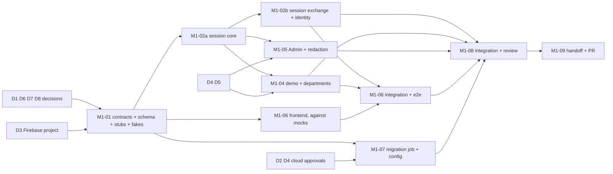

# M1: Authentication and Demo

**Status:** Planned (WF-16), **awaiting user approval**. No M1 code exists and no implementation agent has been started. The task board is `tasks.md`. Written on 2026-11-06 against `main` at `fc8190f`. Normative requirements stay in the specs; this document adds the dependency graph, shared contracts, ownership, agent allocation and the decisions the user has to make first.

**Authentication design (OPEN-24, decided by the user on 2026-11-06):** Firebase Authentication with Email/Password and Google Sign-In on one login screen. KnowServe keeps its own opaque database sessions and authorization model; a Firebase ID token is verified once at a session exchange. Email verification is required for password signups, password reset and safe account linking are in scope, anonymous Try Demo is preserved as KnowServe's own visitor sessions, Email OTP is removed, and no password is ever stored by KnowServe. The affected specs and tests were updated in the same change as this plan: `../../backend/auth.md`, `../../frontend/auth.md`, `../../cross-cutting/product-and-ux.md`, `../../cross-cutting/security-and-permissions.md`, `../../architecture/tech-stack.md`, `../../open-decisions.md`.

## Scope (normative text lives in the specs)
- Firebase identity, session exchange, opaque sessions, cookies: AUTH-01, AUTH-04, AUTH-06..11, AUTH-18, AUTH-29, AUTH-30, PROD-02.
- Email verification, Google Sign-In, account linking, password reset: AUTH-13, AUTH-31..33, FE-AUTH-02, 03, 07, 11, 12.
- CSRF + Origin check, same-origin topology: AUTH-14, AUTH-19 (topology proven in M0, M0-AC11).
- Rate limiting of the session exchange and Try Demo: AUTH-15.
- Try Demo, departments, active department and switching (Demo Mode): AUTH-16, AUTH-17, AUTH-20, PROD-01, PROD-04, SEC-10, SEC-16.
- Admin identity and Admin-only 403: AUTH-04, AUTH-11, SEC-03, SEC-15, SEC-17 (user-facing rules apply to the Admin).
- Error envelope and status codes, including 409 `ACTIVE_DEPARTMENT_REQUIRED` and 403 `EMAIL_NOT_VERIFIED`: ARCH-05, FE-ARCH-03.
- Audit and logging hygiene: AUTH-21, MON-04, MON-05. Fail closed when the database, auth or Firebase key fetch is unavailable: SEC-13.
- Frontend: FE-AUTH-01..09, 11, 12, FE-ARCH-02..04, FE-ARCH-12/13.

Removed from M1: Email OTP (AUTH-22..28, FE-AUTH-10), custom password hashing and policy code, Resend, our own verification-mail flow. Not in M1: documents, library, viewer, chat (M2+). The document and chat halves of SEC-10 and SEC-16 land with M2 and M4.

## Acceptance criteria
M1-AC01..AC10 are rewritten for Firebase. The old AC03..AC05 (Email OTP) are retired and their numbers reused for Google sign-in, session-exchange hardening, and linking/reset. M1-AC11 and M1-AC12 are **proposed additions** that need the user's confirmation as part of OPEN-23.

| ID | Acceptance criterion | Evidence | Covers |
|---|---|---|---|
| M1-AC01 | Signup with email and password → verification email → session exchange → logout works end to end; an unverified account gets 403 `EMAIL_NOT_VERIFIED` and no session | integration (fake verifier) + Playwright e2e (Firebase Auth emulator, or a component-level fallback decided in M1-01) | AUTH-01, AUTH-06, AUTH-08, AUTH-13, FE-AUTH-02, 03 |
| M1-AC02 | No password or hash exists anywhere in KnowServe code or schema; the Firebase password policy (8-character minimum, no composition rules) is configured and exported as evidence | review + schema/code search + exported configuration | AUTH-01, AUTH-03 |
| M1-AC03 | Google Sign-In on the same login screen creates the same session type as password login; the Admin is refused Google | integration + e2e (emulator) | AUTH-04, AUTH-06, AUTH-31, FE-AUTH-02 |
| M1-AC04 | Session-exchange hardening: forged, expired, wrong-audience, wrong-issuer, stale `auth_time`, anonymous-provider and disallowed-provider tokens all give the same 401; per-IP and per-uid rate limits; no ID token stored or logged | integration tests | AUTH-07, AUTH-15, AUTH-18, AUTH-30 |
| M1-AC05 | Account linking and password reset: Google on an email with a password account requires sign-in with the existing method first; an unverified password account is never linked; a second `uid` with a used email is refused; reset shows the same confirmation for any email; action pages show success, expired and invalid; sign out everywhere revokes all sessions | integration + component | AUTH-02, AUTH-32, AUTH-33, FE-AUTH-07, 11, 12 |
| M1-AC06 | No ID tokens, session tokens, cookies or CSRF values in logs or audit records | log-capture tests | AUTH-21, MON-05 |
| M1-AC07 | CSRF token + Origin check enforced on every cookie-authenticated mutation; the session exchange requires the Origin check and a rate limit | integration + deploy smoke | AUTH-14, AUTH-19 |
| M1-AC08 | Every user and visitor can select every department; switching isolates data; missing department returns 409 `ACTIVE_DEPARTMENT_REQUIRED`; Try Demo works without Firebase | integration + e2e | AUTH-16, AUTH-17, PROD-04, SEC-10, FE-AUTH-08, 09 |
| M1-AC09 | Security hard gates: 401 without session, 403 on Admin APIs for non-Admins, no public Admin creation, Admin has no bypass in user paths | integration tests | SEC-01, SEC-03, AUTH-04, SEC-17 |
| M1-AC10 | Error envelope with `request_id` on every error status used in M1 | integration + contract (OpenAPI) check | ARCH-05, FE-ARCH-03 |
| M1-AC11 *(proposed)* | Migrations run in the deployed environment through a Cloud Run job with its own service account and secret; the GitHub deployer still cannot read any database secret | Terraform plan review, job run log, IAM inspection | INFRA-07, M0 handoff item 2 |
| M1-AC12 *(proposed)* | Deployed smoke through the Pages proxy against the real Firebase project: password login of a pre-verified test account, Try Demo, CSRF rejection, department switch, logout; direct Cloud Run access still 403. Google Sign-In, signup verification mail and password reset mail are a documented manual check (Google login cannot be automated) | Playwright deployed smoke + manual checklist | AUTH-06, AUTH-14, AUTH-17, AUTH-19, AUTH-31, AUTH-33 |

## Decisions the user must make first
D0 is settled. D1..D8 are open; the Owner's recommendation is given so each can be approved or changed in one pass. D3 and D8 involve cloud/account actions the user does themselves or authorizes separately.

| # | Decision | Needed before | Owner recommendation |
|---|---|---|---|
| D0 | Firebase Authentication scope | **settled** | Recorded as OPEN-24: identity provider only, KnowServe sessions kept. |
| D1 | **OPEN-05 values for M1**: session and demo lifetimes, purge cadence, rate limits (table below) | M1-01 defaults; final before M1-02a merges | Approve the proposed values; they are configuration. |
| D2 | **Migration permissions.** `deploy.yml` reads `database-url` to migrate, but the deployer cannot read that secret by design; M0 left `RUN_MIGRATIONS` off. M1 adds the first schema change (revision 0002). | M1-07, and the first deploy carrying 0002 | A **Cloud Run job** `knowserve-migrate` running the API image with `alembic upgrade head`, under its own service account that reads a separate `migration-database-url` secret (a Neon role that may run DDL). Runtime services keep a DML-only role. The deployer may update and execute the job but still reads no secret. Needs a `terraform apply`, a second Neon role and the secret value, so it needs the user's separate approval and action. Alternatives: let the deployer read the existing secret (undoes the M0 security fix), or run migrations by hand from a laptop (no audit trail). |
| D3 | **Firebase project setup** (user action in the Firebase console, no secret involved). Choose the project: reuse `knowserve-m0-spike` (add Firebase to it) or a new one. Then: enable Email/Password and Google; enable **email enumeration protection** and **one account per email**; add `knowserve-m0-spike.pages.dev` to authorized domains; set the email-template action URL to `https://knowserve-m0-spike.pages.dev/auth/action`; choose the Google OAuth consent branding. Copy the public web config (API key, auth domain, project id) to the frontend build variables. The API needs only the project id (`KS_FIREBASE_PROJECT_ID`); token verification uses Google's public keys, so there is no new secret and no extra IAM role. | M1-01 (contract), M1-06 integration, M1-08 | Reuse the spike project to keep one billing and IAM boundary. Terraform provider coverage for Identity Platform is unverified, so the console steps are documented and the configuration is exported as evidence, as with other manual steps (OPEN-06). Whether this adds cost or needs billing, and whether Firebase's default sender is acceptable without a custom domain (mail may land in spam), are **not verified here**: M1-01 checks the current Firebase documentation and reports. |
| D4 | **Admin provisioning.** AUTH-04 requires an out-of-band Admin. | M1-05 and the first deploy | The user creates one Firebase email/password account for the Admin in the console and gives the plan its `uid` and email (neither is a secret). The seed command, run by the migration job, marks that `uid` as Admin from `KS_ADMIN_FIREBASE_UID` and `KS_ADMIN_EMAIL`. The password never enters the repo, Terraform or Secret Manager. The Admin cannot use Google. |
| D5 | **Visitor purge mechanism.** M0 decided there is no Cloud Scheduler; Try Demo sessions must expire and be purged (AUTH-16). | M1-04 | Expiry is enforced at lookup (an expired session is a 401 whether or not it was purged). Purge is opportunistic and bounded: each Try Demo creation deletes a limited batch of expired visitors and their rows. A QStash schedule or Scheduler stays an option if the table grows and would need separate approval. Cap on active visitors in D1. |
| D6 | **Seeded departments.** AUTH-20 needs a fixed list; DEF-01 defers the document corpus, not the names. | M1-01 (seed migration) | Five: Human Resources, Finance, Engineering, Legal, Sales, with stable slugs and ids; the UI reads them from the API (PROD-03). |
| D7 | **Approve the plan refinements (OPEN-23):** task IDs, the proposed M1-AC11/AC12, the agent allocation, the single owner-written schema migration, and that the OTP task ID M1-03 is retired and not reused. | start of M1-01 | Approve. |
| D8 | **Confirm the consequences of Firebase for approved decisions** (recorded in OPEN-24 as consequences): (a) signup reveals that an email is already registered, which amends OPEN-14 (sign-in and reset stay generic); (b) the common-password blocklist and breach check of OPEN-15 are dropped, and the password policy is whatever Firebase can enforce; (c) an existing KnowServe session survives a password reset until it expires or the user signs out everywhere. | M1-01 (spec text is already written on this basis) | (a) Accept, since hiding it needs custom mail and password handling you ruled out. (b) Enable Firebase's password policy with a minimum of 8 if it is available on the plan in use (it may require upgrading to Identity Platform, an account/billing action for you to authorize; otherwise accept Firebase's default minimum and say so in the UI and README). (c) Accept with the proposed lifetimes and the revoke-all endpoint. |

### D1: proposed OPEN-05 values
All are configuration (`KS_*` keys fixed in M1-01). "IP" is the forwarded client IP after the proxy check (`../../contracts/proxy.md`). Counters live in PostgreSQL (ADR-M1-03). Firebase applies its own, untunable limits to sign-in, signup and reset.

| Parameter | Proposed value | Notes |
|---|---|---|
| Registered session | 7 days absolute, 24 h idle | Idle time slides; the `last_seen` write is throttled to once per 5 minutes. |
| Admin session | 8 h absolute, 1 h idle | Shorter because of the elevated endpoints. |
| Try Demo visitor session | 4 h absolute, 30 min idle | Fictional data only; short on purpose. |
| Fresh sign-in window for the exchange (`auth_time`) | 5 minutes | A stolen older ID token cannot start a session. |
| Session exchange | 30 per IP per 15 min, 10 per `uid` per 15 min | Responds `429 RATE_LIMITED`; no hard account lock. |
| Active Try Demo visitors | 200 at once; Try Demo creation 10 per IP per hour | Beyond the cap, creation returns 503 `DEMO_CAPACITY` (fail closed). |
| Purge | At most 100 expired visitor sessions and rows deleted per Try Demo creation; expired registered sessions purged the same way | See D5. |
| Sign out everywhere | 5 per session per hour | |

## Design findings (Owner ADRs in M1-01, not user-level)
1. **ADR-M1-01 Firebase as identity provider.** Replaces the earlier password, Resend and OTP decisions in the specs. Records the exchange flow, the allowed providers (`password`, `google.com`), the `auth_time` window, why Firebase Anonymous Auth is not used (Try Demo stays ours), and why sessions stay ours (CSRF, active department, Admin rules, purge, and the proven cookie path through the proxy).
2. **ADR-M1-02 Token verifier.** `google-auth` (or the Firebase Admin SDK, whichever M1-01 shows is lighter at runtime) behind a `TokenVerifier` interface. The key fetch is cached; if the keys cannot be fetched and none are cached, the exchange fails closed with 503 (SEC-13). Tests use a fake verifier, so no hard gate depends on the network.
3. **ADR-M1-03 Rate-limit store.** Counters in PostgreSQL with an atomic upsert, because there is no Redis and Cloud Run may run two instances. The limiter sits behind an interface.
4. **ADR-M1-04 CSRF token delivery.** The token is bound to the session, returned by `GET /v1/auth/me` and the exchange, and sent as `X-CSRF-Token` (the proxy already forwards that header). The exchange itself uses the Origin check plus the rate limit, and the ADR records why login CSRF is acceptable.
5. **ADR-M1-05 Account linking policy.** One KnowServe user per `uid`; never link or merge by email in our code; `users.email` unique; unverified password accounts never trusted; client-side linking only after sign-in with the existing method. Firebase behavior for the unverified-account case is **verified against current documentation in M1-01**, not assumed.
6. **ADR-M1-06 Migration roles** (follows D2): the DDL and DML role split on Neon and default grants so the runtime role can use tables created by the migration role.
7. **ADR-M1-07 Test strategy for Firebase.** Backend hard gates use the fake verifier. For the frontend e2e, M1-01 checks whether the Firebase Auth emulator runs acceptably in CI (extra tooling, CI minutes, OPEN-22). If not, e2e uses a mocked SDK and the real Firebase is covered by the deployed smoke and the manual checklist.
8. **Session behavior after a password reset or a disabled user:** KnowServe sessions are not tied to Firebase state after the exchange. Mitigations: the lifetimes in D1 and the revoke-all endpoint. This is a documented gap (`../../backend/auth.md`).
9. **Spike endpoints:** `/v1/spike/*` stays off and is not extended.
10. **Google sign-in flow on `pages.dev`:** popup is the default because redirect flows can break under browsers' third-party storage rules; checked in M1-06 and the deployed smoke.

## Task graph
Sizes are relative (S small, M medium, L large). No calendar estimates are given because none were measured. M1-03 (Email OTP) is retired and its number is not reused.

| ID | Task | Depends on | Size | Workstream |
|---|---|---|---|---|
| M1-01 | Contracts, ADRs, single schema migration, models, route stubs and OpenAPI, shared interfaces, fakes, Firebase doc check | D1, D3 (project id), D6, D7, D8 | M | Owner |
| M1-02a | Session core: sessions, identity dependency, cookie, CSRF + Origin, Postgres rate limiter, Firebase token verifier | M1-01 | M | Backend-Auth |
| M1-02b | Session exchange, `me`, logout, revoke-all, `users` rows, provider and Admin rules, linking conflict guard, audit | M1-02a | M | Backend-Auth |
| M1-04 | Try Demo, departments, active department and switch, 409, purge | M1-02a, D5 | M | Backend-Identity |
| M1-05 | Admin seed command, Admin guard, SEC-03/17 tests, log-redaction tests | M1-02a, D4 | S | Backend-Identity |
| M1-06 | Frontend auth: Firebase SDK + exchange + guards (a), login screen with both methods, signup, verify (b), action pages, reset, linking (c), Try Demo and department selector (d) | M1-01 (mocks), then 02b/04 for e2e | L | Frontend |
| M1-07 | Migration job, secrets, deploy wiring, Firebase configuration documentation and export | D2, D3, D4 | M | Infrastructure |
| M1-08 | Integration, full e2e, deployed smoke, independent security review, traceability | M1-02b, 04..07 | M | Owner + Review Agent |
| M1-09 | M1 handoff and milestone PR | M1-08 | S | Owner |

**Critical path:** user decisions (D3 needs the Firebase project) → M1-01 → M1-02a → M1-02b → frontend integration and e2e → M1-08 → M1-09. A second path can be longer in practice: D2/D3/D4 → M1-07 → Terraform apply and Firebase console setup (user) → the deployed smoke in M1-08. The code path is bounded by M1-02a plus M1-02b. The cloud and account approvals are the biggest schedule risk, so answering D2, D3 and D4 early is the main lever, as A3/A4 were for M0.

**Genuinely parallel**
- M1-06 starts when M1-01 merges and runs next to all backend work, using the OpenAPI stubs and the Firebase SDK against mocks or the emulator.
- M1-07 starts when M1-01 merges (it needs the config keys and the 0002 revision name) and shares no files with the code streams.
- After M1-02a, M1-02b and M1-04+M1-05 are independent. Each owns separate modules and routers, and none writes a migration.

**Deliberately not parallel**
- M1-02a is serial and kept small: sessions, identity dependency, CSRF, limiter and verifier are used by every other backend slice, so they land first instead of being written against guesses.
- M1-02a and M1-02b share one agent, because the exchange is the first consumer of the session core and splitting them would only add a handoff.
- M1-04 and M1-05 share one agent: both extend the same identity-type model (visitor, registered, Admin) and are each small.
- Frontend screens share one agent: they share the router, the auth provider and the API client, so several agents would collide on the same few files.

## Shared contracts to fix before parallel work (M1-01)
Per WF-03 these change only with Owner approval and notice to dependent agents before implementation.

| Contract | Fixed in | Content |
|---|---|---|
| Schema | one Alembic revision `0002` written by the Owner | Tables: `users` (Firebase `uid` unique, normalized `email` unique, kind, provider, no password column), `sessions` (token hash, identity kind, user id or visitor id, `active_department_id`, CSRF secret, timestamps, revoked), `visitors`, `departments` (seeded), `audit_events`, `rate_limit_counters`. A single owner of the migration removes the usual conflict point. After M1-01 any schema change goes through the Owner. |
| API surface | `docs/contracts/api.md` and regenerated `openapi.json` | Every M1 route with models and error codes, implemented as `501` stubs so the frontend can generate its client: `POST /v1/auth/session`, `POST /v1/auth/logout`, `GET /v1/auth/me`, `POST /v1/auth/sessions/revoke-all`, `POST /v1/demo/start`, `GET /v1/departments`, `PUT /v1/session/department`. New codes: `ACTIVE_DEPARTMENT_REQUIRED` (409), `EMAIL_NOT_VERIFIED` (403), `DEMO_CAPACITY` (503), `RATE_LIMITED` (429), `CSRF_INVALID` and `ORIGIN_INVALID` (403), and the generic auth failure (401). |
| Identity and session interface | `docs/contracts/auth-session.md` (new) | The `Identity` type (kind: registered, visitor, admin; user id; active department), the `get_identity`, `require_admin` and `require_active_department` dependencies, cookie name and attributes, CSRF header, the exchange request and response, the allowed providers, session lifetimes. |
| Shared Python interfaces | `knowserve_core` | `audit.record(...)` with a redaction-safe payload type (implemented in M1-01, used by all), `TokenVerifier` interface and `FakeTokenVerifier` (signs test tokens), `RateLimiter` interface. The limiter and the real verifier land in M1-02a. |
| Config keys | `docs/contracts/config-and-deploy.md` | All M1 `KS_*` keys with the D1 defaults: lifetimes, limits, `KS_FIREBASE_PROJECT_ID`, `KS_AUTH_MAX_AGE`, Admin seed keys, allowed origin. Frontend build variables `VITE_FIREBASE_*` (public). Agents add no keys without the Owner. |
| Route registration | `apps/api/.../app.py` | One router module per slice (`auth`, `demo`, `departments`, `admin`) registered once in M1-01 so slices do not edit the app factory. |
| Test fixtures | `tests/` helpers | A session factory (create verified user, Admin, visitor, with a valid cookie and CSRF token) and the fake verifier, so every slice tests against real DB sessions without waiting for another slice. |

## Ownership boundaries
| Workstream | Tasks | Owns (writes) | Reads only |
|---|---|---|---|
| Owner | M1-01, M1-08, M1-09 | `docs/contracts/`, `docs/adr/`, `docs/milestones/M1/`, `AGENTS.md`, Alembic revision `0002`, `knowserve_core/models.py`, `audit.py`, the interfaces and fakes, `app.py` registration, `openapi.json`, lockfile reconciliation | everything |
| Backend-Auth | M1-02a, M1-02b | `apps/api/src/knowserve_api/auth/`, the limiter and verifier implementations in `knowserve_core` | contracts |
| Backend-Identity | M1-04, M1-05 | `.../demo/`, `.../departments/`, `.../admin/`, the Admin seed command | session core |
| Frontend | M1-06 | `apps/frontend/` (auth feature folder, router, provider, Firebase init, tests, e2e specs) | OpenAPI snapshot |
| Infrastructure | M1-07 | `infra/terraform/` additions, the migration-job wiring in `.github/workflows/deploy.yml`, the Firebase setup notes in `infra/terraform/README.md` | config contract |

Conflict rules (carried over from M0):
- **Lockfiles** (`uv.lock`, `pnpm-lock.yaml`) are never hand-merged: rebase and regenerate; the Owner re-locks at integration.
- **`openapi.json`** is never hand-merged either: regenerate it at each integration merge. A route or schema change that is not in the M1-01 stubs needs Owner approval.
- **Migrations:** only the Owner writes `0002`. A slice that needs a column asks the Owner.
- **`compose.yaml`:** no M1 slice needs a new service. Edit only your own block if that changes.
- **Contracts and config keys:** change only with Owner approval, with notice to dependent agents first.

## Integration points and order
1. M1-01 merges into `m1/integration`; every task branch forks from it. The Owner approves the contracts.
2. M1-02a merges next, after an **independent review** (session, cookie, CSRF, limiter, token verification). This unblocks the parallel group.
3. M1-02b and M1-04+05 merge as each passes its gates, in any order. M1-02b gets an independent review of the exchange (providers, `auth_time`, Admin rules, linking guard).
4. M1-07 merges after `terraform plan` review. Applying it needs the user's approval and the D2/D3/D4 inputs. Independent review of IAM and secrets.
5. M1-06 merges its screens against the real API once 02b and 04 are in; the e2e runs in the Owner's trial worktree.
6. M1-08: full CI, the deployed smoke (after the apply and the Firebase console setup), the final independent security review, and the TEST-03 traceability table for every M1-AC.
7. M1-09: handoff doc (WF-12), then the milestone PR to `main` for the user's approval (WF-13). Merge triggers the deploy through the spike environment's required reviewer.

## Agent allocation and rationale (WF-16)
| Agent | Tasks | Why this shape |
|---|---|---|
| Owner | M1-01, integration, M1-08/09 | Owns every shared contract and the single migration, so the other agents never wait on each other for schema. |
| Backend-Auth | M1-02a → M1-02b | The critical path. The session core is the dependency of everything else, so one agent does it and moves straight on to the exchange. |
| Backend-Identity | M1-04, M1-05 | Two small slices over the same identity model: Try Demo and departments, plus Admin seeding and the 403 matrix. |
| Frontend | M1-06 | Starts on mocks after M1-01, so it is off the backend critical path until integration. |
| Infrastructure | M1-07 | No file overlap with the code streams; short-lived; gated by user approvals, not by code. |
| Independent Review Agent | M1-02a, M1-02b, M1-07, M1-08 | Selective, as for M0: session/CSRF/verification, the exchange, IAM and secrets, then the final cross-cutting pass. Read-only. |

Peak parallelism is four agents plus the Owner (right after M1-02a); the minimum is two (Owner and Backend-Auth during M1-02a). With OTP gone there is no separate third backend slice: the remaining backend work is small and shares one identity model, so more agents would mostly add merge work. If M1-02a slips, M1-04 may start against the M1-01 interfaces and fixtures, with integration after 02a; the Owner decides case by case.

## Quality gates
- **Every merge into `m1/integration`:** the CI checks green for the touched packages (`ci-required`), contract diff clean or approved, the slice's "Required tests" rows from `backend/auth.md`, `frontend/auth.md` and `cross-cutting/security-and-permissions.md` present with requirement ids in the test names (TEST-07), security tests as hard gates (no skips, no xfail).
- **The Owner re-runs checks in the trial worktree** and does not rely on an agent's "tests pass" claim (WF-08).
- **Milestone PR:** full CI, every M1-AC with evidence or a stated gap, the traceability table, the review summary, user approval. Per OPEN-22(c), doc-only edits during M1 are batched into one PR per work session or milestone step.

## Risks
| Risk | Effect | Mitigation |
|---|---|---|
| D2/D3/D4 answered late | Deployed smoke and the final deploy slip | Ask now. Code and tests do not depend on them (fake verifier, local DB). |
| Firebase behavior differs from what the specs assume (linking, enumeration protection, password policy, unverified accounts) | Spec text or tests wrong | Specs say "from general knowledge"; M1-01 verifies against current documentation and records it; M1-08 checks the real project. |
| Password policy needs Identity Platform / billing | Cost or account change | D8(b): user decides; fallback is Firebase's default minimum, stated openly. |
| Default Firebase sender without a custom domain | Verification and reset mail in spam | Checked in M1-01; Try Demo remains the primary path for reviewers; a custom sender domain is a user decision with cost (OPEN-10). |
| Google popup/redirect problems on `pages.dev` | Google login fails in some browsers | Popup default; deployed smoke and manual checklist (M1-AC12). |
| Sessions outlive a reset or a disabled Firebase user | Stale access up to the session lifetime | Short lifetimes, revoke-all, documented gap (D8c). |
| Firebase key fetch fails | Logins fail | Cached keys; fail closed with 503 (SEC-13). |
| Emulator cost in CI (OPEN-22) | Slower or heavier CI | ADR-M1-07 decides; component tests plus deployed smoke as the fallback. |
| Neon pooler and role split (D2) | Migration or grants fail on the real database | ADR-M1-06 first; the job is run against the spike database before M1-08. |
| `ci` cost per PR (OPEN-22) | Many PRs mean many full CI runs | Few, large PRs by design (WF-01); batch docs. |

## Open items affecting M1
- OPEN-05: session and demo lifetimes, purge cadence and rate-limit values. Proposed above (D1); **not binding until the user approves**. The M3 (upload) and M4 (AI) parts stay open.
- OPEN-23: this plan's refinements and decisions D1..D8.
- OPEN-22: CI/CD efficiency; M1 follows the interim rule (c).
- M0-AC09 (measured costs) is still open and does not block M1. Any Firebase or sender-domain cost adds to OPEN-10.

## Related docs
`tasks.md`, `../../backend/auth.md`, `../../frontend/auth.md`, `../../cross-cutting/security-and-permissions.md`, `../../cross-cutting/product-and-ux.md`, `../../contracts/`, `../M0/plan.md`, `../M0/handoff.md`, `../../open-decisions.md`, `../../workflow/agent-workflow.md`
