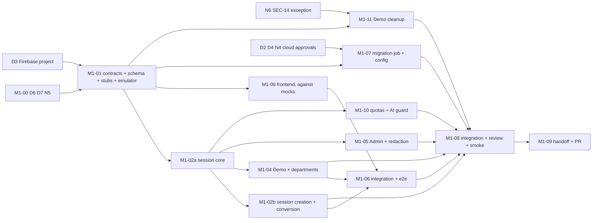

# M1 task board

**Status:** Approved (OPEN-26); local implementation in progress. The plan is in `plan.md`. Cloud, Firebase Console, production database, QStash schedule, Admin provisioning, billing, deployment and merge actions need separate Owner authorization. The Owner keeps this board current at meaningful changes, not every commit (WF-10). Acceptance criteria M1-AC01..AC17 and the Definition of Done (M1-EX1..6) are defined in `plan.md`. Architecture inputs: OPEN-24 (Firebase Authentication, Email OTP removed) and OPEN-25 (24 h sessions, Firebase Anonymous Try Demo, conversion, retention, department persistence, limits, test strategy).

## Board
| ID | Objective | Depends on | Workstream | Status |
|---|---|---|---|---|
| M1-00 | Owner decisions and approvals (OPEN-26) | none | User | done; cloud executions still need separate authorization |
| M1-01 | Contracts, ADRs, schema migration `0002`, models, route stubs and OpenAPI, shared interfaces, fixtures, emulator setup | M1-00 | Owner | in progress |
| M1-02a | Session core: 24 h absolute sessions, identity dependency, cookie, CSRF + Origin, Postgres limiter, Firebase Admin token verifier | M1-01 | Backend-Auth | not started |
| M1-02b | Session creation, `me`, logout, revoke-all, Demo → Registered conversion, `users` rows, provider and Admin rules, linking conflict guard, audit | M1-02a | Backend-Auth | not started |
| M1-03 | *Retired (Email OTP removed by OPEN-24). The ID is not reused.* | n/a | n/a | retired |
| M1-04 | Demo start and identity, departments, persisted active department, 409 | M1-02a | Backend-Identity | not started |
| M1-05 | Admin provisioning, Admin guard, SEC-03/17 and AUTH-04 tests, log-redaction tests | M1-02a, D4 | Backend-Identity | not started |
| M1-06 | Frontend: (a) SDK, session, guards; (b) login, signup, verification; (c) action pages, reset, linking; (d) Try Demo, departments; (e) conversion UI | M1-01 (mocks); M1-02b and M1-04 for e2e | Frontend | not started |
| M1-07 | Migration job, secrets, deploy wiring, Firebase configuration export, QStash daily schedule | M1-01; D2, D3, D4, N4; apply needs the user's approval | Infrastructure | not started |
| M1-08 | Integration, full e2e, deployed smoke, real-Firebase smoke, independent security review, traceability | M1-02b, 04, 05, 06, 07, 10, 11 | Owner + Review Agent | not started |
| M1-09 | M1 handoff and the milestone PR | M1-08 | Owner | not started |
| M1-10 | Quota service, global AI guard and kill switch, 429/503 behavior | M1-02a, N1 | Backend-Limits | not started |
| M1-11 | Demo cleanup (idempotent, bounded) and its signed Worker endpoint | M1-01, N6 | Backend-Limits | not started |

## Dependency graph

**Critical path:** M1-00 → M1-01 → M1-02a → M1-02b → frontend integration → M1-08 → M1-09. The cloud path (D2, D3, D4, N4 → M1-07 → apply and console setup → deployed and real-Firebase smoke) can finish later than the code, so those answers are the biggest schedule lever.

**Genuinely parallel:** M1-06, M1-07, M1-11 and M1-02a once M1-01 has merged; M1-02b, M1-04 then M1-05, and M1-10 after M1-02a.
**Blocked:** M1-02a/b, 04, 05, 10 on the session core; M1-06 integration on 02b and 04; M1-11 on N6; the deployed smoke on M1-07, the Firebase project and the user's apply.

## Workstreams, file ownership and branches
The milestone branch is `m1/integration` (worktree `worktrees/m1`). Each task gets its own branch `m1/<id>-<slug>` in its own worktree `worktrees/m1-<slug>` (root rules; never elsewhere). The Owner uses a trial-integration worktree `worktrees/m1-trial` (WF-07).

| Workstream | Branch | Owns (writes) |
|---|---|---|
| Owner (M1-01, integration) | `m1/integration` | `docs/contracts/`, `docs/adr/`, `docs/milestones/M1/`, `AGENTS.md`, revision `0002`, `knowserve_core` models, audit, interfaces, fixtures, `app.py` registration, `openapi.json`, lockfiles at integration |
| Backend-Auth | `m1/02-auth-core` | `knowserve_api/auth/`, limiter and verifier implementations |
| Backend-Identity | `m1/04-identity` | `knowserve_api/demo/`, `departments/`, `admin/`, Admin provisioning command |
| Backend-Limits | `m1/11-limits` | `knowserve_core/demo_cleanup.py`, the Worker maintenance endpoint, `knowserve_core/quotas.py`, the AI guard |
| Frontend | `m1/06-frontend` | `apps/frontend/` auth feature, router, provider, Firebase init, tests, e2e specs |
| Infrastructure | `m1/07-infra` | `infra/terraform/` additions, migration-job wiring in `deploy.yml`, Firebase setup notes, the QStash schedule |
| Independent review | read-only | none |

Conflict rules: lockfiles and `openapi.json` are never hand-merged (rebase and regenerate); only the Owner writes migrations; contracts and config keys change only with Owner approval and notice to dependent agents first (WF-03).

## Integration order and PR strategy
1. CP1 M1-01 into `m1/integration`; every task branch forks from it.
2. CP2 M1-02a (independent review first), which unblocks the parallel group.
3. CP3 M1-02b, M1-04+05, M1-10, M1-11 as each passes its gates (any order); independent review for M1-02b and M1-11.
4. CP4 M1-07 after `terraform plan` review (independent review); the apply needs the user's approval.
5. CP5 M1-06 screens against the real API, then Playwright in the trial worktree.
6. CP6 M1-08 full verification, deployed smoke, real-Firebase smoke, final review.
7. CP7 M1-09 handoff and the single milestone PR to `main` for the user's approval (WF-13).

Two PRs in total: the docs PR with this plan (for approval before agents start) and **one milestone PR**. Agent branches merge locally. The milestone PR is opened as a Draft early so CI runs on integration merges (OPEN-22) and is the same PR that is marked ready for final review; there is no extra integration PR.

## Handoff (agent → Owner, WF-08)
Each handoff provides: branch and commit; files and contracts touched; the commands run, with their actual output summary; the test IDs added, named with requirement ids (TEST-07); risks, known gaps, integration notes. The Owner re-runs the checks in the trial worktree and does not rely on a "tests pass" claim. Blockers get bounded attempts, then escalate with the options (WF-09).

## Quality gates
- **Every merge into `m1/integration`:** CI green for the touched packages, contract diff clean or approved, the slice's required tests present with requirement ids, security tests as hard gates (no skips).
- **Independent Review Agent (required):** M1-02a, M1-02b, M1-11, M1-07, and M1-08 (final cross-cutting pass).
- **Milestone PR:** the Definition of Done (M1-EX1..6), the TEST-03 traceability table, and user approval.

## Tasks

### M1-00 Owner decisions and approvals
- **Objective:** settle what blocks the start and the cloud work.
- **Deliverables:** the final decisions recorded as OPEN-26 (`../../open-decisions.md`) and in `plan.md`.
- **Acceptance:** done 2026-11-06. Cloud executions (Firebase Console, Terraform apply, Secret Manager, IAM, production Neon, QStash schedule, Admin provisioning, billing, deployment, merge) each still need separate Owner authorization.
- **Blocking risks:** none for local work.

### M1-01 Contracts, schema and shared interfaces
- **Objective:** freeze the minimal contracts so the slices run in parallel.
- **Deliverables:** ADRs listed in `plan.md`; revision `0002` (`users`, `sessions`, `departments`, `audit_events`, `rate_limit_counters`, `usage_counters`, `ai_budget`; no password column); `501` route stubs and regenerated `openapi.json` and TS types; `docs/contracts/auth-session.md`; updated `api.md`, `config-and-deploy.md`, `jobs-outbox.md`; `audit.record`, `TokenVerifier`, `RateLimiter`, `QuotaService` interfaces; fixtures (emulator token factory, session factory, fake clock); the emulator in `compose.yaml` or the recorded fallback; Firebase behavior assumptions (anonymous linking, claims after linking) recorded as emulator-verified tests and as items for the real-Firebase smoke.
- **Acceptance:** M1-AC10 (stubs and envelope); contract set approved by the Owner.
- **Verification:** `uv run alembic upgrade head` on an empty database; `uv run pytest`; `pnpm -r typecheck`; `check:api` shows no drift.
- **Integration point:** CP1.
- **Blocking risks:** D3 (project id); keep the contracts minimal.

### M1-02a Session core
- **Objective:** the shared base every other backend slice uses.
- **Deliverables:** session create/lookup/revoke with hashed tokens and an absolute 24 h `expires_at`; cookie attributes; `get_identity` and the Admin/registered/department dependencies; CSRF token and Origin check; Postgres rate limiter; the Firebase Admin verifier (signature, issuer, audience, expiry, freshness, provider rules, key outage fails closed, emulator refused in production).
- **Acceptance:** M1-AC04, AC07 (part), AC13 (part); AUTH-06, 10, 14, 18, 30.
- **Verification:** `uv run pytest -m "m1 and auth"`: expiry at 24 h ± 1 s with a fake clock, no extension by use, CSRF/Origin matrix, concurrent limiter calls, forged/expired/wrong-audience/stale tokens, production refusing the emulator.
- **Integration point:** CP2; independent review required.
- **Blocking risks:** key-fetch behavior on Cloud Run with scale to zero.

### M1-02b Session creation, conversion and identity
- **Objective:** sign in with a Firebase ID token and convert a Demo.
- **Deliverables:** `POST /v1/auth/session`, `GET /v1/auth/me`, `POST /v1/auth/logout`, `POST /v1/auth/sessions/revoke-all`, `POST /v1/auth/convert`; `users` row creation by uid; `EMAIL_NOT_VERIFIED`; provider allow-list; Admin only via `password`; unique-email conflict guard; conversion as one idempotent transaction with a new session; `401 REAUTH_REQUIRED` for a valid but stale token; audit events.
- **Acceptance:** M1-AC01, AC03, AC05 (API side), AC06, AC13, AC15 (identity continuity and fixture records); AUTH-01, 04, 06..09, 13, 21, 29..34.
- **Verification:** `uv run pytest -m "m1 and auth"` with emulator tokens: conversion twice on fixture records in two departments, conversion after a lost call, conversion racing cleanup, credential already owned by another uid, Demo → Admin email; verification later than 5 minutes followed by reauthentication, with the session expiring 24 h after its own creation; log-capture test for tokens, cookies and CSRF values.
- **Integration point:** CP3; independent review required.
- **Blocking risks:** Firebase claim behavior after anonymous linking (M1-01 check).

### M1-04 Demo and departments
- **Objective:** anonymous Demo users and department selection.
- **Deliverables:** `POST /v1/demo/start` (anonymous token only, 5/h/IP, `DEMO_EXPIRED`), Demo identity and session, `GET /v1/departments`, `PUT /v1/session/department`, persistence in `users.last_active_department_id`, restore at login, 409 `ACTIVE_DEPARTMENT_REQUIRED`.
- **Acceptance:** M1-AC08, AC14; AUTH-16, 17, 20, SEC-10, SEC-16 (M1 part).
- **Verification:** two Demo users isolated; expired Demo refused; every department selectable; last department restored on the next session; selection grants nothing; creation above the limit gives 429.
- **Integration point:** CP3.
- **Blocking risks:** D6 (names).

### M1-05 Admin identity and redaction
- **Objective:** the single Admin and the hard gates.
- **Deliverables:** one-time idempotent provisioning command (uid and email from configuration), `require_admin`, a test Admin-only route, the AUTH-04 matrix, SEC-03/17 tests, logging-redaction tests.
- **Acceptance:** M1-AC09, AC06; AUTH-04, 11, SEC-01, 03, 17, MON-05.
- **Verification:** the AUTH-04 matrix (another uid with the Admin email, a Google-provider token, a `role: admin` payload, provisioning twice); non-Admin and Demo 403.
- **Integration point:** CP3.
- **Blocking risks:** D4.

### M1-06 Frontend auth
- **Objective:** the login experience on the generated client.
- **Deliverables:** (a) Firebase init with session persistence, session creation, `AuthProvider` from `me`, route guards, CSRF client, 401/409/429/503 handling; (b) one login screen with email + password, Continue with Google, Forgot password, Sign up, Try Demo; signup and the verification state; (c) `/auth/action` for verification and reset (verification starts no session; reauthenticate or log in), reset request, the linking flow, the "confirm it is you" step on `REAUTH_REQUIRED`; (d) Try Demo, Demo Mode indicator with time left, department selector with restore and first-login requirement; (e) create account from Demo with the pending, collision and success states.
- **Acceptance:** M1-AC01, AC03, AC05, AC08, AC14, AC15 (UI side); FE-AUTH-01..09, 11..13.
- **Verification:** `pnpm -r lint|format:check|typecheck|test|build`; about six Playwright flows against the emulator.
- **Integration point:** CP5.
- **Blocking risks:** Google popup on `pages.dev`; emulator in CI.

### M1-07 Migration job, secrets, Firebase configuration, schedule
- **Objective:** migrations that the deployer cannot read secrets for, the documented Firebase setup, and the daily trigger.
- **Deliverables:** Terraform for the `knowserve-migrate` Cloud Run job, its service account and `migration-database-url` secret container; `deploy.yml` runs the job (the deployer reads no secret); Admin provisioning run through the job; `KS_FIREBASE_PROJECT_ID` and public frontend variables wired; Firebase console steps and an exported configuration; the QStash daily schedule (created only after N4).
- **Acceptance:** M1-AC11, AC16 (trigger), part of AC12.
- **Verification:** `terraform fmt -check`, `validate`, `plan` reviewed for secret values; after approval, a job run log, IAM inspection and the schedule listing.
- **Integration point:** CP4; independent review required.
- **Blocking risks:** D2, D3, D4, N4; applies are the user's cloud action; Terraform coverage of Firebase is unverified, so manual steps are documented, not worked around.

### M1-08 Integration, smoke and security review
- **Objective:** evidence for the milestone PR.
- **Deliverables:** full CI; the Playwright flows; the deployed smoke through the Pages proxy (M1-AC12); the real-Firebase smoke (Google OAuth, verification and reset mail, password policy, anonymous provider); the independent review summary; the TEST-03 traceability table for every M1-AC and M1-tagged requirement.
- **Acceptance:** every M1-AC has evidence or an explicit, user-visible gap; M1-EX1..5.
- **Verification:** the Owner re-runs full CI in the trial worktree.
- **Integration point:** CP6.
- **Blocking risks:** the deployed smoke needs M1-07 applied and the Firebase project set up.

### M1-09 Handoff and milestone PR
- **Objective:** WF-12 handoff and the user's approval of the PR.
- **Deliverables:** `handoff.md` (implemented state, the M4 criteria that complete M1 evidence (CHAT-18, CHAT-19), contracts, evidence, merged SHA, ADRs, limitations, notes for M2); `open-decisions.md` updated (OPEN-05, 23, 24, 25 evidence); the specs' "Current implementation / Known gaps" updated (WF-15).
- **Acceptance:** M1-EX6; the existing milestone PR (opened as a Draft at the first integration merge) is marked ready for the user's approval; deploy follows on merge.

### M1-10 Quotas and AI guard
- **Objective:** the limits mechanism that chat will use in M4.
- **Deliverables:** `QuotaService` with atomic per-user per-UTC-day counters (Demo 20, Registered 100, Admin 100, all configurable), global daily total, kill switch and `AI_UNAVAILABLE` behavior, 429 responses with retry time, a test-only protected route to exercise them; Demo creation limit configuration shared with M1-04.
- **Acceptance:** M1-AC17; AUTH-15, 36, COST-02, COST-03 (mechanism).
- **Verification:** boundary at the 21st/101st question, UTC day rollover with a fake clock, concurrent consumption near a limit, a converted user keeping one counter, the kill switch leaving sign-in and the library working.
- **Integration point:** CP3.
- **Blocking risks:** N1 (the global threshold default).

### M1-11 Demo cleanup
- **Objective:** remove unconverted Demo data after 48 h without ever touching converted data.
- **Deliverables:** a bounded, idempotent cleanup function that deletes `demo` users older than 48 h with their dependents, re-checking the kind inside the transaction; the Worker maintenance endpoint (valid QStash signature, parameterless, no job row; pending N6); counts-only logging and an audit entry.
- **Acceptance:** M1-AC16; AUTH-35, SEC-14 (exception).
- **Verification:** 47 h and 49 h rows, a converted row, a race with conversion, two consecutive runs, a failing batch that resumes, unsigned and badly signed calls rejected.
- **Integration point:** CP3; independent review required.
- **Blocking risks:** N6; the dependents rule for later chat tables (recorded in an ADR).
