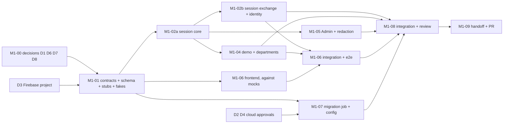

# M1 task board

**Status:** Planned, **not started**. The plan (graph, contracts, allocation, decisions D1..D8) is in `plan.md` and awaits the user's approval; nothing below is implemented and no implementation agent has been started. The Owner keeps this board current at meaningful changes, not every commit (WF-10). Acceptance criteria M1-AC01..AC12 are defined in `plan.md`. Authentication uses Firebase Authentication with Email/Password and Google, plus KnowServe's own opaque sessions (OPEN-24). Email OTP is removed.

## Board
| ID | Objective | Depends on | Workstream | Status |
|---|---|---|---|---|
| M1-00 | User decisions D1..D8, Firebase project setup (D3), cloud approvals | none | User | open; D0 settled (OPEN-24) |
| M1-01 | Contracts, ADRs, schema migration `0002`, models, route stubs and OpenAPI, shared interfaces, fakes, Firebase documentation check | M1-00 (D1, D3 project id, D6, D7, D8) | Owner | not started |
| M1-02a | Session core: sessions, identity dependency, cookie, CSRF + Origin, Postgres rate limiter, Firebase token verifier | M1-01 | Backend-Auth | not started |
| M1-02b | Session exchange, `me`, logout, revoke-all, `users` rows, provider and Admin rules, linking conflict guard, audit | M1-02a | Backend-Auth | not started |
| M1-03 | *Retired (Email OTP removed by OPEN-24). The ID is not reused.* | n/a | n/a | retired |
| M1-04 | Try Demo, departments, active department and switch, 409, purge | M1-02a, D5 | Backend-Identity | not started |
| M1-05 | Admin seed command, Admin guard, SEC-03/17 tests, log-redaction tests | M1-02a, D4 | Backend-Identity | not started |
| M1-06 | Frontend auth: (a) Firebase SDK, exchange, guards, CSRF client; (b) login screen with both methods, signup, verification; (c) action pages, reset, linking; (d) Try Demo and department selector | M1-01 (mocks); M1-02b and M1-04 for e2e | Frontend | not started |
| M1-07 | Migration job, secrets, deploy wiring, Firebase configuration notes and export | M1-01; D2, D3, D4; apply needs the user's approval | Infrastructure | not started |
| M1-08 | Integration, full e2e, deployed smoke, independent security review, traceability | M1-02b, 04, 05, 06, 07 | Owner + Review Agent | not started |
| M1-09 | M1 handoff and milestone PR | M1-08 | Owner | not started |

## Dependency graph

**Critical path:** M1-00 → M1-01 → M1-02a → M1-02b → frontend integration → M1-08 → M1-09. The cloud/account path (D2, D3, D4 → M1-07 → apply and Firebase console setup → deployed smoke) can finish later than the code, so those answers are the biggest schedule lever.

**Genuinely parallel:** M1-06 and M1-07 once M1-01 has merged; after M1-02a, M1-02b and M1-04+05.
**Blocked:** M1-02a/b, 04, 05 wait for M1-01 and (02b, 04, 05) for M1-02a; M1-06 integration waits for 02b and 04; the deployed smoke waits for M1-07, the Firebase project and the user's apply.

## Workstreams, file ownership and branches
The milestone branch is `m1/integration` (worktree `worktrees/m1`). Each task gets its own branch `m1/<id>-<slug>` in its own worktree `worktrees/m1-<slug>` (root rules; never elsewhere). The Owner uses a trial-integration worktree `worktrees/m1-trial` (WF-07).

| Workstream | Branch | Parallel? | Owns (writes) |
|---|---|---|---|
| Owner (M1-01, integration) | `m1/integration` | n/a | `docs/contracts/`, `docs/adr/`, `docs/milestones/M1/`, `AGENTS.md`, revision `0002`, `knowserve_core` models, audit, interfaces and fakes, `app.py` registration, `openapi.json`, lockfiles at integration |
| Backend-Auth | `m1/02-auth-core` | after M1-01 | `knowserve_api/auth/`, limiter and verifier implementations |
| Backend-Identity | `m1/04-identity` | after M1-02a | `knowserve_api/demo/`, `departments/`, `admin/`, Admin seed command |
| Frontend | `m1/06-frontend` | after M1-01 | `apps/frontend/` auth feature, router, provider, Firebase init, tests, e2e specs |
| Infrastructure | `m1/07-infra` | after M1-01 | `infra/terraform/` additions, migration-job wiring in `deploy.yml`, Firebase setup notes |
| Independent review | read-only | at gates | none |

Conflict rules: lockfiles and `openapi.json` are never hand-merged (rebase and regenerate); only the Owner writes migrations; contracts and config keys change only with Owner approval and notice to dependent agents first (WF-03).

## Integration order
1. M1-01 into `m1/integration`; every task branch forks from it.
2. M1-02a (independent review first), which unblocks the parallel group.
3. M1-02b and M1-04+05 as each passes its gates (any order); M1-02b gets an independent review.
4. M1-07 after `terraform plan` review (independent review of IAM and secrets); the apply needs the user's approval.
5. M1-06 screens against the real API, then the e2e in the trial worktree.
6. M1-08 full verification and the final security review.
7. M1-09 handoff and the milestone PR to `main` for the user's approval (WF-13).

## Handoff (agent → Owner, WF-08)
Each handoff provides: branch and commit; files and contracts touched; the commands run, with their actual output summary; the test IDs added, named with requirement ids (TEST-07); risks, known gaps, integration notes. The Owner re-runs the checks in the trial worktree and does not rely on a "tests pass" claim. Blockers get bounded attempts, then escalate with the options (WF-09).

## Quality gates
- **Every merge into `m1/integration`:** CI green for the touched packages, contract diff clean or approved, the slice's required tests present with requirement ids, security tests as hard gates (no skips).
- **Independent Review Agent (required):** M1-02a (session, cookie, CSRF, limiter, verifier), M1-02b (exchange, providers, Admin rules, linking), M1-07 (IAM, secrets, migration job), M1-08 (final cross-cutting pass).
- **Milestone PR:** full CI, every M1-AC with evidence or an explicit gap, the TEST-03 traceability table, and user approval.

## Tasks

### M1-00 User decisions and prerequisites
- **Objective:** settle what blocks the start and the cloud work.
- **Deliverables:** answers to D1 (OPEN-05 values), D2 (migration job), D3 (Firebase project and console setup), D4 (Admin account and `uid`), D5 (purge), D6 (departments), D7 (plan refinements), D8 (Firebase consequences). The Firebase project exists with providers enabled (D3).
- **Acceptance:** recorded in `../../open-decisions.md` (OPEN-23 resolved, OPEN-05 M1 part moved to resolved).
- **Blocking risks:** account and cloud actions are the user's; code work does not wait for D2/D4 but the deployed smoke does.

### M1-01 Contracts, schema and shared interfaces
- **Objective:** freeze the minimal contracts so the slices run in parallel.
- **Deliverables:**
  - ADR-M1-01..07 (`plan.md`)
  - revision `0002`: `users`, `sessions`, `visitors`, `departments` (seeded), `audit_events`, `rate_limit_counters`; no password column
  - route stubs (`501`) for every M1 route, regenerated `openapi.json`, and the generated TS types
  - `docs/contracts/auth-session.md`; updated `api.md` and `config-and-deploy.md` with the M1 `KS_*` and `VITE_FIREBASE_*` keys
  - `audit.record`, `TokenVerifier` + `FakeTokenVerifier`, `RateLimiter` interface, `EmailSender` is **not** needed
  - test fixtures (session factory)
  - a check of current Firebase documentation for linking, enumeration protection, the password policy and unverified accounts, reported to the user; spec edits if it differs
- **Acceptance:** M1-AC10 (stubs and envelope); contract set approved by the Owner.
- **Verification:** `uv run alembic upgrade head` on an empty database; `uv run pytest`; `pnpm -r typecheck`; `check:api` shows no drift.
- **Integration point:** first merge into `m1/integration`.
- **Blocking risks:** D3 (project id) and D8; keep the contracts minimal.

### M1-02a Session core
- **Objective:** the shared base every other backend slice uses.
- **Deliverables:** session create/lookup/revoke with hashed tokens; cookie attributes; `get_identity` and the Admin/department dependencies; CSRF token and Origin check (AUTH-14); Postgres rate limiter; the real `TokenVerifier` (signature, issuer, audience, expiry, `auth_time`, key caching, fail closed).
- **Acceptance:** M1-AC07 (part), AC04 (verifier part); AUTH-06, 10, 14, 15 (limiter), 18, 30 (verifier).
- **Verification:** `uv run pytest -m "m1 and auth"`: expired/tampered sessions, CSRF and Origin matrix, limiter under concurrent calls, verifier with forged/expired/wrong-audience tokens, fail-closed when keys are unavailable.
- **Integration point:** merged early; independent review required.
- **Blocking risks:** key-fetch behavior on Cloud Run with scale to zero.

### M1-02b Session exchange and identity
- **Objective:** log in with a Firebase ID token and manage the session.
- **Deliverables:** `POST /v1/auth/session`, `GET /v1/auth/me`, `POST /v1/auth/logout`, `POST /v1/auth/sessions/revoke-all`; `users` row creation by `uid`; `EMAIL_NOT_VERIFIED` (403); provider allow-list; Admin only via the `password` provider; unique-email conflict guard; audit events.
- **Acceptance:** M1-AC01 (API side), AC03 (API side), AC04, AC05 (API side), AC06; AUTH-01, 04, 06..09, 13, 21, 29..33.
- **Verification:** `uv run pytest -m "m1 and auth"` with the fake verifier; log-capture test that no ID token, cookie or CSRF value is logged.
- **Integration point:** after M1-02a; independent review required.
- **Blocking risks:** Firebase documentation check from M1-01 (linking and unverified accounts).

### M1-04 Try Demo and departments
- **Objective:** anonymous visitors and department selection.
- **Deliverables:** `POST /v1/demo/start` (no Firebase), visitor identity and session, expiry and bounded opportunistic purge, active-visitor cap, `GET /v1/departments`, `PUT /v1/session/department`, 409 `ACTIVE_DEPARTMENT_REQUIRED`.
- **Acceptance:** M1-AC08; AUTH-16, 17, 20, SEC-10, SEC-16 (M1 part).
- **Verification:** two visitors isolated; expired visitor 401 and purged; every department selectable; switch clears the previous context; creation above the limit and the cap fails closed.
- **Integration point:** after M1-02a.
- **Blocking risks:** D5 (purge) and D6 (departments).

### M1-05 Admin identity and redaction
- **Objective:** the single Admin and the hard gates.
- **Deliverables:** seed command (`KS_ADMIN_FIREBASE_UID`, `KS_ADMIN_EMAIL`), idempotent; `require_admin`; a test Admin-only route; SEC-03/17 and AUTH-04 tests; logging-redaction tests for tokens, cookies and CSRF values.
- **Acceptance:** M1-AC09, AC06; AUTH-04, 11, SEC-01, 03, 17, MON-05.
- **Verification:** the AUTH-04 matrix (another `uid` with the Admin email, a Google-provider token, a `role: admin` payload); non-Admin 403 on Admin routes.
- **Integration point:** after M1-02a.
- **Blocking risks:** D4 (Admin account).

### M1-06 Frontend auth
- **Objective:** the login experience on the generated client.
- **Deliverables:** (a) Firebase init (least-persistent storage), the exchange call, `AuthProvider` hydrating from `me`, route guards, CSRF header in the client, 401 and 409 handling; (b) one login screen with email + password, Continue with Google and Try Demo; signup and the verification state; (c) `/auth/action` for verification and reset (success/expired/invalid), reset request, the linking flow; (d) Try Demo entry, Demo Mode indicator, department selector.
- **Acceptance:** M1-AC01 (e2e), AC03 (e2e), AC05 (component), AC08 (e2e); FE-AUTH-01..09, 11, 12.
- **Verification:** `pnpm -r lint|format:check|typecheck|test|build`; Playwright against the API with the fake verifier or the emulator (ADR-M1-07).
- **Integration point:** screens merge after 02b and 04.
- **Blocking risks:** Google popup behavior on `pages.dev`; emulator in CI.

### M1-07 Migration job, secrets and Firebase configuration
- **Objective:** migrations that the deployer cannot read secrets for, and the documented Firebase setup.
- **Deliverables:** Terraform for the `knowserve-migrate` Cloud Run job, its service account, `migration-database-url` secret container and bindings; `deploy.yml` executes the job (no secret read by the deployer); Admin seed run through the job; `KS_FIREBASE_PROJECT_ID` and the public frontend variables wired; Firebase console steps and an exported configuration in `infra/terraform/README.md`.
- **Acceptance:** M1-AC11, part of AC12.
- **Verification:** `terraform fmt -check`, `validate`, `plan` reviewed for secret values; after approval, a job run log and IAM inspection.
- **Integration point:** Terraform merged after `plan` review; independent review required.
- **Blocking risks:** D2/D3/D4; the apply is the user's cloud action; Terraform coverage of Firebase is unverified, so manual steps are documented, not worked around.

### M1-08 Integration, deployed smoke and security review
- **Objective:** evidence for the milestone PR.
- **Deliverables:** full CI, the e2e, the deployed smoke through the Pages proxy against the real Firebase project (M1-AC12), the manual checklist (Google sign-in, verification and reset mail), the independent review summary, the TEST-03 traceability table for every M1-AC and M1-tagged requirement.
- **Acceptance:** every M1-AC has evidence or an explicit, user-visible gap.
- **Verification:** the Owner re-runs full CI in the trial worktree.
- **Integration point:** milestone PR to `main`.
- **Blocking risks:** the deployed smoke needs M1-07 applied and the Firebase project set up.

### M1-09 Handoff and milestone PR
- **Objective:** WF-12 handoff and the user's approval of the PR.
- **Deliverables:** `handoff.md` (implemented state, contracts, evidence, merged SHA, ADRs, limitations, notes for M2); `open-decisions.md` updated (OPEN-05 M1 part, OPEN-23, OPEN-24 evidence); specs' "Current implementation / Known gaps" updated (WF-15).
- **Acceptance:** the PR is open for the user's approval; deploy follows on merge.
