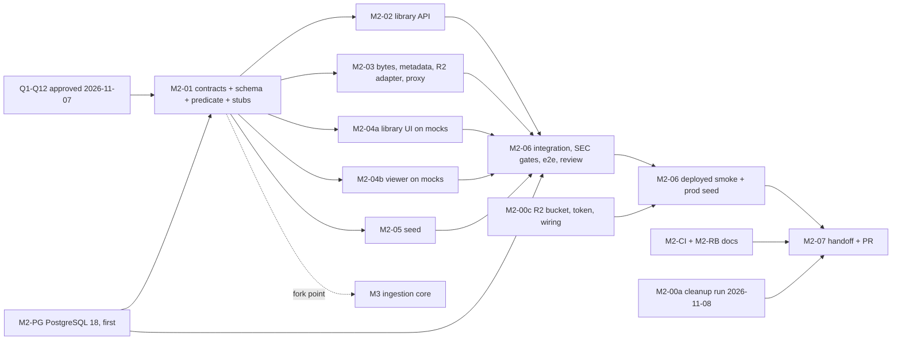

# M2: Documents Library and Access

Status: approved by the Owner on 2026-11-07 (decisions Q1 to Q12, recorded as OPEN-28 in `../../open-decisions.md`). Only M2-PG is authorized for local implementation so far; the next checkpoint is M2-01. Nothing here authorizes cloud actions, `git push`, a merge, a deployment or a production data change; each needs separate approval. The task board is `tasks.md`. Normative requirements stay in the specs; this plan adds the scope, acceptance criteria, contracts, access model, schema, risks and owner actions. The roadmap section is `../ROADMAP.md` (section 4); where this plan and the roadmap table differ, this plan owns the final allocation (A2).

Anything I inferred and did not find in the specs is marked "Assumption" and collected in section 13. Approved decisions and the questions that remain are in section 12.

## 1. Goal

An authenticated user, or a Demo visitor, sees only the ready documents their active department may read, and opens them in a protected PDF viewer. Authorization for documents is enforced and tested before any content arrives through ingestion (M3). Ownership never grants access; only explicit `document_department_access` rows do.

## 2. Where M2 starts

| Area | State on `main` (182bc0d) | Source |
|---|---|---|
| Schema | Revisions `0001` (jobs, outbox, spike table) and `0002_m1_identity` (users, sessions, departments, audit events, counters). No document, revision or access tables. | `packages/backend_core/migrations/versions/` |
| Identity | Session dependency, active department with 409 `ACTIVE_DEPARTMENT_REQUIRED`, Admin guard, CSRF and Origin checks, error envelope. | M1 handoff, `docs/contracts/auth-session.md` |
| Object storage | No storage interface, no R2 settings, no R2 bucket in Terraform (M0 spike finding F7). Never exercised end to end. | `M0/spike-report.md`, `infra/terraform/` |
| Pages proxy | `apps/frontend/functions/api/[[path]].ts` forwards a fixed list of request headers. `range` and `if-range` are not on it (read from the code, not run). Response headers other than hop-by-hop ones pass through, so `content-range` and `accept-ranges` would survive. | `functions/api/[[path]].ts` |
| Frontend | Routes `/`, `/auth/action`, `/login`, `/dashboard`. TanStack Query is installed. React-PDF is not a dependency. No documents feature. | `apps/frontend/src/app/routes.tsx`, `package.json` |
| E2E | Smoke, mocked smoke, proxy and auth flows exist. `ci.yml` does not run Playwright on PRs. | `docs/workflow/testing.md` |
| CI database | `pgvector/pgvector:pg16` in CI and Compose; Neon is 18.6. | ADR 0002, `testing.md` |
| Demo cleanup | The 2026-11-07 03:00 UTC run was rejected (401). Cause found: the QStash schedule destination host differed from the Worker's `KS_WORKER_PUBLIC_URL`. Fixed in production. The handoff update is PR #31, owned by another session. | roadmap section 3, owner report |
| Client IPs | `audit_events.ip` exists (migration `0002`) and the auth and Demo routes write it through `audit.record(..., ip=...)`. The Demo-start rate limit keys `rate_limit_counters.key` as `demo:ip:<address>`, so an address is stored in plain text until a pruning rule removes the row (none found in the code). The Pages Function forwards `CF-Connecting-IP` as `X-KS-Client-IP`. The audit logger and `redact` do not log the address (read from `audit.py`, not re-run). A spike-only echo route can return it and is off by default. Production contents were not read. | `audit.py`, `demo/router.py`, `0002_m1_identity.py`, `proxy_guard.py` |

## 3. Scope

In scope, with requirement ids as they appear in the specs.

| Area | Requirements |
|---|---|
| Library read path | DOC-01, DOC-03, DOC-05, DOC-07, DOC-08, DOC-10 |
| Bytes and metadata | DOC-04, DOC-09 (M2 part: filename, page count, page range check) |
| Access model | SEC-02, SEC-04, SEC-05, SEC-06, SEC-07, SEC-09 (documents part), SEC-10 and SEC-17 (document halves), LIFE-02 (library side) |
| Storage | ARCH-14 (thin storage interface, no public object URLs), STACK-21 |
| Frontend | FE-DOC-01 to FE-DOC-09, PROD-05 (library entry), PROD-06, PROD-07 |
| Schema | ARCH-11 (migration `0003`), `backend/documents.md` data model |
| Decisions in force | D1 (3 to 5 seeded fictional PDFs), D2 (OPEN-22 decision, OPEN-27 proposal), D5 (PostgreSQL 18), A7 (verify the R2, Cloud Run and Pages delivery path, fix only demonstrated gaps), A4 (numbering from actual history) |
| Carry-overs | Demo cleanup confirmation, M0-AC09 cost evidence (owner), rollback note, E2E placement (TEST-13), client-IP privacy (SEC-18, Q9) |

Out of scope: upload, ZIP and ingestion (M3), chunks and vectors (M3), chat and citation links beyond the metadata endpoint (M4), delete and replace (M5), the Admin document list (ADM-02, M3), DEF-01 (a varied fictional corpus). CHAT-18 and CHAT-19 belong to M4. The seed is not the Golden Dataset.

## 4. Definition of Done

| ID | Exit criterion |
|---|---|
| M2-EX1 | Every acceptance criterion in section 5 has evidence, or an explicit gap the user has seen (TEST-03 traceability table). |
| M2-EX2 | CI is green on the milestone branch, security tests run as hard gates with no skips, no committed secrets. |
| M2-EX3 | The independent review points in section 10 are done and no Critical or High finding is open (WF-11). |
| M2-EX4 | Migration `0003` is applied in production through the migration job under the `production` approval, the 3 to 5 seeded documents are present, and the deployed smoke (M2-AC16) passes. |
| M2-EX5 | The specs are true: DOC, SEC, LIFE-02, FE-DOC and PROD rows, their "Current implementation / Known gaps" sections, and `testing.md` match the code (WF-15). |
| M2-EX6 | The handoff exists (WF-12) and the user approves the milestone PR (WF-13). |

## 5. Acceptance criteria

AC01 to AC12 come from the roadmap list and keep its order where possible. AC13 to AC22 make the roadmap's security tests, carry-overs and the decisions of 2026-11-07 (Q3, Q7, Q9) checkable. Test level names follow `testing.md`.

| ID | Criterion | Evidence | Covers |
|---|---|---|---|
| M2-AC01 | A caller sees only documents that are not soft-deleted, have a current revision with status `ready`, and have an access row for the active department. Candidate, queued, processing and failed states are never listed. Pagination applies after the predicate, search and filter: every visible document appears exactly once across pages, in a stable order, and a filtered-out or forbidden document never appears on any page. | integration on real PostgreSQL | DOC-01, SEC-05, SEC-07, LIFE-02 |
| M2-AC02 | Ownership never grants access: a document owned by A and allowed only to B is not listed, not searchable and returns 404 on bytes and metadata for a caller active in A. | integration | SEC-04, DOC-07 |
| M2-AC03 | Forbidden, unknown, not-ready, not-current, soft-deleted and malformed ids return the same 404 (same status, code, message and headers; only `request_id` differs). No session gives 401. | integration, response comparison | SEC-02, DOC-05, SEC-01 |
| M2-AC04 | No active department gives 409 `ACTIVE_DEPARTMENT_REQUIRED` with no document data, for a registered user, a Demo visitor and the Admin. No fallback to "all documents". | integration | DOC-03, SEC-17 |
| M2-AC05 | Revoking an access row or soft deleting is effective on the next request to list, bytes and metadata. No server cache can serve stale access. | integration (revoke, then request) | DOC-10, SEC-09 (documents) |
| M2-AC06 | Route walk: every route that returns document bytes or metadata applies the shared visibility predicate, checked against the matrix {allowed, forbidden, deleted, not ready}. A new route that does not apply it fails the test. | integration plus route-registry test | SEC-06 |
| M2-AC07 | Filename search and owner filter return the intersection, inside the visible set only, with cursor pagination (`limit`, opaque `cursor`, `items`, `next_cursor`, `has_more`, no total count). Filter options come from the API. The UI has a "Load more" button and resets the cursor when the filter, identity or department changes. | integration, component | DOC-08, FE-DOC-03, FE-DOC-06, FE-DOC-10 |
| M2-AC08 | The bytes endpoint streams the current ready revision through the API from the object store (faked in tests): `application/pdf`, private no-store caching, no storage or public URL in any response body or header. A valid single range returns 206 with `Content-Range`; an unsatisfiable one returns 416; multiple ranges are not supported; authorization is rechecked on every request including each range request; the proxy forwards `Range` and `If-Range`. | integration with the fake store; proxy unit test; real R2 in the deployed smoke | DOC-04, DOC-11, ARCH-14, A7 |
| M2-AC09 | Metadata returns filename, title and page count. `page` outside 1..count returns 422; a forbidden or unknown document with any `page` value returns 404, never 422. | integration | DOC-09 (M2 part) |
| M2-AC10 | Switching departments never shows the other department's documents; the query cache is keyed by identity and department and cleared on switch and logout. | component plus e2e | SEC-10, FE-DOC-01 |
| M2-AC11 | The Admin follows the same active-department rules in the regular library, bytes and metadata as any user. The half that shows the same document in the Admin list lands with ADM-02 in M3. | integration | SEC-17, OPEN-13 |
| M2-AC12 | The viewer loads bytes only from the API bytes URL with credentials, has page navigation and zoom, syncs `?page=N` with navigation, and shows a neutral not-available view on 404. | component plus e2e | FE-DOC-07..09, PROD-07 |
| M2-AC13 | Library states: loading, empty ("no documents available in this department"), error (rendered as a friendly localized message), no match; each item shows filename and owner department without implying access; click opens `/documents/:id`. | component | FE-DOC-02, 04, 05, 06, PROD-06, PROD-13 |
| M2-AC14 | Migration `0003` runs on an empty database and on top of `0002`, downgrades or has documented forward-fix reasoning, is backward compatible with the running API revision, and the PR answers the INFRA-05 checklist. | CI migration test plus review | ARCH-11, INFRA-05, TEST-11, TEST-16 |
| M2-AC15 | The seed creates 3 to 5 fictional PDFs with explicit, varied department access, idempotently, locally and through the owner-run production command. The seed holds no chunks and does not expand DEF-01. | integration, local run, owner-run record | D1 |
| M2-AC16 | Deployed smoke through the Pages proxy reads a seeded document with real R2 (including a Range request), checks the neutral 404 for another department's document, and makes no destructive writes. | Playwright deployed smoke, handoff record | TEST-15, A7, D1 |
| M2-AC17 | CI and Compose run PostgreSQL 18 with pgvector. `0001`, `0002` and `0003` and the affected integration tests pass. An ADR records the result and any version difference that remains. Production is not touched. | CI plus ADR | D5, TEST-11 |
| M2-AC18 | OPEN-22 is decided. An OPEN-27 proposal is written (trigger, ordinary versus approval-gated jobs, WIF conditions, `needs` chain). The E2E placement for the library flow is decided. No implementation without separate owner approval. | review | D2, TEST-13, TEST-14 |
| M2-AC19 | One scheduled Demo cleanup run is accepted: the 2026-11-08 03:00 UTC Worker log shows a 2xx and counts only, and the `demo.cleanup.run` audit event exists. Closes the open part of M1-AC16. | Worker log read; audit row read by the owner | AUTH-35, SEC-14 |
| M2-AC20 | A short Cloud Run revision-rollback note exists, including the check that the previous revision works with the `0003` schema, written before the first production migration of M2. | review | INFRA-05, TEST-16, `testing.md` gap 4 |
| M2-AC21 | Privacy (Q9): no client IP is written to the application database or to application and Worker logs, and the forwarded IP header is not logged. Audit events keep non-IP data. Demo creation per hour is still limited. A read-only report states whether production holds IP data and a remediation is proposed for approval. | integration, log-capture test, read-only report | SEC-18, MON-04, MON-05, AUTH-15 |
| M2-AC22 | User-facing errors in new and changed M2 flows come from a localized friendly-message catalog keyed by error code, with a generic fallback; no technical text is shown. Gaps in existing flows are listed in the handoff, not rewritten. | component, review | PROD-13, FE-ARCH-14 |

AC19 is the only criterion that depends on a future event, and it does not block code work.

## 6. Architecture and contract changes

M2-01 fixes these contracts before the slices fork. All are shared contracts under WF-03 and need the Owner's approval.

### 6.1 Visibility predicate (Shared Domain Core)
One function in `knowserve_core` (name chosen in M2-01) returns the SQL condition for SEC-07: document not soft-deleted, current revision pointer set and that revision `ready`, and an access row for the given department. List, bytes and metadata call it. M4's retriever will reuse the same predicate so SEC-08 applies it in SQL before similarity. Callers pass the department from the session, never from the request (SEC-06). The Owner writes it and its tests in M2-01 because three workstreams depend on it and it is the security core of the milestone.

### 6.2 Object store interface (ARCH-14)
A thin `ObjectStore` interface with the operations M2 needs: get a byte stream (with an optional byte range), head (size), and put (used by the seed, and later by M3). Three implementations (Q6, approved): `FakeObjectStore` (in memory, automated tests), `FilesystemObjectStore` (local development and local e2e) and `R2ObjectStore` (production, over the S3 API, M2-03). The factory refuses the fake and filesystem stores when the environment is production, like the emulator guard. No MinIO or other persistent dependency is added. No method returns a URL.

### 6.3 OpenAPI additions (draft; final in M2-01)
Names and paths are a proposal in the style of `docs/contracts/api.md`; the Owner fixes them.

| Route | Purpose | Notes |
|---|---|---|
| `GET /v1/documents` | Library list | Query `q` (filename or title substring), `owner_department_id`, `limit` (default and maximum set in M2-01), opaque `cursor`. Response `{items, next_cursor, has_more}`; items: id, title, filename, owner department (id and name), page count. Search, filter and the predicate apply before paging; order is stable and deterministic (a sort key plus the document id as tiebreaker; the cursor encodes the last key, is opaque and is validated; details in M2-01). No total count. |
| `GET /v1/documents/{id}` | Metadata | Optional `page`. Returns id, title, filename, owner department, page count. |
| `GET /v1/documents/{id}/content` | PDF bytes | Streams the current revision. Headers: `Content-Type: application/pdf`, `Cache-Control: private, no-store`, `X-Content-Type-Options: nosniff`, `Content-Disposition: inline` with a sanitized filename (Assumption), `Accept-Ranges: bytes`. A single `Range` (and `If-Range`) gives 206 with `Content-Range`, an unsatisfiable one 416; multiple ranges are not supported (Q2). |
| `GET /v1/departments` | Owner filter options | Exists from M1. The filter reads it (FE-DOC-03). |

Errors use the existing envelope. Not found uses `DOCUMENT_NOT_FOUND` with one fixed message for every cause. Order of checks: session (401), active department (409), then the document query (404). A malformed id gets the same 404 (Q7, approved). A malformed or tampered `cursor` returns 422, shown as a friendly localized message (Assumption: the cursor carries no document data, so a 422 reveals nothing).

### 6.4 Pages proxy
`functions/api/[[path]].ts` must forward `range` and `if-range` on GET (Q2, approved). That changes a documented contract (`docs/contracts/proxy.md`), so it needs the Owner's approval and a proxy test. This is the first A7 gap and it is visible from the code. Whether the Function streams a large body incrementally on the deployed edge is verified by the smoke, not assumed.

### 6.5 Configuration
New keys for the R2 endpoint, bucket and credentials (names fixed in M2-01 in `docs/contracts/config-and-deploy.md`). Credentials go to Secret Manager containers; values never enter the repo or Terraform state (hard limits). Wiring them into Cloud Run is a Terraform change and needs separate approval.

### 6.6 Frontend
New routes `/documents` and `/documents/:id` behind `RequireAuth`; the Owner registers them in M2-01 as stubs so the two frontend workstreams do not both edit `routes.tsx`. The query key includes identity and active department. Viewer: React-PDF (STACK-07) with a custom toolbar.

## 7. Access rules and security model

| Rule | Source | Enforcement and test |
|---|---|---|
| A document is user-visible only if not soft-deleted, current revision `ready`, and an access row for the active department. | SEC-07 | One predicate (6.1); AC01 |
| Access comes only from `document_department_access`. `owner_department_id` is a label. An org-wide document has one row per department. | SEC-04, SEC-05 | AC02; the seed contains an owner-A, allowed-C case |
| Every route returning bytes or metadata re-checks session, active department and document state on every request. The frontend is never relied on. | SEC-06 | Route-walk test (AC06) |
| Forbidden, unknown, not ready, not current, deleted and malformed all give one 404. | SEC-02, DOC-05 | AC03 compares full responses |
| The Admin has no bypass in regular paths. | SEC-17, OPEN-13 | AC04, AC11 |
| Revocation and soft delete apply on the next request; no server-side cache of access decisions. | DOC-10, SEC-09 | AC05 |
| Cached client data is partitioned by identity and department and cleared on switch and logout. | SEC-10, FE-DOC-01 | AC10 |
| No storage URL is ever returned. Bytes pass through the API. | DOC-04, ARCH-14 | AC08: assert no body or header contains the bucket host |
| User-facing errors are friendly, localized and non-technical; raw errors stay in internal logs. | PROD-13, FE-ARCH-14 | AC22: component tests per error code |
| Logs never contain document content, signed URLs or secrets. Document ids are fine; titles are treated as non-secret metadata (Assumption). | MON-05 | Log-capture test on the three routes |
| No client IP in the application database or in application and Worker logs; the forwarded IP header is not logged; provider-level processing is not claimed away. | SEC-18, OPEN-28 Q9 | AC21: audit, counter and log-capture tests |

Limits worth stating. A stream that already started when access is revoked finishes; the next request, including the next range request, gets 404. If the viewer loads the whole file in one request, the bytes stay in the browser until the user leaves the page. FE-DOC-09 says the viewer "stops loading new pages", which holds for range loading and is limited to the in-memory copy for a full download. OPEN-11 accepts this level of historical disclosure for chat; I treat the in-memory copy the same way (Assumption).

Department switching changes only the stored active department (M1). No M2 table references `users.id`, so the Demo cleanup dependents rule from ADR 0005 needs no change in M2.

## 8. Data and schema changes

Revision `0003` (A4: the next number after `0002` when M2-01 is written; id and file name chosen then). Only the Owner writes migrations. Columns follow `backend/documents.md`; exact types are fixed in M2-01.

| Table | Columns (draft) | Notes |
|---|---|---|
| `documents` | id (uuid), title, filename, `owner_department_id` (fk departments), `current_revision_id` (nullable, fk), `deleted_at` (nullable), `created_at`, `updated_at` | Soft delete by `deleted_at`. Ownership only. No `created_by` in M2 (the Admin uploader arrives with M3; a nullable column is added then). |
| `document_revisions` | id, `document_id`, `storage_key`, status (`queued`, `processing`, `ready`, `failed`), phase (nullable), `failure_reason` (nullable), `page_count` (nullable until ready), `size_bytes`, `content_type`, embedding model and index identity (nullable, ING-18), `created_at`, `ready_at` | Full set from the spec so M3 does not alter the table (Assumption, Q4). The `current_revision_id` and `document_id` cycle needs deferred or nullable foreign keys; M2-01 decides. |
| `document_department_access` | `document_id`, `department_id`, primary key on both | The only access source. Index on `department_id` for the library query. |

Constraints proposed: `current_revision_id` must point to a revision of the same document with status `ready` (a composite foreign key or a test, M2-01 decides); an index for the library query. A search index is not needed at demo size (Assumption).

Storage key layout: `documents/{document_id}/{revision_id}.pdf` (Assumption). Keys are never shown to clients.

Compatibility (INFRA-05, TEST-16): `0003` only adds tables, so the previous API and Worker revisions keep working against it. Rolling back the application needs no schema rollback. The rollback note (AC20) says so.

Seed rows use deterministic ids (uuid5 from a fixed namespace and slug) so reruns do nothing and the production run is safe to repeat (Assumption).

## 9. Seed (D1)

3 to 5 fictional PDFs made by a small deterministic generator; the generator and the small generated PDFs are committed (Q5, approved). The titles are placeholders for the shape of the data; DEF-01 remains deferred.

| Shape | Owner | Allowed departments | Purpose |
|---|---|---|---|
| Organization-wide document | any | all five | SEC-05, department switching |
| Two-department document | A | A and B | list intersection, owner filter |
| Single-department document | B | B | forbidden 404 from the others |
| Owner is not a reader | A | C only | SEC-04 in the deployed smoke |
| Optional fifth, larger file (a few MB) | any | one or all | Range and streaming check (A7) |

Rows are inserted `ready` with a page count and no chunks, and without a job. M3 owns turning these into searchable content (Q8). Departments: Human Resources, Finance, Engineering, Legal, Sales (OPEN-26 D6). The production run is an idempotent one-off Cloud Run Job (Q5, approved): it never duplicates or overwrites existing documents when rerun, extends the existing migration-job infrastructure as little as possible, and gets only the permissions it needs. The job configuration and the access changes are prepared for review; the Cloud Run permissions, R2 credentials, Terraform apply and the execution itself each need separate owner approval.

## 10. Agent allocation, dependency graph and review points (WF-16)

Critical path: M2-01, then M2-03 (R2 adapter, Range, proxy), then the deployed smoke, then the handoff. The cloud path (R2 bucket, token, Terraform wiring, migration approval, production seed) is the biggest schedule lever, as in M1; the code does not depend on it.

Allocation rationale. Six implementation workstreams are independent after M2-01 because they own different directories and share only the contracts fixed there: Backend-Library (list API), Backend-Content (bytes, metadata, R2 adapter, proxy), Backend-Seed, Frontend-Library, Frontend-Viewer and Infra-PG. The Owner keeps M2-01, M2-CI, M2-RB and integration. Backend-Seed is small and may be absorbed by Backend-Library if the Owner prefers fewer agents; it needs only the schema and the interface from M2-01 for local runs. The two frontend workstreams may also merge into one if review load matters more than speed. Parallelism is an opportunity, not a requirement (A1).

Review points (WF-06):

| Point | Why | Reviewer |
|---|---|---|
| M2-01 (CP1) | Schema, visibility predicate and 404 policy are the access core | Independent Review Agent |
| M2-03 (CP2) | Bytes path, Range handling, proxy header change, storage guard | Independent Review Agent |
| M2-06 | Cross-cutting pass: route walk, SEC matrix, spec to code | Independent Review Agent |
| M2-02, M2-04a, M2-04b, M2-05, M2-PG | Lower risk once the predicate and contracts are reviewed | Owner at the integration checkpoint |

Branches and worktrees follow the root rules: milestone branch `m2/integration` in `worktrees/m2`; task branches `m2/<id>-<slug>` in `worktrees/m2-<slug>`; trial integration worktree `worktrees/m2-trial` (WF-07). Names are in `tasks.md`.

Integration checkpoints:
1. CP1: M2-01 merges into `m2/integration` after review. Every task branch forks from it. The M3 ingestion core may fork from here (roadmap section 2).
2. CP1b: M2-PG merges any time before CP2, ideally first, so M2 tests run on the production major version.
3. CP2: M2-02, M2-03 and M2-05 merge as each passes its gates, in any order.
4. CP3: M2-04a and M2-04b merge against the real API once M2-02 and M2-03 are in; Playwright runs in the trial worktree.
5. CP4: M2-06 full verification, then (after the owner's cloud steps) the deployed smoke and the production seed.
6. CP5: M2-07 handoff and the milestone PR.

## 11. Test strategy (TEST-10 to TEST-18)

| Policy row | How M2 applies it |
|---|---|
| TEST-10 risk-based merge gate | Schema change: migration test (AC14). API change: OpenAPI drift check and contract tests for the three routes. UI flow change: component tests and the library and viewer e2e. Document access change: positive and negative SEC tests before merge (AC01 to AC06). Evidence that is still valid is cited, not rerun (for example the M1 auth tests). |
| TEST-11 unit and integration | Visibility predicate and ownership tests on real PostgreSQL with pgvector, never mocks. Migrations `0001` to `0003` on the local Docker database first. Move to PostgreSQL 18 (M2-PG, AC17); an ADR records the result. Neon is not used for tests; a version-specific check there would be recorded as release evidence. |
| TEST-12 external services | R2 is faked in every PR test (`FakeObjectStore`). The real R2 path is one deployed smoke, done before the release that depends on it, with evidence in the handoff. |
| TEST-13 E2E | Library and viewer join the Playwright smoke in M2: login (emulator), switch department, list, open a document, `?page=` navigation, forbidden id shows the neutral view. The suite stays small. Whether it runs in `ci.yml` is the M2-CI decision (AC18); any workflow edit needs separate approval. |
| TEST-14 deployment | Production migration `0003` needs explicit approval and runs through the migration job before the dependent API deploy, in the same approved run or via `needs`. The OPEN-27 proposal is written, not implemented. |
| TEST-15 smoke | After deploy: read a seeded document through the Pages proxy, one Range request if supported, one forbidden id returns the neutral 404. No writes, no LLM or embedding calls. The production seed is a separate owner-run step, not part of the smoke. |
| TEST-16 rollback | Rollback note (AC20). `0003` is additive, so rollback of the API revision is safe. Dropping `0003` is a separate decision, and the note says so. |
| TEST-17 responsibilities | Claude Code: local implementation and tests. GitHub Actions: checks and gates. Owner: R2 bucket and token, Terraform apply, migration approval, production seed, billing review, QStash checks. |
| TEST-18 incremental | No new framework. New tooling is limited to the object store fake and, if chosen, a dev store. The traceability table (TEST-03) is produced in M2-06. |

Hard-gate security tests start here: the SEC-02, 04, 05, 06, 07 matrix, the document halves of SEC-10 and SEC-17, the route walk, the identical-404 comparison. Test names carry requirement ids (TEST-07), for example `test_sec_04_owner_without_access_row_gets_404`.

## 12. Decisions and remaining questions

### 12.1 Approved on 2026-11-07 (OPEN-28)
Binding. The normative text is in `../../open-decisions.md` (OPEN-28) and the specs it lists.

| # | Decision | Lands in |
|---|---|---|
| Q1 | M2 scope, acceptance criteria and parallel approach approved. The agent count is flexible; parallelism only where dependencies and file ownership make it pay. | this plan |
| Q2 | Single byte-range requests with 206 and 416. `Range` and `If-Range` forwarded by the Pages proxy. Authorization rechecked on every request. No multi-range. Validated once on the deployed R2 path. | DOC-11, M2-03, AC08, AC16 |
| Q3 | Cursor pagination (`limit`, opaque `cursor`; `items`, `next_cursor`, `has_more`). Filters and predicate before paging, stable order, "Load more", no total counts. Replaces the earlier 200-item cap. | DOC-01, FE-DOC-10, M2-01, 02, 04a, AC01, AC07 |
| Q4 | Full `document_revisions` column set from `backend/documents.md` in `0003`; no speculative fields; nullable where the lifecycle needs it. | M2-01, section 8 |
| Q5 | Deterministic PDF generator plus committed small PDFs; 3 to 5 documents; idempotent one-off Cloud Run Job for production; no duplicates or overwrites; job config prepared for review. | M2-05, section 9 |
| Q6 | `FilesystemObjectStore`, `FakeObjectStore`, `R2ObjectStore`, production guard, no MinIO. | M2-01, M2-03 |
| Q7 | One uniform 404 for malformed, unknown, inaccessible, deleted and not-ready ids; 401 and 409 unchanged. Global rule: friendly, non-technical, localized user-facing errors, stable API codes, no raw errors in the UI. | SEC-02, PROD-13, FE-ARCH-14, AC03, AC22 |
| Q8 | Seeded documents go through the real M3 pipeline later with their document and revision ids preserved. M3 handoff dependency. No M3 work authorized. | M2-07 handoff |
| Q9 | No client IP in the application database or application and Worker logs; no forwarded IP header logging; rate limiting kept without persistent IP history; provider-level processing not claimed away. The earlier retention-period proposal is withdrawn. | SEC-18, MON-04, MON-05, M2-PRIV, AC21 |
| Q10 | R2 bucket created manually. Cloud Run and Secret Manager wiring may use existing Terraform. No credentials in Git, state, logs or docs. | M2-00c |
| Q11 | M2-PG first, PostgreSQL 18 pgvector image, no Neon change, no volume deletion. `0003` is tested on 18 once it exists. | M2-PG, AC17 |
| Q12 | M2-00a stays "pending verification" until the 2026-11-08 03:00 UTC run is checked read-only. No new run, no QStash change. | M2-00a, AC19 |

### 12.2 Questions that remain
| # | Question | Needed | Recommended default |
|---|---|---|---|
| Q13 (OPEN-29) | PROD-13 asks for messages in "the user's selected interface language". No language selector or message catalog exists. Which languages are supported, which is the default, where does the user choose, and is the choice kept in the browser or the account? | Before the first localized message ships (M2-04a, M2-04b) | English default, one catalog keyed by error code with a generic fallback, language kept in the browser, more languages added as catalog files. You name the languages. Not a product-wide rewrite. |
| Q14 | Q9 remediation for production: approve a read-only count of `audit_events.ip` and the `demo:ip:` keys in `rate_limit_counters`, then (separately) a scrub? The proposed steps are in M2-PRIV. | After M2-PRIV code lands | Yes to the read-only count; the scrub only after you see the count. |

Everything else in the earlier question list is answered above. Nothing blocks M2-PG. M2-01 can start after M2-PG; Q13 is needed only before localized messages ship.

### 12.3 OPEN items touched
| ID | Status in M2 |
|---|---|
| OPEN-22 | Decide in M2-CI (D2). My recommendation is (a) plus a path-aware `changes` job for docs-only PRs, with `ci-required` still failing on failed or cancelled jobs. The user approves any branch protection or `ci-required` change. |
| OPEN-27 | Proposal only (D2). Implementation needs separate approval. |
| OPEN-10 | M0-AC09 billing evidence is an owner action in M2-00b. |
| OPEN-05 | Not touched by M2. |
| OPEN-28 | Resolved on 2026-11-07 (Q1 to Q12). |
| OPEN-29 | New, still open (Q13). |

## 13. Assumptions made in this plan

1. The migration id and file name for `0003` are decided at M2-01 (A4).
2. Table and column names, route paths and parameter names in sections 6 and 8 are drafts for M2-01.
3. `Content-Disposition: inline` with a sanitized filename on the bytes route.
4. Storage key layout `documents/{document_id}/{revision_id}.pdf`.
5. A tampered cursor returns 422 and reveals nothing about documents.
6. Document titles and filenames are non-secret metadata for logging.
7. Deterministic seed ids (uuid5) make the seed idempotent.
8. Search at demo size needs no special index.
9. The cursor sort key is a stable creation or title order with the document id as tiebreaker; M2-01 fixes it.
10. When the page query is out of range, the viewer shows an inline "page not in this document" notice and opens page 1. The specs do not say.
11. The SEC-17 comparison with the Admin list cannot run until ADM-02 exists (M3).
12. Cloud Run response limits and Pages Function body streaming for PDFs are not measured. The smoke measures them (A7).
13. The browser's in-memory copy of a PDF the user already opened is accepted as the same class of limitation as OPEN-11.
14. A pgvector image for PostgreSQL 18 exists (M2-PG verifies the tag before editing; see its result in `tasks.md`).
15. A rate limit keyed by a keyed hash of the address, with rows expiring at the end of the window, counts as no application-managed persistent IP history (M2-PRIV; the owner confirms when the code lands).
16. The seed Cloud Run Job reuses the migration job's image with a separate, narrowly scoped identity; M2-05 documents the least-privilege design and the owner approves the IAM change.

## 14. Risks

| Risk | Effect | Mitigation |
|---|---|---|
| No R2 usage has been tested end to end | Range, streaming through the Pages Function and Cloud Run response limits fail only at the smoke | Adapter tested against the fake; deployed smoke on the seed as soon as the bucket exists (M2-00c); fix only demonstrated gaps (A7). |
| Proxy does not forward `range` | Viewer falls back to a full download or breaks on large files | Change in M2-03 with a proxy test; the smoke checks it. |
| PostgreSQL 18 move exposes pgvector or migration differences | CI breaks, schedule slips | M2-PG runs first and alone; reruns `0001` and `0002`; ADR; image tag checked first. |
| Predicate bugs leak documents | Worst-case security failure | One predicate, matrix tests, route walk, independent review at CP1. |
| 404 policy leaks existence through response shape | Information disclosure | One response builder for all causes; comparison test. Timing differences are not tested (accepted for a demo; stated). |
| Seed mistaken for corpus design | DEF-01 creep | Plan says so; titles are placeholders; the generator is small. |
| Cloud path answered late (bucket, token, wiring, migration approval) | Deployed smoke and final deploy slip | Ask now; code does not depend on it. |
| Migration `0003` runs after the API revision that expects it, or the reverse | Errors on the library routes | `0003` is additive; the deploy runs the job first (TEST-14); the rollback note covers it. |
| Two frontend workstreams edit shared files | Merge conflicts | The Owner registers routes and API client types in M2-01; each workstream owns a feature directory. |
| Demo cleanup fix not yet proven | AC19 stays open | Does not block code; watched tomorrow. |
| Existing IP data in production | SEC-18 is breached by data already stored | Read-only count first, scrub only with approval (M2-PRIV). No production change in this task. |
| Language support undefined (Q13) | Localized messages cannot ship in more than one language | English default and a catalog structure; the owner names languages. |

## 15. Owner actions by hand

Each needs separate approval; this plan authorizes none of them.

1. Answer Q13 and Q14.
2. Confirm tomorrow's 03:00 UTC Demo cleanup run (M2-00a).
3. Create the private R2 bucket by hand with a scoped token (Q10), store the token in Secret Manager, and approve the Terraform change that wires it into Cloud Run (M2-00c).
4. Approve the production migration `0003` under the `production` environment.
5. Approve the seed Cloud Run Job's IAM, then its single production execution (Q5).
6. Review the billing report for M0-AC09 (M2-00b).
7. Decide OPEN-22 and, separately, approve any OPEN-27 implementation.

## 16. Related docs

`tasks.md`, `../ROADMAP.md`, `../M1/plan.md`, `../M1/handoff.md`, `../../backend/documents.md`, `../../frontend/my-documents.md`, `../../cross-cutting/security-and-permissions.md`, `../../cross-cutting/document-lifecycle.md`, `../../workflow/testing.md`, `../../open-decisions.md`, `../../contracts/api.md`, `../../contracts/proxy.md`
