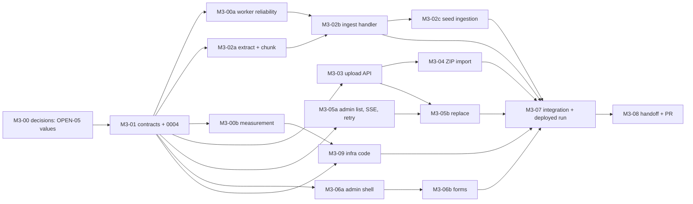

# M3: Admin Upload and Ingestion

**Status:** Proposed on 2026-11-13, written from `main` at `5d1957e`. It is not approved. Until the Owner approves it, no M3 implementation is authorized, and cloud, IAM, Terraform, Secret Manager, OpenAI, QStash, production database, deploy and merge actions each need their own approval. On approval the decisions in section 12 are recorded as OPEN-31, the way OPEN-28 recorded M2. The normative requirements stay in the specs. This document adds the scope, acceptance criteria, failure modes, dependency graph, shared contracts, ownership, allocation, test strategy and open decisions.

## 1. Goal

The Admin uploads a PDF or a ZIP with a manifest. The Worker extracts text per page, chunks it, embeds it and publishes it. The Admin watches the stages. A ready document appears in the library of exactly the departments the Admin chose, and nowhere else. A failed document stays invisible, shows an actionable reason, and can be retried or have its file replaced.

## 2. Where M3 starts

M1 and M2 are merged and deployed. M2 is PR 32 (`2163ea8`), its handoff is PR 33, and production has migration `0003` and four seeded documents. No M3 branch or PR exists.

| Area | State on `main` | Source |
|---|---|---|
| Schema | Migrations `0001` to `0003`. `documents`, `document_revisions` (status `queued/processing/ready/failed`, `phase`, `failure_reason`, `page_count`, `embedding_model`, `index_identity`) and `document_department_access` exist. There is no chunk table and no link from a job to a revision. | `0003_m2_documents.py`, `models.py` |
| Visibility | `visible_documents(department_id)` is the one predicate: not deleted, current revision `ready`, access row for the active department. The database does not stop a current pointer at a non-ready revision, so the predicate is the only guard. | `documents_access.py`, M2 handoff |
| Object store | `ObjectStore` has `put`, `size` and `stream`. There is no `delete`. R2 credentials reach the API only. The Worker has none. | `object_store.py`, `gcp_cloud_run.tf` |
| Worker | One signed endpoint `POST /internal/jobs/run`: claim with a lease, handler registry (only `noop`), 4 attempts, release to `queued` on error, mark `failed` at the cap. No heartbeat. `KS_JOB_HANDLER_TIMEOUT_SECONDS` (90) must stay below the lease (120). No way to fail a job without retries. A job failure writes only to `jobs`. | `apps/worker/.../app.py`, `settings.py` |
| Jobs and outbox | `enqueue_job` writes job and outbox in the caller's transaction. `publish_after_commit`, `republish_manual`, `retry_job` and the derived states (`unpublished_stuck`, `queued_stuck`, `processing_stuck` and the rest) exist and are tested. The batch dispatcher is off. | `jobs.py`, `outbox.py`, `job_recovery.py` |
| Identity | `require_admin`, CSRF and Origin on mutations, `audit.record` without IPs, the error envelope, departments, rate limiter. `/v1/admin/ping` is the only admin route. | M1 handoff, `admin/router.py` |
| Frontend | Library, viewer, English and Hebrew catalogs. No admin screens. React Hook Form and Zod are not installed. The client has no multipart helper. | `apps/frontend/src` |
| Pages proxy | Streams request bodies, forwards `content-type`, `content-length`, `last-event-id` and `range`. Upload size through Cloudflare is unmeasured. | `functions/api/[[path]].ts` |
| Cloud Run | API and Worker use default resources (no memory, CPU, concurrency or timeout set in Terraform), so 512 MiB and 300 s apply. Request size limit is 32 MiB. Max 2 instances each. | `gcp_cloud_run.tf`, spike report 2.1.3 |
| CI and deploy | `ci-required` skips heavy jobs for docs-only PRs. The new `deploy.yml` (migration job before rollout) and an `auth-check` run have not run on GitHub yet. | PR 36 and 37 |
| Seed | Four ready revisions, no chunks, no jobs. Q8 says they must go through the real pipeline with their ids kept. | M2 handoff |

## 3. Scope

| Area | Requirements |
|---|---|
| Admin API | ADM-01 to 05, 07, 09 to 14, 16 to 18; ADM-08 in its basic form |
| Ingestion | ING-02, 05, 07, 09 to 13, 15 to 19, 22, 23 |
| Lifecycle | LIFE-01 to 05, 07, 09, 10; LIFE-06 in its basic form |
| Security | SEC-11 (new), SEC-14 for the new job type, SEC-03, 07, 15, 17 on every admin route, SEC-18 |
| Monitoring | MON-04 for admin actions, MON-05, MON-06 (job failure and stuck outbox alerts) |
| Frontend | FE-ADM-01 to 11 and 13, FE-ADM-08 basic, FE-ARCH-09 (React Hook Form and Zod arrive here), PROD-09 upload part |
| Carry-overs | M0 job-reliability gaps (lease heartbeat, crash loop guard, terminal failure), Q8 seed ingestion, OPEN-05 limits |

Decisions already in force and not reopened: OPEN-16 (explicit access on upload and ZIP, no default for ZIP), OPEN-17 (`NO_EXTRACTABLE_TEXT`, replacing the file of a failed document, no OCR), OPEN-13 (no Admin bypass in user paths), ING-18 (OpenAI `text-embedding-3-small`), STACK-23 (no scheduler, manual retry). OPEN-17 and OPEN-16 are resolved. OPEN-05 is the only open decision that M3 depends on.

### Out of scope

- Replacing a ready document and the durable cleanup of objects, chunks and vectors (M5: ADM-15, ING-20, FE-ADM-12).
- Retrieval, chat, citations (M4). M3 only makes sure its chunk table can be queried by the M4 retriever through `visible_documents`.
- OCR, antivirus scanning, Google Drive ingestion, a user-facing revision history (DEF-02, ADM-06).
- A scheduler for recovery. Manual Retry stays the default (A6).
- Duplicate detection by content hash. Two uploads of the same file make two documents.
- Localizing the Admin screens beyond the error catalog (decision D8).

## 4. Definition of Done

| ID | Exit criterion |
|---|---|
| M3-EX1 | Every acceptance criterion in section 5 has evidence, or a gap the Owner has seen (TEST-03 traceability table). |
| M3-EX2 | CI is green on the milestone branch, the security tests run as hard gates with no skips or xfails, and there are no committed secrets. |
| M3-EX3 | The independent reviews in section 11 are done and no Critical or High finding is open (WF-11). |
| M3-EX4 | Migration `0004` is applied in production through the migration job, the Worker has R2 and OpenAI access, and one real upload has gone through the Pages proxy, real QStash, the Worker and real OpenAI to `ready` (M3-AC22). |
| M3-EX5 | The specs are true (WF-15): requirements, "Required tests" and "Current implementation / Known gaps" in the ingestion, admin, admin-upload, lifecycle and jobs specs match the code. The inconsistencies in section 6 are fixed. |
| M3-EX6 | The handoff exists (WF-12) and the Owner approves the milestone PR (WF-13). |

## 5. Acceptance criteria

The roadmap lists eight criteria. They are kept in spirit and split here so each one can be checked.

| ID | Criterion | Evidence | Covers |
|---|---|---|---|
| M3-AC01 | An Admin uploads a PDF (title, owner A, allowed [B]). The document is `queued` in the admin list at once, the Worker processes it, it becomes `ready`, and only department B sees it in the library. A user active in A does not. | integration (QStash simulator, fake embeddings) and e2e | ADM-03, ADM-05, LIFE-01, 04, 05, SEC-04 |
| M3-AC02 | Every `/v1/admin/*` route returns 401 without a session and 403 for registered and Demo users. A route walk fails if a new admin route lacks the guard. Admin routes need no active department (no 409), and the Admin's regular library still follows the active-department rules. | integration (route walk) | ADM-01, SEC-03, 15, 17 |
| M3-AC03 | Creation is atomic. A fault after the outbox insert leaves no document, revision, job or outbox row. A database failure after the R2 write leaves no rows and the object is deleted or logged for cleanup. An unknown department creates nothing in the database or in R2. | integration with fault injection | ADM-03, 04, ING-12 |
| M3-AC04 | A crash after commit and before publish loses nothing: the job shows `unpublished_stuck`, a manual retry publishes it once, and two concurrent retries give one winner and one 409. | integration | ING-13, ADM-16, LIFE-09 |
| M3-AC05 | The same job delivered twice at once runs once and leaves the chunk count of a single run. A worker killed mid-job is reclaimed after the lease expires without duplicate chunks. A job past its attempt cap is never run again. | integration | ING-10, 15, 19, LIFE-07 |
| M3-AC06 | Every job ends `ready` or `failed` with a stable reason code and a friendly message. Corrupt, encrypted, image-only, over-page-limit PDFs, a storage read error, an embedding error and a timeout are each covered. Attempts stop at 4. Terminal reasons (`NO_EXTRACTABLE_TEXT`, `INVALID_PDF`, `PDF_ENCRYPTED`, `TOO_MANY_PAGES`) are not retried automatically. The revision status and the job status never disagree after a terminal failure. | integration | ING-05, 09, 16, 23 |
| M3-AC07 | A document that is `queued`, `processing` or `failed` never appears in the library, metadata, bytes or a retriever query over its chunks. The Admin list shows it with status, phase and reason. | integration, real pgvector | LIFE-02, SEC-07, ING-23, ADM-02 |
| M3-AC08 | Failed-document replacement follows all seven rules of ADM-18: same id, owner and access rows; the same validation; a new revision, job and outbox row in one transaction; an atomic `failed` to `queued` change so concurrent or repeated requests start one attempt; the old revision's chunks never become retrievable; a second failure can be replaced again; `ready`, `queued` and `processing` give 409, unknown or deleted give 404. | integration and e2e | ADM-18, OPEN-17, LIFE-10, FE-ADM-13 |
| M3-AC09 | Publication is atomic. Chunks are page-bound (none spans two pages), carry document, revision and page, and use 512 tokens with 64 overlap. The embedding model and index identity are stored per revision. A revision becomes current only in the same transaction that checks the document is not deleted. A query across a different index identity is refused. | unit and integration | ING-02, 10, 17, 18 |
| M3-AC10 | The status stream is Admin only and scoped to one document, matches the database phases, ends with a terminal event, shows no percentages, and survives a reconnect. | integration; component | ING-07, 11, FE-ADM-06 |
| M3-AC11 | Single-upload validation: a non-PDF renamed `.pdf`, a wrong signature, an empty file, an oversize file, `../`, absolute paths, null bytes, bidirectional control characters and over-long names are rejected with a reason and nothing is stored. Storage keys are generated by the server and never contain the client filename. | integration | SEC-11, ADM-10 |
| M3-AC12 | ZIP validation: traversal, absolute paths, symlinks, bombs (ratio and totals), too many entries, nested archives, encrypted entries, duplicate and case-folded duplicate names, a manifest entry without a file, a file without an entry, malformed JSON and a wrong manifest version are each rejected with a reason. The archive is never extracted to disk. | integration | ADM-11, SEC-11 |
| M3-AC13 | ZIP preview is read only: zero rows, objects and jobs. Each invalid entry is named with its code (`ALLOWED_DEPARTMENTS_MISSING`, `ALLOWED_DEPARTMENTS_EMPTY`, `UNKNOWN_DEPARTMENT`) and an entry with only `owner_department` is invalid. | integration | ADM-12, OPEN-16 |
| M3-AC14 | ZIP confirmation re-validates everything, imports only valid entries, is idempotent under the same key, reports per-file results, and a retry after fixing a rejected file creates exactly one more document. A tampered confirmation that includes an entry the preview rejected creates nothing for it. | integration | ADM-11, 13, 14 |
| M3-AC15 | An access change replaces the allowed departments in one update, takes effect on the next request on every path, starts no job and re-embeds nothing, and refuses an empty list with 422. | integration | ADM-05, 07, 09, LIFE-05, SEC-05 |
| M3-AC16 | Basic soft delete blocks every user path on the next request. A delete during processing never publishes: the job ends without making the revision current. Objects and chunks stay until M5 and the handoff says so. | integration | ADM-08, LIFE-06, SEC-09 |
| M3-AC17 | Every admin action (upload, import confirm, access change, replace, delete, retry) writes an audit event with the admin id and target, and no file content, filename text beyond the sanitized label, or IP address. | integration | ADM-17, MON-04, SEC-18 |
| M3-AC18 | Logs and audit rows contain no PDF text, chunk text, embedding vectors, API keys or storage keys with client input. | log-capture tests | MON-05 |
| M3-AC19 | The new job type keeps SEC-14: no or bad signature gives 401 before any work; a valid signature for an unknown job does nothing; the envelope accepts only `{schema_version, job_id}`; a signed delivery cannot make the Worker run a job type that has no handler or a job of another type. | integration | SEC-14, ING-14, 21 |
| M3-AC20 | Admin UI: FE-ADM-01 to 11 and 13 component tests pass. Playwright (mocked API) covers upload to ready, image-only to failed to replace to ready, and ZIP preview, confirm and retry. Admin controls are hidden from non-Admins and the API still returns 403. | component and e2e | FE-ADM-*, SEC-15, PROD-09, LIFE-04, LIFE-10 |
| M3-AC21 | The four seeded revisions get chunks through the real pipeline with their document and revision ids unchanged, stay visible in the library throughout, and a second run changes nothing. | integration, then the production run | OPEN-28 Q8 |
| M3-AC22 | Deployed proof: one real upload of a small PDF by the Admin through the Pages proxy reaches `ready` through real QStash, the Worker, R2 and OpenAI. The permitted department sees it, another does not. The upload size limit is checked once through Cloudflare and Cloud Run. | manual deployed run recorded as evidence (TEST-12, 15) | LIFE-04, INFRA-11 |
| M3-AC23 | Time, peak memory and embedding cost per document are measured for small, medium and the largest allowed PDF, and compared with OPEN-05 and COST-01. | measurement report | roadmap criterion 8, ING-22 |
| M3-AC24 | An alert or log-based metric exists for permanent job failure and for stuck outbox rows, as Terraform behind a flag or as documented manual steps. | review | MON-06 |

## 6. Findings in the current specs and code

These are the places where the specs or code disagree with each other or leave a gap that blocks a clean design. Each has a proposed resolution and an owner.

| # | Finding | Resolution |
|---|---|---|
| F1 | ADM-12 says preview creates no objects, but confirmation needs the file. | The client sends the ZIP again at confirmation. The backend re-validates it (ADM-11 already demands this). Cost: the ZIP crosses the network twice. A server-side temporary object would break ADM-12. |
| F2 | The envelope carries only `job_id` (ING-21), and `jobs` has no link to a revision. | M3-01 adds `document_revisions.job_id` (unique, nullable for seeded rows). The handler loads the revision by job id. |
| F3 | The Worker updates only `jobs`. A terminal job failure leaves the revision `processing` or `queued`. `retry_job` requeues the job but not the revision. | M3-00a adds a terminal-failure hook and a requeue hook that update the revision in the same transaction. Both live in the shared Worker and `job_recovery` code. |
| F4 | ING-23 wants no backoff retries for a text-less PDF. The Worker releases every exception back to `queued` until the cap. | M3-00a adds a non-retryable error type that marks the job `failed` at once. |
| F5 | The claim query reclaims an expired lease without checking the attempt cap. A handler that dies before its `except` block (out of memory, a native parser crash) can run more than 4 times. | M3-00a checks the cap at claim time and marks the job `failed` with `PROCESSING_CRASHED` instead of running it again. |
| F6 | The handler timeout (90 s) must stay under the lease (120 s), and Cloud Run's default request timeout is 300 s. Ingestion of a large PDF may not fit. | M3-00a adds a lease heartbeat (the handler renews the lease while it runs). M3-00b measures real times. M3-09 raises Worker timeout and sets memory and concurrency if the measurement asks for it. |
| F7 | A Cloud Run timeout returns 504 but the container may keep running (spike report 2.1.1). A late writer could overwrite a newer attempt. | All pipeline writes are conditional on the job still being claimed by this worker (a fencing check in the same transaction). |
| F8 | ARCH-14's test lists put, get and delete, but `ObjectStore` has no `delete`, and the R2 token's delete right is unconfirmed. | M3-01 adds `delete` to the interface and all three stores. The Owner confirms the token allows delete (decision D6). |
| F9 | `document-lifecycle.md` (step 3 and LIFE-09) still names the Cloud Scheduler recovery dispatcher. ING-13 and STACK-23 say it is optional and off. | M3 reads LIFE-09 as "the Admin's manual retry publishes the lost job once". M3-01 fixes the wording. |
| F10 | The ADM-08 test expects "cleanup job enqueued", but ING-20 cleanup is M5. A job type without a handler would fail with "no handler". | M3 delete only sets `deleted_at` and `updated_at`. M5 finds deleted documents by `deleted_at` and needs no job row. Decision D7. |
| F11 | ADM-02 asks for the "current revision status", but a document that never succeeded has no current revision. | The admin list shows the latest revision. |
| F12 | ING-19 says "resumed or retried from a checkpoint". | M3 retries from the start with idempotent writes. The one costly stage (embedding) is repeated at most 3 times. Decision D9. |
| F13 | FE-ADM-06 shows Retry for `NO_EXTRACTABLE_TEXT`, while ING-23 says retry cannot help. | Follow the spec: Retry is shown and uses one attempt. The UI puts Replace file first for terminal reasons. |
| F14 | ADM-18 and ADM-13 need idempotency keys, and a double submit of a single upload would create two documents. | M3-01 adds one idempotency table used by single upload, replace and ZIP confirm. |
| F15 | ZIP manifests name departments by id in the spec. Ids are uuids; slugs are also stable (D6 in M1). | Decision D10: accept slugs in the manifest. Ids stay the API identifier elsewhere. |
| F16 | PyMuPDF is licensed AGPL-3.0 (or commercial). | The repository is public, so source is available. Recorded as a risk; no action unless the repository goes private or the code is sold. |
| F17 | LlamaIndex's `SentenceSplitter` needs a tokenizer, and the usual tiktoken setup downloads its vocabulary file on first use. | M3-02a bakes the file into the Worker image or sets a tokenizer that needs no download, and a test fails if the Worker imports it over the network. To confirm in M3-02a. |
| F18 | PostgreSQL text cannot hold NUL characters, and PDF extraction can produce them. | The extractor strips NULs before chunking. A test covers it. |
| F19 | The M1 deployed smoke used a test account. The Admin signs in with a real Firebase account. | The deployed upload run in M3-AC22 is done by the Owner in the browser. No Admin credential enters the repository or GitHub. |

## 7. Architecture and contract changes

### 7.1 Pipeline

1. API (`POST /v1/admin/documents`): validate, generate `document_id` and `revision_id`, write the object to R2 under `documents/{document_id}/{revision_id}.pdf`, then in one transaction write the document, revision, access rows, job (`ingest_revision`) and outbox row. After commit, `publish_after_commit` with the bounded timeout. If the transaction fails, delete the object and log the key.
2. QStash calls the Worker. The Worker verifies the signature, claims the job, loads the revision by `job_id`, and runs these stages, setting `phase` before each: `fetching`, `extracting`, `chunking`, `embedding`, `publishing`.
3. Extraction runs in a child process with a hard timeout and returns page texts. A parser crash or hang then fails the attempt without taking the Worker down (decision D11).
4. Embedding calls OpenAI directly in batches, with a bounded timeout and retries for 429 and 5xx. A 401 or a bad key fails with `EMBEDDING_FAILED` and is logged as a configuration error.
5. Publish, in one transaction that first locks the job row and checks it is still claimed by this worker: delete any chunks of this revision, insert the new chunks, set the revision `ready` with `page_count`, `ready_at`, `embedding_model` and `index_identity`, and set `documents.current_revision_id` only if `deleted_at IS NULL` and the document has no current revision yet. If the document was deleted, end the job with `DOCUMENT_DELETED` and publish nothing.
6. Reindex mode (Q8): for a revision that is already `ready` and has no chunks, the same handler writes chunks and the identity without changing status or the current pointer. The visibility predicate keeps working throughout.

### 7.2 Revision states

| Revision status | Written by | Rule |
|---|---|---|
| `queued` | API on upload or replace; `retry_job` on requeue | Never visible. |
| `processing` (with `phase`) | Worker, after the claim | Never visible. |
| `ready` | Worker, in the publish transaction | Visible only through `visible_documents`. |
| `failed` (with a reason code) | Worker on terminal failure; the terminal hook after the attempt cap or crash guard | Never visible. Replaceable (ADM-18). |

The failure reason is a stable code in `failure_reason`. The friendly message comes from a server catalog, so no extra column is needed.

### 7.3 Contracts to fix in M3-01

| Contract | Content |
|---|---|
| Schema, migration `0004` (additive only) | `document_chunks` (id, document_id, revision_id with a composite key to the same document, page, ordinal, text, token_count, `embedding vector(1536)`, unique on revision and ordinal; indexes on revision and document). `document_revisions.job_id` (unique, nullable). `admin_idempotency_keys` (admin user, key, operation, request hash, stored result) and `import_batch_entries` (key, entry key, outcome, document id, error code). No vector index in M3 (decision D5). No table references `users.id` with a cascade, so the Demo cleanup rule does not apply. |
| API (OpenAPI stubs first) | Proposed routes: `GET /v1/admin/documents`, `POST /v1/admin/documents`, `GET /v1/admin/documents/{id}`, `GET /v1/admin/documents/{id}/events` (SSE), `PATCH /v1/admin/documents/{id}/access`, `DELETE /v1/admin/documents/{id}`, `POST /v1/admin/documents/{id}/retry`, `POST /v1/admin/documents/{id}/replace`, `POST /v1/admin/imports/preview`, `POST /v1/admin/imports/confirm`. Uploads are multipart with an `Idempotency-Key` header. List uses the M2 cursor style. The success status of upload (the spec says 200) is fixed here. |
| Error codes | New stable codes with friendly messages: upload too large (413), unsupported file or invalid PDF (422), unknown department (422), allowed departments missing or empty (422), the ZIP and manifest codes in ADM-12, not replaceable (409), not retryable (409), upload backlog or daily cap (429), uploads disabled (503). Unknown or deleted document: the existing `DOCUMENT_NOT_FOUND` 404. |
| Failure reason codes | `NO_EXTRACTABLE_TEXT`, `INVALID_PDF`, `PDF_ENCRYPTED`, `TOO_MANY_PAGES` (terminal); `STORAGE_UNAVAILABLE`, `EMBEDDING_FAILED`, `PROCESSING_TIMEOUT`, `PROCESSING_CRASHED`, `INTERNAL_ERROR` (retried until the cap); `DOCUMENT_DELETED` (terminal). |
| SSE events | `event: status` with `{document_id, revision_id, status, phase, failure_code, failure_message, delivery_state, updated_at}`, built from the database, a keepalive comment every 15 s, an end event after a terminal state or 120 s so the client reconnects. The list is the fallback if the stream fails. |
| ZIP manifest | `{"version": 1, "documents": [{"file", "title", "owner_department", "allowed_departments"}]}`. `allowed_departments` is required and non-empty for every entry; nothing is inferred from `owner_department`. |
| Interfaces | `ObjectStore.delete`; `EmbeddingProvider` (OpenAI and a deterministic fake; the fake is refused in production like the object store); the worker handler registry entry `ingest_revision`; the terminal-failure and requeue hooks from F3; a non-retryable error type. |
| Config keys | Upload and ZIP limits, in-flight cap, daily upload cap, chunk size and overlap (`KS_CHUNK_SIZE_TOKENS`, `KS_CHUNK_OVERLAP_TOKENS`, tunable under OPEN-03), OpenAI key, model, dimension and batch size, SSE intervals, extraction timeout, and `KS_UPLOADS_ENABLED` (a plain stop switch for new uploads). All in `config-and-deploy.md` and `.env.example`. |
| Test fixtures | Small PDFs: two-page text, image-only, corrupt, encrypted, many-page, a PDF with NUL bytes in its text. In-memory hostile ZIP builders. A QStash simulator that delivers signed requests to the Worker app. A fake embedder. |
| ADRs | Ingestion job model (F2 to F5, F7); chunk schema and no vector index; admin import and idempotency model (F1, F14); retry from the start (F12); seed reindex mode; upload validation and limits. |

### 7.4 Why no vector index in M3

SEC-08 needs the access filter applied before similarity ordering. An approximate index can return fewer rows than asked for when a filter removes many candidates, and the demo corpus is small. M3 stores vectors and relies on an exact scan. M4 decides the index with real retrieval measurements (OPEN-03).

## 8. Failure modes

| Failure | What happens | Handling |
|---|---|---|
| R2 write succeeds, database transaction fails | An orphan object | Best-effort delete. If that fails the key is logged. M5 sweeps. Cost is negligible. |
| Commit succeeds, QStash publish fails or the API dies | Job unpublished | Shown as `publish_failed` or `unpublished_stuck`. Retry republishes once. |
| QStash delivers twice or in parallel | Two claims | One wins. The other gets 409 and QStash retries later. |
| Worker killed mid-run (out of memory, native crash) | Expired lease, no `except` block runs | Reclaim after the lease. The cap check at claim time ends a crash loop with `PROCESSING_CRASHED` (F5). |
| Cloud Run times out but the container keeps running | A stale writer | Fencing check in the publish transaction (F7). |
| Hostile or broken PDF hangs the parser | Handler cannot cancel native code in a thread | Child process with a hard timeout (D11). |
| Embedding provider rate limit or outage | Attempt fails | Retried to the cap, then `failed` with a retry button. Nothing is written until every batch has embedded. |
| OpenAI key missing, revoked or over its limit | Every job fails | `EMBEDDING_FAILED`, an error log line that feeds the MON-06 alert. Revoking the key is the hard stop. |
| Very large PDF or ZIP | Time, memory and cost | Size, page, entry and ratio caps; the daily document cap; the in-flight cap. |
| Delete or access change during processing | Race with publish | Publish checks `deleted_at` in the same transaction. Access rows are independent of the job. |
| Replace and Retry at the same time | Two writers on one document | Conditional updates. One wins, the other gets 409. |
| Double click or two tabs | Duplicate documents | Idempotency key plus a disabled button. |
| Large upload through Pages and Cloud Run | 413 or a cut connection | Frontend pre-check, a friendly 413 message, and the one-time check in M3-AC22. |
| Worker cold start returns 500 from Cloud Run (seen in the M2 cleanup run) | Delivery rejected before the app runs | Does not use a job attempt. QStash retries. Repeated misses show up as `queued_stuck`; manual retry. |
| Storage growth on Neon's free tier (1 GB) | Database full | A 1536-dimension vector is about 6 KB. The Admin is the only uploader and the daily cap bounds growth. The Owner watches storage. This is an estimate to confirm in M3-AC23. |
| SSE dropped by the proxy or the 300 s timeout | Stale screen | Reconnect, and the list shows the truth (FE-ADM-06). |
| Extracted text is hostile content | Later reaches model prompts | Stored as data and never executed. M4 owns the prompt rules (SEC-12). Noted in the handoff. |
| Hebrew or other right-to-left PDFs extract in visual order | Poor chunks | Not measured and not in scope. Recorded as a gap. |

## 9. Allocation, dependency graph and ownership (WF-16)

Sizes are relative (S, M, L). No dates are given because none were measured.

| ID | Task | Depends on | Size | Workstream |
|---|---|---|---|---|
| M3-00 | Owner actions and decisions in section 12 | none | S | Owner |
| M3-00a | Worker reliability: lease heartbeat, attempt cap at claim, non-retryable errors, terminal-failure and requeue hooks, fencing helper | M3-01 | M | Backend-Worker |
| M3-00b | Measurement harness and local baseline (time and peak memory per page, three sizes) | M3-01 | S | Backend-Extract |
| M3-01 | Contracts, migration `0004`, models, ADRs, OpenAPI stubs, `ObjectStore.delete`, interfaces, config keys, fixtures, route registration, spec fixes | M3-00 (limits) | M | Owner |
| M3-02a | Extraction in a child process, per-page text, NUL strip, chunking (512/64, no cross-page chunks), tokenizer without download, hostile PDF fixtures | M3-01 | M | Backend-Extract |
| M3-02b | `ingest_revision` handler: fetch, embed (OpenAI and fake), atomic publish, reindex mode, phases, failure mapping | M3-00a, M3-02a | L | Backend-Worker |
| M3-02c | Seed ingestion command (Q8) and its use of the existing seed job | M3-02b | S | Backend-Worker |
| M3-03 | Upload API: validation, creation service, R2 write, idempotency, limits, audit | M3-01 | M | Backend-Admin-A |
| M3-04 | ZIP import: validation, manifest, preview, confirm, partial success | M3-03 | L | Backend-Admin-A |
| M3-05a | Admin list, detail, access update, soft delete, retry, SSE, audit | M3-01, M3-00a (hook signature) | M | Backend-Admin-B |
| M3-05b | Replace file of a failed document | M3-03 (creation service), M3-05a | S | Backend-Admin-B |
| M3-06a | Frontend shell: admin routes and guard, multipart and idempotency helper, list, badges, SSE hook, access editor, delete dialog, retry | M3-01 (mocks) | M | Frontend-A |
| M3-06b | Frontend forms: single upload (React Hook Form and Zod), ZIP preview and confirm, replace dialog | M3-06a shell | M | Frontend-B |
| M3-07 | Integration, crash and duplicate-delivery tests, e2e, deployed run, independent reviews, traceability | everything, M3-09 applied | M | Owner and Review Agent |
| M3-08 | Handoff and milestone PR | M3-07 | S | Owner |
| M3-09 | Infrastructure: Worker access to R2 and the OpenAI secret, Worker memory, concurrency and timeout, new env, alert policy behind a flag. Added by this plan. | M3-01 (keys), M3-00b | S to M | Infrastructure |

Critical path: M3-00 (limits) → M3-01 → M3-00a → M3-02b → M3-07 → M3-08. The cloud path (OpenAI key, Terraform apply, migration approval, first `deploy.yml` run) is the largest schedule risk, so ask early. Code and tests never depend on it.

Genuinely parallel after M3-01: M3-00a, M3-02a, M3-00b, M3-03, M3-05a, M3-06a and M3-09. M3-04 follows M3-03. M3-05b follows both M3-03 and M3-05a. M3-06b follows M3-06a.

Deliberately serial:
- M3-00a and M3-02b stay with one agent. Both edit the Worker app and the job code, and 02b is the first consumer of the new hooks.
- M3-03 and M3-04 stay with one agent. ZIP import calls the creation service that 03 writes.
- M3-05a and M3-05b stay with one agent, for the same reason as the retry hook and replace.
- The two frontend slices are sequential, not concurrent: 06b needs the shell and the helper. Before 06a merges, 06b works on mocks in its own folder only.

The agent count is five to six at peak. If the Owner prefers less coordination, M3-02a can fold into the Backend-Worker agent and the two Backend-Admin agents can merge into one, at the cost of a longer critical path through the admin API.

### Slices that touch the same files

| File or area | Slices | Rule |
|---|---|---|
| `apps/worker/.../app.py`, `job_recovery.py`, `jobs.py`, `outbox.py` | M3-00a, M3-02b, M3-02c; M3-05a calls `retry_job` | One agent owns them. M3-05a uses the function signatures fixed in M3-01 and does not edit them. |
| `models.py`, `migrations/`, `settings.py`, `.env.example`, `config-and-deploy.md`, `object_store.py` | M3-01 only | Owner only. A slice that needs a column or key asks the Owner. |
| `apps/api/.../admin/router.py` | M3-01 turns it into a registrar | Each slice owns its own module (`upload.py`, `imports.py`, `manage.py`, `events.py`) and its own schema module. The shared `schemas.py` is not edited. |
| Creation service (document, revision, access, job, outbox in one transaction) | M3-03 writes it; M3-04 and M3-05b call it | M3-03 lands it first. |
| `docs/contracts/openapi.json` and `apps/frontend/src/lib/api/schema.d.ts` | all API and frontend slices | Generated. Never hand-merged; regenerate at each integration merge. |
| `uv.lock`, `pnpm-lock.yaml` | Worker (pymupdf4llm, llama-index-core), API (python-multipart), frontend (react-hook-form, zod, resolver) | Never hand-merged. The Owner re-locks at integration. |
| `apps/frontend/src/app/routes.tsx`, `lib/api/client.ts`, i18n catalogs, `test/fake-api.ts`, `tests/e2e/support/fake-api.ts` | M3-06a, M3-06b | 06a edits them. 06b adds files in `features/admin/upload/` and `features/admin/import/` and asks 06a for any shared change. |
| `infra/terraform/*` | M3-09 only | No code slice edits Terraform. |
| Worker `Dockerfile`, `apps/worker/pyproject.toml` | M3-02a, M3-02b | 02a adds the dependencies and the tokenizer file; 02b rebases. |
| Seed command and job | M3-02c | The M2 seed files change only by an added flag. |

Worktrees go under the workspace `worktrees/<name>` folder, as the workspace rules require, and branches are `m3/<id>-<name>`, forked from `m3/integration`.

### Integration checkpoints

1. CP1: M3-01 merges into `m3/integration`. The Owner approves the contracts. Every branch forks from it.
2. CP2: M3-00a merges after an independent review (claim, lease, fencing, hooks).
3. CP3: M3-02a, M3-03 and M3-05a merge as each passes its gates.
4. CP4: M3-02b merges after an independent review (publish transaction, deletion race, reindex mode).
5. CP5: M3-04 and M3-05b merge after an independent review of upload and archive handling.
6. CP6: M3-06a then M3-06b merge. Playwright runs in the Owner's trial worktree against the real API.
7. CP7: M3-09 merges after a `terraform plan` review. Applying it needs the Owner.
8. CP8 (M3-07): full CI, deployed run, final review, traceability. Then M3-08.

## 10. Test strategy

Risk-proportionate, as in `workflow/testing.md`. Integration tests use real PostgreSQL 18 with pgvector. Providers are faked (TEST-09, TEST-12): `FakeObjectStore`, the fake embedder, the QStash simulator. Real providers run only in the deployed run (M3-AC22).

| Layer | Used for |
|---|---|
| Unit | Chunking and page bounds, NUL stripping, filename sanitization, ZIP path rules, ratio and total checks, manifest schema, failure-code mapping, envelope strictness, config guards (fake embedder refused in production) |
| Integration (backend) | Upload, atomicity and fault injection, the Worker pipeline end to end on fixture PDFs, duplicate delivery, crash and lease reclaim, the attempt cap at claim, fencing, retry and replace races, idempotency, SSE, the authorization matrix, the visibility of non-ready states, chunk queries through `visible_documents`, audit and log hygiene |
| Component | Admin list and badges, upload form validation, owner preselect (single upload only), ZIP preview with invalid entries and no default, replace dialog, error mapping |
| Playwright (mocked API) | Upload to ready, failed to replace to ready, ZIP preview, confirm and retry |
| Deployed run | M3-AC22 and M3-AC23, done by the Owner with the Admin account, plus the existing library smoke |
| Not built | Load tests, a staging environment, antivirus, OCR tests |

### Security tests that are hard gates

1. A route walk that lists every `/v1/admin/*` route and requires 401, 403 and CSRF and Origin rejection on every mutation, multipart ones included (ADM-01, SEC-03, AUTH-14).
2. The SEC-11 matrix: PDFs and ZIPs from M3-AC11 and M3-AC12, each asserting that no row, object or job exists afterwards.
3. No inferred access (ADM-05, OPEN-16): owner A with allowed [B], owner A with allowed [A], empty list, and ZIP entries missing, empty or unknown.
4. Non-ready states never appear in any user route or in chunk queries (SEC-07, LIFE-02).
5. SEC-14 for the new job type and the strict envelope (ING-14, ING-21).
6. The Admin has no bypass in the regular library with a document allowed only to another department (SEC-17).
7. Storage keys never contain client input. Client mass assignment is rejected (a request cannot set status, ids, job id or revision fields).
8. No document text, chunk text or key material in logs or audit rows (MON-05, SEC-18).
9. Deletion and publish race, fencing against a stale worker, and the cap check at claim.

## 11. Review points

| Point | Why | Reviewer |
|---|---|---|
| M3-00a | Claim, lease, fencing, terminal and requeue hooks | Independent Review Agent |
| M3-02b | Publish transaction, deletion race, reindex mode, embedding failure handling | Independent Review Agent |
| M3-03 and M3-04 | Hostile file handling, archive validation, idempotency | Independent Review Agent |
| M3-09 | Secrets, IAM, Worker resources | Independent Review Agent |
| M3-07 | Authorization matrix, log hygiene, spec-to-code consistency | Independent Review Agent |
| Others | Lower risk | Owner review at the checkpoint, no separate gate (WF-06) |

## 12. Decisions the Owner makes

Recommendations are mine. None of these is recorded as binding until the Owner approves. After approval they are written to `open-decisions.md` as OPEN-31 and OPEN-05's M3 part is marked resolved.

| ID | Decision | Recommendation | Needed before |
|---|---|---|---|
| D1 | OPEN-05 limits for M3 (the only open decision on the critical path) | Single PDF 20 MiB (the Cloud Run request limit is 32 MiB and multipart adds overhead); at most 300 pages; ZIP 25 MiB compressed, at most 20 PDFs, 100 MiB uncompressed in total, a 20 to 1 ratio cap per entry, manifest 256 KiB; at most 10 documents `queued` or `processing`; at most 50 new documents per UTC day. All are config keys. M3-00b measurement may lower the page limit. | M3-01 |
| D2 | Worker sizing (Terraform apply): memory from 512 MiB to 1 GiB, concurrency 1, request timeout 600 s if M3-00b shows the need | Decide after M3-00b. Needs a separate apply approval. | M3-09 apply |
| D3 | Embedding provider setup: OpenAI key in Secret Manager, a spending limit on the OpenAI project, model `text-embedding-3-small` at 1536 dimensions | Approve. The cost per typical document is small, but the price must be re-checked on the provider page when the key is created. | first deploy |
| D4 | Q8 handling of the four seeded documents | Reindex mode: write chunks onto the existing ready revisions and leave status alone. The alternative, resetting them to `queued`, hides them from the library and breaks the deployed smoke while they run. | M3-01 |
| D5 | No vector index in M3 (section 7.4) | Approve. M4 chooses the index with measurements. | M3-01 |
| D6 | R2 token must allow object delete, and the Worker needs read access. Confirm the token scope and add the Worker to the R2 secret readers. | Owner checks the token; M3-09 writes the Terraform. | first deploy |
| D7 | Delete in M3 is soft delete only, with no cleanup job (F10) | Approve. Cleanup is M5 and works from `deleted_at`. | M3-01 |
| D8 | Admin screens language | English screens, with every new error code in both catalogs so PROD-13 holds. Full Hebrew labels only if the Owner asks. | M3-06a |
| D9 | Retry from the start instead of stage checkpoints (F12) | Approve. Revisit only if M3-00b shows jobs that do not fit one attempt. | M3-01 |
| D10 | Manifest identifies departments by slug (F15) | Approve. One identifier form keeps validation small. | M3-01 |
| D11 | Extraction in a child process with a hard timeout | Approve. It adds some code and Windows-compatible tests, and it contains parser hangs and crashes. | M3-02a |
| D12 | Keep multipart uploads through the API (no presigned direct-to-R2 upload) | Approve. It keeps R2 private and keeps ARCH-14 true. The cost is the 32 MiB ceiling. | M3-01 |
| D13 | Outbox "dead state" from the M0 handoff | Do not add a stored state in M3. It matters only if the optional dispatcher is enabled. The Admin sees `publish_failed` and retries. Keep it tied to `KS_ENABLE_RECOVERY_DISPATCHER`. | M3-00a |
| D14 | `KS_UPLOADS_ENABLED` stop switch | Approve. It is a config flag that returns 503 on upload routes. | M3-01 |
| D15 | Real-provider checks (TEST-12): one real QStash plus OpenAI upload run, and whether to verify QStash's real retry count against `KS_JOB_MAX_ATTEMPTS=4` | The upload run is required for M3-AC22. The retry check needs a failing job in production, and the plan does not enable failure hooks there, so the reconciliation stays UNVERIFIED unless a real failure occurs. Tell me if you want a throwaway test revision instead. | M3-07 |

Cloud and account actions that only the Owner can do, each separately approved:

1. Create the OpenAI key, set its spending limit, store the key as a Secret Manager version (the Terraform container comes from M3-09).
2. Confirm the R2 token allows delete.
3. Confirm the QStash plan limits against the expected number of ingestion messages.
4. Approve and run `terraform apply` for M3-09 (Worker secrets, env, sizing, optional alert policy and a notification channel).
5. Approve migration `0004` through the migration job.
6. Approve the first real `deploy.yml` run. The workflow from PR 36 and 37 has not run on GitHub, so run an `auth-check` first and expect to fix workflow problems then.
7. Approve the one-off seed ingestion run (the existing seed job flag).
8. Sign in as Admin on production and upload one small PDF for M3-AC22, and report the result. No Admin credential goes into the repository or GitHub.

## 13. Deployment gates and order

1. CI green on the milestone PR, security tests included.
2. Owner applies M3-09 (after the plan review) and adds the OpenAI secret version.
3. `deploy.yml` `auth-check`, then `deploy`. The migration job runs `0004` before the API and Worker roll out.
4. Seed ingestion run (M3-02c).
5. M3-AC22 upload by the Owner. Evidence recorded in the handoff.
6. Docs-only merges start no deploy.

## 14. Quality gates

- Every merge into `m3/integration`: CI green for the touched packages, contract and OpenAPI diff clean or approved, the "Required tests" rows of the touched specs present with requirement ids in the test names (TEST-07), no skips or xfails on security tests.
- The Owner reruns checks in the trial worktree and does not rely on an agent's report (WF-08).
- Specs are updated in the same change as the behavior (WF-15), including the "Known gaps" of each spec.
- PR strategy as in M1 and M2: agent branches merge into `m3/integration` locally. One milestone PR from `m3/integration` to `main`, opened as a draft early so each integration merge gets CI, and marked ready for the Owner's approval. Doc-only edits go into that PR.

## 15. Rollback

| Layer | Rollback |
|---|---|
| API and Worker | Cloud Run revision rollback, as in `architecture/rollback.md`. `0004` only adds tables and a nullable column, so the M2 revisions keep working against it. If the Worker is rolled back while ingestion jobs are queued, those jobs fail with "no handler"; after rolling forward the Admin uses Retry. |
| Frontend | Cloudflare Pages deployment rollback, separate. |
| Database | `alembic downgrade 0003` drops the chunk and idempotency tables and all uploaded chunks. It is not part of an application rollback. Take a Neon branch first and decide it on its own. |
| Bad uploads | Soft delete the document. M3 has no hard delete, so objects and chunks stay until M5. |
| Cost runaway | `KS_UPLOADS_ENABLED=false`, then revoke the OpenAI key. The daily and in-flight caps bound the damage before that. |
| Cloud changes | Terraform changes for M3-09 are reversible by a further plan. Secrets are not destroyed. |

## 16. Risks

| Risk | Effect | Mitigation |
|---|---|---|
| OpenAI key, Terraform apply, migration or deploy approvals arrive late | Deployed run slips | Ask at plan approval. Code does not depend on them. |
| The new `deploy.yml` has never run on GitHub | The first deploy fails for workflow reasons | Run `auth-check` first and keep the manual path available. |
| 512 MiB Worker runs out of memory on PyMuPDF and the tokenizer | Crash loops | Page cap, child process, M3-00b measurement, then D2. The claim-time cap stops loops. |
| Processing time exceeds one attempt | Jobs time out | Heartbeat, a larger Cloud Run timeout if needed, and the page cap. Checkpoints only if measurement demands them. |
| QStash retry behavior differs from `KS_JOB_MAX_ATTEMPTS=4` | Jobs end `queued_stuck` or retry more than expected | Derived states and manual Retry cover both. Real behavior stays unverified (D15). |
| Cold starts reject deliveries | Slow or stuck first attempts | Retry. Scale to zero stays (COST-01). |
| Upload through Cloudflare cuts large bodies | 413 or reset | Limit set below the Cloud Run ceiling and checked once in M3-AC22. |
| Hostile PDFs reach pdf.js in the viewer | Viewer-side issues | Only the Admin uploads, nothing is rewritten, no antivirus (DEF-02). Recorded, not mitigated. |
| PyMuPDF license (F16) | Obligations if the code is ever sold or closed | Public repository today. |
| Extracted text becomes prompt input in M4 | Prompt injection | M4 owns SEC-12. Flagged in the M3 handoff. |
| This is the largest milestone so far | Merge conflicts, long integration | The collision table above, one owner per shared file, Owner-written schema and contracts. |

## 17. Open items and the spec changes M3-01 makes

- OPEN-05: the M3 part is decided by D1. The M4 part (AI limits) stays open.
- OPEN-22 and OPEN-27 are implemented (PR 36 and 37) but unproven in production.
- OPEN-30 (historical client IPs) is separate and not part of M3.
- Spec edits in M3-01: `document-lifecycle.md` (F9), `ingestion.md` (job link, hooks, reindex mode, retry from the start), `admin-docs.md` (idempotency, the 409 and 429 codes, ADM-08 test split), `jobs-outbox.md` (new Worker rules), `config-and-deploy.md`, `api.md`, `proxy.md` (upload size), and `testing.md` (admin flows in the Playwright suite).

## Related docs

`../../workflow/agent-workflow.md`, `../../workflow/testing.md`, `../../open-decisions.md`, `../ROADMAP.md`, `../M1/plan.md`, `../M2/handoff.md`, `../../backend/ingestion.md`, `../../backend/admin-docs.md`, `../../backend/documents.md`, `../../frontend/admin-upload.md`, `../../cross-cutting/document-lifecycle.md`, `../../cross-cutting/security-and-permissions.md`, `../../contracts/jobs-outbox.md`, `../../architecture/rollback.md`
