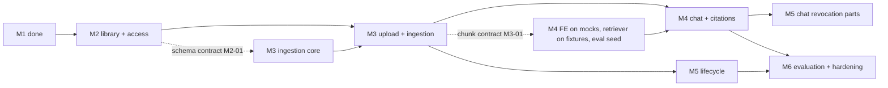

# KnowServe roadmap, M0 to M6

Status: proposed by the Planning & Integration Owner on 2026-11-06. It is a planning aid, not an approval. Each milestone still gets its own plan, task board and user approval before work starts (WF-10, WF-13, WF-16), and this file does not change any requirement, contract or decision.

Sources: `../workflow/agent-workflow.md` (WF-14 for the milestone names), `../workflow/testing.md`, `../open-decisions.md`, the specs under `../backend`, `../frontend` and `../cross-cutting` (each requirement carries its milestone tag), and the M0 and M1 plans, boards and handoffs. Anything I inferred and did not find in those documents is marked "Assumption" and listed again in the last section, so the Owner can confirm or strike it. Requirement ids are cited as they appear in the specs.

## 1. Where we are

| Milestone | State | Reference |
|---|---|---|
| M0 Foundation, CI, IaC, deployment spike | Merged to `main`. The spike ran live and was cleaned up. Formal completion is not claimed: M0-AC09 (measured cost) is still open. | `M0/handoff.md`, `M0/test-plan.md` |
| M1 Authentication and Demo | Merged to `main` and deployed (PR #28). Some real-Firebase and cloud evidence is still open, and the chat part of the quota evidence belongs to M4. | `M1/handoff.md`, OPEN-24 to OPEN-26 |

M0 delivered the monorepo, CI with the `ci-required` aggregate, Terraform, Cloud Run (API and Worker), the Pages `/api` proxy, Neon with pgvector, QStash and the transactional outbox with a manual-retry recovery path. The initial migration `0001` has only `jobs`, `outbox` and a spike probe table.

M1 delivered Firebase sign-in with opaque 24 h database sessions, CSRF and Origin checks, Try Demo through anonymous accounts, Demo to Registered conversion, departments with a stored active department, the single Admin guard, per-user quotas with a global AI guard and kill switch (mechanism only), the daily Demo cleanup, and the migration Cloud Run job. Migration `0002` added users, sessions, departments and counters. There are no document, chunk or conversation tables yet.

## 2. Dependency overview

| Milestone | Needs from earlier milestones | Can start before the previous one ends | Must wait for |
|---|---|---|---|
| M2 Documents Library and Access | M1 (identity, active department, Admin guard, errors, CSRF) | Yes, now, as soon as the roadmap is merged | M2-01 contracts frozen before its own slices fork |
| M3 Admin Upload and Ingestion | M2 schema and storage interface; M0 worker, outbox, QStash | Ingestion core and Admin API, after M2-01 merges | End to end "uploaded document shows in the library" needs M2 merged |
| M4 RAG Chat and Citations | M3 chunks and embeddings; M1 quotas; M2 visibility rules | Frontend against mocks, retriever SQL against fixture chunks, evaluation seed, after M3-01 merges | Real retrieval over ingested documents needs M3 merged |
| M5 Admin Lifecycle and Hardening | M3 ingestion; M4 for the chat halves of CHAT-13 and CHAT-15 | Delete cleanup and replace-version, after M3 | Revocation during a live stream and citation history need M4 |
| M6 Evaluation and Production hardening | M4 (baselines), M5 | Evaluation dataset and hardening tasks that do not touch chat, from the middle of M4 | Approved baseline and final thresholds need the M4 pipeline stable |

Recommended order: M2, then M3, then M4, with M5 and M6 work started early where the table allows.

Where milestones may overlap, stated plainly:
1. M2 and M3 overlap. Once the M2 document schema and storage interface are merged (M2-01), the M3 Worker pipeline and Admin API can be built while the M2 library and viewer are finished. The M3 milestone PR still waits until M2 is on `main`.
2. M3 and M4 overlap on the parts that do not need real ingested data. Real retrieval, citation validation against real chunks and the first usable demo wait for M3.
3. M5 lifecycle work (ING-20 cleanup, ADM-15 replace) can run next to M4, because it touches ingestion and storage, not chat. Its chat-facing acceptance waits for M4.
4. M6 evaluation work overlaps the second half of M4, as EVAL-01, EVAL-06 and EVAL-10 already put a seed and the deterministic checks in M4.
5. Nothing overlaps at the PR level. Each milestone ends in one PR the user approves (WF-13), and the merge order is M2, M3, M4, M5, M6. Whether M5 should merge before M4 is not decided here.

This overlap plan is an Assumption. WF-14 only says "independent slices may run in parallel"; the specific cut lines above are mine and the Owner decides them in each milestone plan (WF-16).

## 3. Carry-overs from M0 and M1

| Item | Placement | Source |
|---|---|---|
| M0 cost evidence (M0-AC09): billing report for the idle project (Cloud Run, Artifact Registry, Secret Manager, logging) and Neon compute hours | Owner action at the start of M2 (task M2-00), re-checked at M4 as OPEN-10 says | `M0/handoff.md`, OPEN-10, COST-01 |
| First scheduled Demo cleanup observation: the QStash schedule at 03:00 UTC must exist, call the signed Worker endpoint once, and log counts only | Owner action in M2-00. Evidence goes into `M1/handoff.md` through the `m1/production-evidence` branch, which is meant to ride in the M2 PR | `M1/handoff.md` AC16, `WORKTREES_STATUS.md` |
| CHAT-18 and CHAT-19 (Demo conversation isolation; every LLM call passes quota and budget reservation first), plus real chat-history preservation on conversion | M4 acceptance. They close M1-AC17 and the chat half of M1-AC15 | `M1/handoff.md` section 3, `backend/chat.md` |
| Remaining real-Firebase checks (password policy, real Google OAuth, mail delivery, convert after real linking), the migration job applied and exercised, deployed smoke through the proxy | Owner actions, ahead of or inside M2-00. The migration job must have one verified run before M2's first schema migration reaches production | `M1/handoff.md` section 3, `testing.md` gap 3 |
| OPEN-22 (CI/CD efficiency, docs-only PR policy) | Settle in M2 as a small side task (M2-CI). The interim rule is to batch doc-only edits | `open-decisions.md` |
| OPEN-27 (automatic deploy after merge) | Decide in M2 and implement only after the user approves. M2 contains the first schema change since `0002`. If it is not decided, the manual approved dispatch keeps working, so M2 is not blocked | `open-decisions.md`, TEST-14 |
| Rollback note (Cloud Run revision rollback and schema compatibility check) | Write in M2, before the first production migration of the milestone | `testing.md` gap 4, INFRA-05, TEST-16 |
| PostgreSQL version choice (CI and Compose run pg16, Neon runs 18.6) | Decide when the first version-sensitive migration lands. I expect that to be the vector index in M3 (Assumption) | `testing.md` |
| Security review leftovers from M0: outbox max-attempts dead state and a sweeper for jobs QStash never finishes, lease heartbeat, pin third-party GitHub Actions by digest | Before M3 starts ingestion work (the first two); the digest pinning in M6 hardening | `M0/handoff.md` item 4 |
| Audit rows store client IPs; retention policy unconfirmed. AUTH-19 deploy smoke. FE-ARCH-09 (React Hook Form and Zod unused) | Retention in M2 planning. FE-ARCH-09 in M3, where the upload form needs RHF + Zod (FE-ADM-03) | `M1/handoff.md` section 4 |
| E2E placement: auth Playwright flows are not in `ci.yml` | Decide in M2 (TEST-13). The library and viewer flow joins the smoke suite in M2 | `testing.md` gap 2 |

## 4. M2 Documents Library and Access

Goal: an authenticated user, or Demo visitor, sees only the ready documents their active department may read, and can open them in a protected PDF viewer. Authorization for documents is enforced and tested before any content arrives through ingestion.

In scope (requirements): DOC-01, 03, 04, 05, 07, 08, 09 (M2 part), 10; SEC-02, 04, 05, 06, 07, SEC-09 (documents part), SEC-10 and SEC-17 (document halves); LIFE-02 (library side); PROD-05 (library entry), PROD-06, PROD-07; FE-DOC-01 to FE-DOC-09. This includes the schema for documents, revisions and `document_department_access`, a private storage interface (R2) with a fake for tests, and the viewer with page deep links.

Out of scope: uploading, ZIP import and ingestion (M3), chunks and vectors (M3), chat and citation deep links beyond the metadata endpoint (M4), delete and replace (M5). DEF-01 (a varied fictional corpus) stays deferred.

Main tasks (sized like the M1 board)

| ID | Objective | Depends on | Workstream | Size |
|---|---|---|---|---|
| M2-00 | Owner actions and carry-overs: cost evidence, first Demo cleanup run, remaining M1 cloud checks, R2 bucket and token, rollback note | M1 | Owner + user | small, but gates the deployed smoke |
| M2-CI | Settle OPEN-22 and prepare the OPEN-27 proposal; E2E placement decision | M1 | Owner | small |
| M2-01 | Contracts and schema: migration `0003` (documents, revisions, access rows), storage interface, OpenAPI for library, bytes and metadata, ADR for the read path | M2-00 not required | Owner | medium |
| M2-02 | Authorized read path: library query with SEC-07 visibility, search and filter, 404 policy, 409 without a department | M2-01 | Backend-Docs | medium |
| M2-03 | PDF bytes and metadata endpoints streaming from storage, headers, range behaviour, no existence leak | M2-01 | Backend-Docs | medium |
| M2-04 | Frontend: library page, filters, empty and error states, viewer with toolbar, deep link `?page=`, neutral 404 | M2-01 (mocks) | Frontend | medium |
| M2-05 | Test seed: a minimal set of fictional PDFs with explicit department access, loadable locally and by a one-off owner-run command in production | M2-01 | Backend-Docs | small |
| M2-06 | Integration, SEC hard gates, Playwright smoke for the library flow, deployed smoke, independent review, traceability table | M2-02..05 | Owner + Review Agent | medium |
| M2-07 | Handoff and the milestone PR | M2-06 | Owner | small |

Parallel and waiting: M2-02, 03, 04 and 05 run in parallel after M2-01. M2-00 and M2-CI run beside everything. The deployed smoke waits for M2-00 (R2 and the seed). M3 ingestion core may fork after M2-01.

Acceptance criteria and evidence (to be numbered M2-AC01.. in the M2 plan)
1. A user sees only ready, non-deleted documents with a current revision for the active department: integration tests on real PostgreSQL (SEC-05, SEC-07, DOC-01).
2. Ownership never grants access: integration test with a document owned by A and allowed only to B (SEC-04).
3. Forbidden, unknown and not-ready documents return identical 404 (SEC-02, DOC-05): integration.
4. No active department gives 409 `ACTIVE_DEPARTMENT_REQUIRED` (DOC-03): integration.
5. Access revocation shows on the next request for list, bytes and metadata (DOC-10, SEC-09): integration.
6. Switching departments never shows the other department's documents (SEC-10): e2e.
7. The Admin sees the same library as any user in the regular library (SEC-17, OPEN-13): integration.
8. Viewer loads bytes only from the API, page navigation and zoom work (FE-DOC-07, 08): component plus e2e.
9. Deployed smoke through the Pages proxy reads a seeded document: smoke (TEST-15), no destructive writes.

Security tests that start here: the SEC-02, 04, 05, 06, 07 matrix as hard gates; document half of SEC-10, 17; a route-walk test that every bytes or metadata route applies the visibility query (SEC-06); the 404 non-leak comparison.

Open decisions to resolve first: none are blocking in the list. OPEN-22 and OPEN-27 belong to M2-CI. OPEN-10 evidence (M0-AC09) is an M2-00 task. Whether a minimal seed in production is acceptable given DEF-01 is a question for the user (Assumption A3).

Owner actions by hand: create the R2 bucket and an access token and store it in Secret Manager (Cloudflare, Secret Manager); apply Terraform changes for storage wiring (separate approval); apply the migration through the migration job under the `production` approval; run the seed once; review the billing report.

Risks: no R2 usage has been tested end to end (M0 explicitly excluded it), so range requests, streaming through the Pages Function and Cloud Run response size limits are unverified (Assumption); the seed could be mistaken for the corpus work that DEF-01 defers; the first production migration after the job was authored but barely exercised.

## 5. M3 Admin Upload and Ingestion

Goal: the Admin uploads a PDF or ZIP, the Worker extracts, chunks, embeds and publishes it, the Admin watches progress, and a ready document appears in the library of exactly the departments chosen.

In scope: ADM-01 to 05, 07, 09 to 14, 16 to 18, ADM-08 (basic); ING-02, 05, 07, 09 to 13, 15 to 19, 22, 23; LIFE-01, 02, 03, 04, 05, 07, 09, 10, LIFE-06 (basic); SEC-11; MON-04 (admin audit) and MON-06 (job failure alerts); PROD-09 (upload part); FE-ADM-01 to 11 and 13, FE-ADM-08 (basic delete confirmation). Decisions in force: OPEN-16 (explicit access on upload and ZIP), OPEN-17 (`NO_EXTRACTABLE_TEXT`, replace of a failed document), ING-18 (OpenAI `text-embedding-3-small`).

Out of scope: replacing a ready document and full delete cleanup (M5, ADM-15, ING-20), OCR (DEF-02), Drive/gdown ingestion (removed, ADM-06).

Main tasks

| ID | Objective | Depends on | Workstream | Size |
|---|---|---|---|---|
| M3-00 | Owner actions and decisions: OPEN-05 (upload limits), embedding cost estimate, PG version, OpenAI key, R2 write access, QStash signing keys check | M2-01 | Owner + user | small |
| M3-01 | Contracts: migration for chunks and vectors, job and stage model, SSE event schema, ZIP manifest schema, ADR for the vector index | M2-01 | Owner | medium |
| M3-02 | Worker pipeline `ProcessDocument`: R2 fetch, PyMuPDF4LLM extraction, LlamaIndex chunking, embeddings, atomic revision promotion, leases, heartbeat, bounded retries, dead state and sweeper (the M0 leftovers) | M3-01 | Backend-Worker | large |
| M3-03 | Admin upload API: single PDF, validation (SEC-11), one-transaction document/job/outbox write, access rows, orphan cleanup | M3-01 | Backend-Admin | medium |
| M3-04 | ZIP import: manifest validation, read-only preview, idempotent confirmation, partial success | M3-03 | Backend-Admin | large |
| M3-05 | Admin list, access update, status SSE (Admin only), manual retry, failed-document replacement, audit events | M3-01 | Backend-Admin | medium |
| M3-06 | Frontend admin: list and status badges, upload form (RHF + Zod), ZIP preview and confirm, access editor, retry, failed replace | M3-01 (mocks) | Frontend | large |
| M3-07 | Integration, crash and duplicate-delivery tests, real QStash and OpenAI smoke, independent review, traceability | M3-02..06, M2 merged | Owner + Review Agent | medium |
| M3-08 | Handoff and the milestone PR | M3-07 | Owner | small |

Parallel and waiting: M3-02, 03, 05 and 06 run in parallel after M3-01. M3-04 follows M3-03. M3-07 needs M2 on `main` to prove "ready appears in the library".

Acceptance criteria and evidence
1. Upload to `ready` to visible in the library for the allowed departments only: e2e plus integration (LIFE-01, LIFE-05, ADM-03).
2. Non-Admin gets 403 and anonymous gets 401 on every admin route (ADM-01, SEC-03): integration.
3. Atomicity: a crash after commit and before publish loses nothing; duplicate delivery creates no duplicate chunks (ING-12, 15, LIFE-07, LIFE-09): integration with the QStash simulator, plus one live smoke (TEST-12).
4. Every job ends `ready` or `failed` with a reason within the attempt bound (ING-09, ING-16): integration.
5. Failed documents never reach library, viewer or retrieval and can be replaced (OPEN-17, ADM-18, LIFE-10): integration plus e2e.
6. ZIP rules: invalid entries flagged and never imported, valid ones confirmed once (ADM-11 to 14): integration.
7. Hostile files are rejected (SEC-11): integration.
8. Cost and time per document measured against COST-01 and OPEN-05: spike-style report.

Security tests that start here: SEC-11 upload validation (signature, size, ZIP bomb and path traversal, filename sanitization); SEC-14 signature check on the ingestion delivery path (already M0) re-run for new job types; ADM-01 and SEC-03 on every admin route; ADM-05 and OPEN-16 (no inferred access); no PDF content or secrets in logs (MON-05).

Open decisions to resolve first: OPEN-05 (M3 limits: file size, ZIP size and count, concurrency), the PG version choice, and the M0 security leftovers (dead state, sweeper, lease heartbeat) which the M0 handoff places before M3.

Owner actions by hand: OpenAI API key into Secret Manager; spending limits on the OpenAI project; R2 write access for the Admin path; confirm QStash plan quotas against ingestion volume; Terraform apply and migration approval; first production upload with a real PDF.

Risks: Cloud Run request timeout against large uploads and long ingestion (ING-22); QStash retry behaviour against `KS_JOB_MAX_ATTEMPTS=4` is documented as unverified until a live test; pgvector index build on Neon free tier limits; PyMuPDF4LLM memory on a small Cloud Run instance (Assumption, no measurement exists); the largest milestone so far, so allocation by dependency graph matters (WF-16).

## 6. M4 RAG Chat and Citations (first usable MVP)

Goal: a user asks a question in the active department and gets a streamed, grounded answer with validated citations that link to the viewer. This is the first milestone a visitor can use end to end.

In scope: CHAT-01 to 05, 08 to 12, 14, 16 to 19, CHAT-13 and CHAT-15 (M4 part); SEC-08, SEC-09 (chat part), SEC-12, SEC-10 and SEC-17 (chat halves); COST-02 to 05, INFRA-10, MON-02; PROD-08, PROD-10; FE-CHAT-01 to 03 and 05 to 13; DOC-09 (citation deep links); EVAL-01 (seed), EVAL-02 (initial), EVAL-04, EVAL-05, EVAL-06 (deterministic and security gates), EVAL-10 (report). Decisions in force: OPEN-11 (history stays visible after revocation), OPEN-12, OPEN-13, OPEN-26 N1 (100 AI questions per UTC day plus kill switch).

Out of scope: final model and threshold choices (OPEN-02 final confirmation and OPEN-03 final are M6), hybrid retrieval or reranker (DEF-02), tracing platforms.

Main tasks

| ID | Objective | Depends on | Workstream | Size |
|---|---|---|---|---|
| M4-00 | Owner actions and decisions: OpenRouter key, provider spend limits, OPEN-02 benchmark plan and ADR, OPEN-03 starting values, OPEN-05 AI limits, global budget size | M3-01 | Owner + user | small |
| M4-01 | Contracts: conversations and messages schema (per identity and department), SSE chat events, citation payload, usage record, ADR; the dependents rule for Demo cleanup of chat tables | M3-01 | Owner | medium |
| M4-02 | Authorized Retriever: SQL applying SEC-07 before similarity, top_k, threshold, tested on fixture chunks first | M4-01 | Backend-Chat | large |
| M4-03 | Chat endpoint: LlamaIndex components, prompt rules (SEC-12), SSE streaming, stop, error events, citation validation, quota and budget reservation before any LLM call, kill switch behaviour | M4-02 | Backend-Chat | large |
| M4-04 | Conversations API and persistence, citation re-check on history (CHAT-15), revocation during a stream (CHAT-13) | M4-01 | Backend-Chat | medium |
| M4-05 | Frontend chat: list, composer, streaming parser, markdown without raw HTML, citations to the viewer, stop, unavailable state | M4-01 (mocks) | Frontend | large |
| M4-06 | Evaluation seed: golden samples from the seeded corpus, deterministic citation checks, security checks, report files | M3-01 | Evaluation | medium |
| M4-07 | Integration, real-model smoke, cost measurement, evidence for CHAT-18 and CHAT-19, independent review, traceability | M4-02..06, M3 merged | Owner + Review Agent | large |
| M4-08 | Handoff and the milestone PR | M4-07 | Owner | small |

Parallel and waiting: M4-04, 05 and 06 and the fixture-based part of M4-02 run before M3 is merged. Real retrieval, M4-07 and the quality of M4-06 samples wait for M3.

Acceptance criteria and evidence
1. Authorized retrieval: forbidden, deleted and not-ready chunks never come back, with a real pgvector query (SEC-08, CHAT-04): integration.
2. Citations are validated by the backend and map only to authorized retrieved chunks (CHAT-11): unit plus integration.
3. SSE order and the error path behave as specified, stop cancels upstream (CHAT-03, 10, 12): integration.
4. No active department gives 409 (CHAT-05); Demo conversations are isolated per visitor and department (CHAT-18, closes M1 evidence): integration plus e2e with the emulator.
5. Quota and budget are checked before any LLM call (CHAT-19, COST-02, 03, closes M1-AC17): integration.
6. Kill switch or exhausted budget gives a clear message and the library still works (CHAT-17, PROD-10): integration plus e2e.
7. Revocation: viewer blocked, citation loses link and content, history text stays (OPEN-11, CHAT-13, 15, SEC-09): integration.
8. Prompt injection and cross-department leak cases hard-fail (SEC-12, EVAL-05): eval.
9. Cost per answer within COST-01 and recorded (OPEN-02, OPEN-10): measured report.
10. Chat joins the Playwright smoke suite (TEST-13). Answer quality is judged only by the evaluation harness.

Security tests that start here: SEC-08 pre-filtering in SQL; SEC-12 instruction hierarchy and injection cases; CHAT-09 authorization only from the session; cross-conversation and cross-department isolation (CHAT-14, SEC-10); no prompt or answer text in logs beyond policy (MON-05); SSE through the proxy beyond 120 s is checked or the limit is documented.

Open decisions to resolve first: OPEN-02 (final chat model, by ADR from a benchmark), OPEN-03 (initial retrieval parameters; final in M6), OPEN-05 (AI limits and the global threshold), OPEN-10 re-check, and the Demo cleanup dependents rule for chat tables.

Owner actions by hand: OpenRouter key and credit limit; OpenAI key reuse check; Secret Manager entries; provider billing alerts (COST-04, manual by design); confirm the budget values; approve the first deploy.

Risks: model cost drift against $0 to 5 a month; streaming through the Pages Function beyond the verified 120 s; weak answers with a thin seeded corpus because DEF-01 defers corpus design (Assumption: a small evaluation corpus is still needed, see A3); the conversion and cleanup race now touches chat history.

## 7. M5 Admin Lifecycle and Hardening

Goal: documents can be replaced, deleted and cleaned up safely, and the revocation story holds across library, viewer, retrieval and saved chats.

In scope: ADM-08 (full), ADM-15, ING-20, LIFE-06, LIFE-08, FE-ADM-08 (full), FE-ADM-12, PROD-09 (replace and delete), CHAT-13 and CHAT-15 (M5 part), SEC-09 (hardening part), and the security-review items the Owner chooses (Assumption: those from `M0/handoff.md` item 4 and `M1/handoff.md` section 4 that are not closed earlier).

Out of scope: user administration, versioned history beyond replace (PROD-11), OCR.

Main tasks

| ID | Objective | Depends on | Workstream | Size |
|---|---|---|---|---|
| M5-00 | Plan, decisions: retention of deleted objects and the cleanup cadence (touches OPEN-05) | M3 | Owner + user | small |
| M5-01 | Replace a ready document: candidate revision, atomic promotion, old revision served until then | M3 | Backend-Lifecycle | large |
| M5-02 | Soft delete plus durable asynchronous cleanup of objects, chunks and vectors, idempotent and bounded | M3 | Backend-Lifecycle | large |
| M5-03 | Frontend: replace dialog, full delete flow, status of cleanup | M5-01, 02 (mocks) | Frontend | medium |
| M5-04 | Revocation across chat: stream revalidation and history re-check on the full lifecycle | M4 | Backend-Chat | medium |
| M5-05 | Hardening review pass: independent review of upload, replace, delete and cleanup paths | M5-01..04 | Review Agent | medium |
| M5-06 | Integration, traceability, handoff and the milestone PR | all | Owner | medium |

Parallel and waiting: M5-01, 02 and 03 can start once M3 is on `main`, next to M4. M5-04 and the chat evidence wait for M4.

Acceptance criteria and evidence: old revision served until the new one is ready and a failed replacement changes nothing visible (LIFE-08, ADM-15): integration; delete blocks every path on the next request and cleanup later removes objects, chunks and vectors (LIFE-06, ING-20, ADM-08): integration; cleanup survives crashes and repeats: integration; revocation during a stream and in saved history behaves per OPEN-11 (CHAT-13, 15): integration; Admin actions are audited (ADM-17): integration.

Security tests that start here: cleanup never deletes a revision that is still current or a different document's object; replace cannot be used to widen access (ADM-05); race between delete and chat retrieval.

Open decisions: M5-00 items only (Assumption). Owner actions by hand: approve the migration; check R2 deletion permissions and a lifecycle rule if used. Risks: asynchronous deletion that leaves orphaned vectors; replace racing with chat retrieval; this milestone changes the delete semantic that M3 shipped in basic form.

## 8. M6 Evaluation and Production hardening

Goal: quality and release readiness are measured and recorded, not assumed. Thresholds and the final retrieval settings are approved, and the production setup has rollback, backup limits and cost evidence written down.

In scope: EVAL-01 (full), EVAL-02, EVAL-03, EVAL-06, EVAL-07 to 10; OPEN-02 confirmation, OPEN-03 final, OPEN-08 (thresholds, sample counts, judge); PROD-10 (graceful AI degradation, final check); MON-06 and INFRA-08, 09 (alerts, backup limits, restore attempt, OPEN-09); OPEN-10 final cost report; the carry-overs OPEN-22 and OPEN-27 if they were deferred out of M2; action pinning by digest.

Out of scope: tracing, Sentry, antivirus, large admin system (DEF-02).

Main tasks

| ID | Objective | Depends on | Workstream | Size |
|---|---|---|---|---|
| M6-00 | Decisions: OPEN-08 thresholds proposal, judge model, final OPEN-03 values | M4 baselines | Owner + user | small |
| M6-01 | Golden dataset completion (human plus synthetic, verified samples) | M4-06 | Evaluation | medium |
| M6-02 | Retrieval and answer metrics, AI judge calibration, baseline report, immutable baseline file | M6-01 | Evaluation | large |
| M6-03 | Operations: rollback procedure exercised once, backup and restore attempt, alerts, cost report | M5 | Infrastructure | medium |
| M6-04 | Security and dependency pass: Actions pinning, remaining review items, a final independent review of the whole system | M5 | Review Agent | medium |
| M6-05 | Release smoke on production, final traceability for the whole project, handoff and the milestone PR | all | Owner | medium |

Parallel and waiting: M6-01 and M6-03 can start during M4 and M5. Baselines wait for stable chat. Acceptance and evidence: an approved baseline report with the thresholds applied (EVAL-07, 08); security cases still zero failures (EVAL-05); a recorded restore attempt or stated limitation (OPEN-09, INFRA-08); a measured monthly cost against COST-01 with a user decision if it is over; the rollback procedure exercised once and written down (INFRA-05, TEST-16). Real-model evaluation runs are opt-in and not part of PR gating (TEST-09, EVAL-06).

Security tests that start here: none new in principle; M6 re-runs every hard gate on the release candidate.

Owner actions: approve thresholds and baseline; run the opt-in evaluation with provider credit; approve the restore test and any production changes. Risks: evaluation spend; an AI judge that disagrees with humans (EVAL-03 needs human calibration); hardening scope grows without limit (WF-11 says debt is handled by risk).

The scope of "Production hardening" in the title is an Assumption. WF-14 names the milestone but no spec lists its tasks, so this section collects the items the docs already tag M6 or leave open for the end.

## 9. Assumptions, for the Owner to confirm

A1. The overlap cut lines in section 2 (M3 core after M2-01, M4 mock work after M3-01, M5 lifecycle beside M4, M6 evaluation work from mid M4).
A2. Task ids, sizes, workstream names and the number of tasks per milestone. They follow the M1 board style and are not an allocation (WF-16 decides that per milestone).
A3. A minimal fictional PDF seed is needed for M2 and for the M4 evaluation seed, because uploading arrives only in M3. DEF-01 defers corpus design, so I assume a tiny seed is not "expanding" it. This needs the user's word.
A4. The next migration number is `0003` and the first M3 migration holds chunks and vectors. The specs do not fix numbers.
A5. M5 includes hardening review of the lifecycle paths only; M6 owns system-wide hardening. WF-14 does not split them.
A6. M0 handoff leftovers (dead state, sweeper, lease heartbeat) land before M3 pipeline work; the document says "before M3" without a task.
A7. R2 range requests and large PDF streaming through the Pages proxy are unverified, as M0 excluded R2.
A8. Production already ran migration `0002` through the new job. The handoff documents say it was still unexercised, and the brief for this roadmap says M1 is deployed, so please confirm before M2-01 plans a migration.

## 10. Questions for the owner

1. Is a tiny seeded corpus acceptable for M2 and for the M4 evaluation (A3), or should M2 end with test-only evidence and no deployed documents until M3?
2. Should OPEN-22 and OPEN-27 be decided in M2 as proposed, or left until after M3 so the manual approved dispatch stays the only deploy path longer?
3. Do you want M5 to merge before M4, given that lifecycle work can finish earlier? I assumed M2 to M6 in numeric order.
4. Was the migration job exercised in production, and does the QStash Demo cleanup schedule exist yet (A8, section 3)?
5. Do you want a separate PG 18 test image decision in M3, or earlier?

## Related docs

`../workflow/agent-workflow.md`, `../workflow/testing.md`, `../open-decisions.md`, `M0/handoff.md`, `M1/handoff.md`, `M1/plan.md`, `M1/tasks.md`
